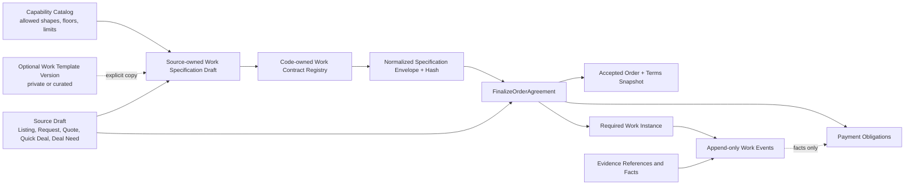
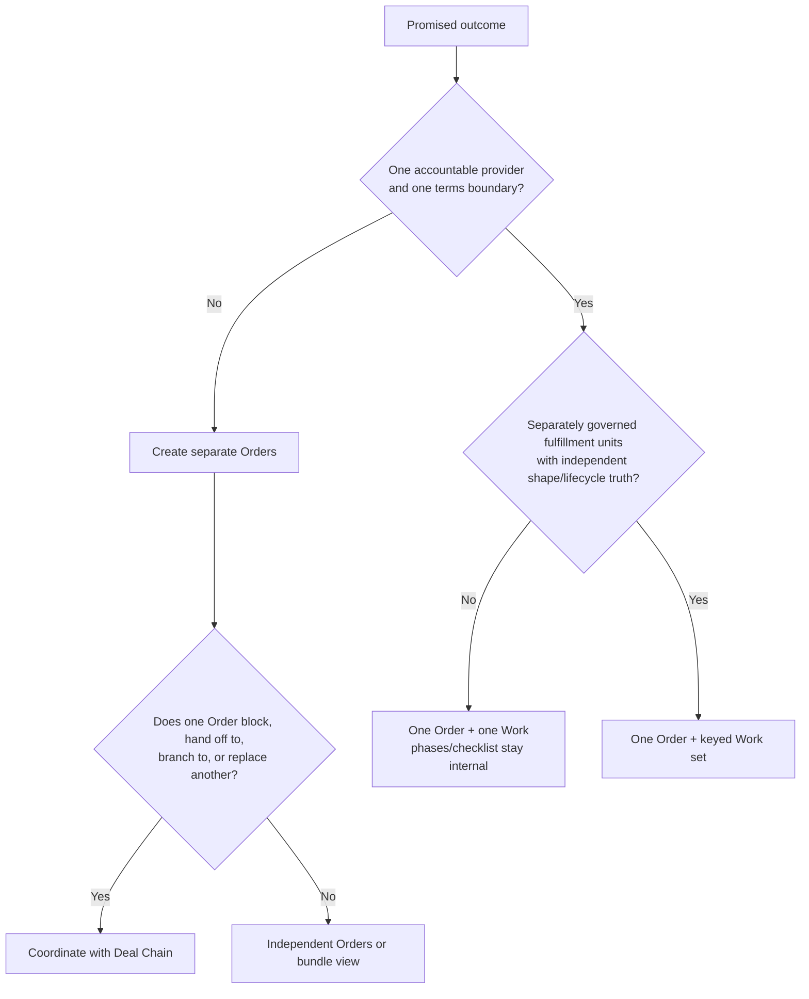
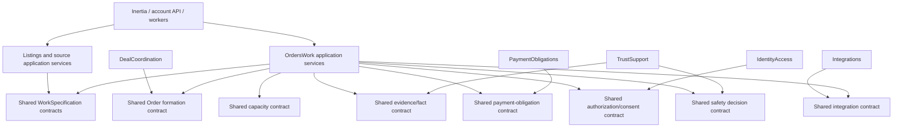

# Architecture Spine — Serbizyu Work Definition and Fulfillment

## Decision

Serbizyu supports many kinds of fulfillment through a **small code-owned Work kernel, versioned shape contracts, bounded declarative specifications, and explicit extension policies**. It does not become a user-programmable workflow engine.

The ordinary case stays small:

> one bilateral Order → one required Work Instance → internal phases/checklist/evidence → completion.

Complexity is admitted only when the commercial truth requires it:

- More than one Work Instance under an Order: separately governed fulfillment units, same buyer, same provider, same accepted terms, and distinct shape semantics or independently auditable completion.
- More than one Order: a different accountable provider or an independent commercial, liability, capacity, cancellation, or payment boundary.
- A Deal Chain: multiple Orders plus at least one explicit cross-Order dependency, handoff, branch, or replacement relationship.

Templates are optional authoring accelerators. A copied template never remains runtime authority.

## Inherited Invariants

This spine narrows, but does not replace, the initiative architecture.

| Inherited decision | Local consequence |
|---|---|
| AD-4 separates Order, Work, Payment, Evidence, Dispute, and Hold truth | Work cannot settle money, own evidence blobs, or collapse Order state into Work state. |
| AD-5 makes `FinalizeOrderAgreement` the sole formation authority | Listings, Requests, Quotes, Quick Deal, and Deal Needs prepare formation input; none creates accepted Work directly. |
| AD-6 requires immutable business versions and accepted terms | Every accepted Work pins its source, capability, policy, shape-contract, payload-schema, and normalized specification versions. |
| AD-7 establishes a common Work kernel with shape adapters | Shapes specialize behavior behind one retained registry; they do not fork the Work aggregate or table. |
| AD-8 requires governed activation | A capability may be authorable, formable, executable, or externally connected only when its relevant activation dimensions permit it. |
| AD-9 makes capacity shape-safe | Capacity is reserved through typed intents derived from the resolved Work specification, never through arbitrary payload fields. |
| AD-25 fixes atomic formation ownership and lock order | Formation revalidates exact versions under locks and commits Order, terms, Work, obligations, reservations, audit, and outbox all-or-none. |
| AD-26 requires relational lineage | Source, terms, Work, obligations, evidence references, and Deal Chain membership use enforceable identifiers, not JSON-only links. |
| AD-18 requires sequenced mutation, transactional outbox/inbox, idempotency, and recovery | Every Work command allocates its event sequence under the mutation lock; consumers park gaps and retry idempotently. |
| AD-19 and AD-24 govern retention, audit, evidence/provider security, and maker/checker controls | Work payloads and projections minimize sensitive data; provider/evidence callbacks cannot bypass verification or approval policy. |
| AD-27 through AD-29 fix deployment, operations, and environment controls | Work workers inherit health, alerting, dead-letter inspection, reconciliation, backup/restore, rollback, secret, and environment-separation requirements. |
| Projection AD-4 through AD-6 and AD-10 require server-owned relationship/action authority | Work UI receives relationship-scoped projections and allowed actions; it cannot reconstruct authority from raw aggregate rows. |
| Projection AD-14 through AD-18 govern stale, failed, unavailable, and reconciliation surfaces | Every mutation and connected-tool path exposes deterministic recovery states rather than optimistic invention. |
| Projection AD-20 separates authoring, agreement, and execution | One mutable UI object must never represent all three authorities. |
| Projection AD-22 separates Work steps from Deal Chain gates | A phase/checklist row is not an Order, Work Instance, obligation, or Chain node. |

## Capability Model



### Distinct concepts

| Concept | Owner | Mutable before acceptance? | Runtime authority? | Purpose |
|---|---|---:|---:|---|
| Capability Profile | Listings | By new governed version | Constraint authority | Permits shapes, payload extensions, limits, evidence floors, safety/data/access rules, and capacity semantics. |
| Work Template | Template Library owned by Listings initially | By new template version | No | Optional reusable authoring starting point. |
| Work Specification Draft | Source aggregate | Yes, under source version/CAS | No | Work promised by this Listing, Request response, Quote, Quick Deal, or Deal Need. |
| Normalized Specification Envelope | OrdersWork resolver | Recomputed, never edited | Formation input | Canonical, validated, hashable representation accepted by formation. |
| Work Contract Definition | OrdersWork code and retained registry | By deployed version | Yes | Shape-specific normalization, validation, commands, transitions, projections, and compatibility readers. |
| Work Instance | OrdersWork | State changes only through commands/events | Yes | Accepted fulfillment unit attached to one Order and one responsible provider. |
| Work Event | OrdersWork | Append-only | Yes | Execution history, revisions, scheduling, progress, sign-off, failure, cancellation, and reconciliation facts. |
| Evidence artifact | TrustSupport | Append-only references and governed metadata | Separate truth | Proof used by Work, disputes, safety, and obligation policies without being embedded as Work state. |
| Payment Obligation | PaymentObligations | Own state machine | Separate truth | Amount, lane, due condition, release/settlement, refunds, and reconciliation. |
| Deal Chain / Need | DealCoordination | Own state machine | Separate truth | Coordinates independently accountable Orders and their explicit cross-Order dependencies. |

## Invariants & Rules

### WAD-1 — OrdersWork owns accepted Work authority [ADOPTED]

- **Prevents:** Listings and OrdersWork implementing different normalization, amendment, or version rules.
- **Rule:** Source modules own editable source drafts and source-version metadata. `OrdersWork` is the sole owner of normalized specification envelopes, accepted Work Instances, Work state, and Work events.
- **Boundary:** Source modules call a Shared `WorkSpecificationPort`. That port is pure with respect to business state: it resolves, normalizes, validates, and hashes; it does not create Work or reserve capacity.
- **Formation recheck:** `FinalizeOrderAgreement` resolves again using the exact source/specification fingerprint under the formation transaction. A mismatch is a stale-input conflict, never a silent reinterpretation.
- **Draft ownership:** `Listings` owns Listing-, Request-, Quote-, and Quick-Deal-backed drafts; `DealCoordination` owns Deal-Need-backed drafts. Each source type has one owner and implements the same Shared versioned read/CAS contract: stable family ID, immutable business version, mutable row version, canonical payload/hash, owner/ACL, and source lineage. No second draft store or alternate mutation semantics may exist for the same source type.

### WAD-2 — Complexity follows accountability [ADOPTED]

- **Default:** one Order, one responsible provider, one required Work Instance.
- **Same-Order multiple Work:** permitted only when every Work has the same buyer/provider/terms boundary and each is a finite, keyed fulfillment unit with its own requiredness, shape contract, lifecycle, completion result, capacity intent, and applicable obligation condition.
- **Not multiple Work:** phases, checklist rows, diagnostics, approvals, measurements, visits inside a governed appointment/project, or units of the same batch remain internal topology unless the capability contract explicitly makes them independently accountable fulfillment units.
- **Separate Order:** required when provider, counterparty acceptance, price liability, cancellation, replacement, independent capacity commitment, or payment obligation belongs to another accountable transaction.
- **Deal Chain:** exists only when separate Orders also have an explicit dependency. A bundle, shared deadline, recommended provider, or parallel purchase alone is not a Chain.
- **Provider invariant:** every Work under an Order resolves to that Order's responsible provider; enforce relationally, not only in application validation.
- **Accepted manifest:** the immutable terms snapshot fixes cardinality mode and the complete ordered Work-key manifest. No Work may be added, removed, or rebound after acceptance except through a newly accepted terms amendment; every Work row must be relationally tied to that manifest and responsible provider.



### WAD-3 — Finite shape contracts, not a workflow language [ADOPTED]

The launch registry retains these code-owned contracts:

| Shape | Meaning | Typical uses |
|---|---|---|
| A1 Linear Project | Progress toward a finite deliverable, possibly with bounded internal phases | repair, installation, fabrication, professional deliverable, renovation |
| A3 Appointment | A scheduled service window with attendance, reschedule, no-show, and service outcome | haircut, consultation, tutoring session, inspection appointment |
| A4 Handoff | Transfer/custody/receipt with condition or quantity acknowledgement | product pickup, document handoff, custody transfer, counter exchange |
| A9 Digital Delivery | Delivery, review, revision, and acceptance of a digital artifact | design file, report, edited media, digitized document |

Foundation reserves registry codes and schema seams, but does not fake support, for:

| Shape | Why it cannot be emulated safely | Activation |
|---|---|---|
| A2 Live Dispatch | Assignment, location freshness, ETA, arrival, and reassignment are authoritative runtime facts | Deferred |
| A5 Rental / Returnable Asset | Checkout, possession interval, return, condition delta, loss/damage, and deposit policy are core | Deferred |
| A6 Recurring Service | Period generation, skip/pause/resume, per-period exceptions, and series termination are core | Deferred |
| A10 Long-running Care / Program | Ongoing plan review and non-terminal continuation cannot be reduced to A1 completion | Deferred |

A7 quote/bid is a formation mechanism, not a Work shape. A8 emergency is an urgency, dispatch, authorization, and safety overlay, not a standalone shape.

Shape behavior is implemented by an allow-listed `WorkShapeContract` returned from the retained registry. No user JSON may define transitions, executable expressions, loops, scripts, callbacks, or arbitrary state machines. Internal topology is descriptive and validation-bound; authoritative transitions remain code.

Deferred codes A2/A5/A6/A10 are absent from active capability allow-lists until their retained contracts are implemented and activated. Authoring, template copy, resolution, formation, execution, import, and migration paths return one stable `work_contract_inactive_or_unsupported` result for those codes, with no Work, reservation, obligation, or success event. Legacy unmapped rows are explicitly quarantined/parked with a reason and command guard; `not_started` is never used to imply executable support.

Every launch shape must define typed partial, mismatch, rejection, and shortfall outcomes. Such an outcome does not complete the whole Work, create another Work, release capacity, or satisfy an obligation implicitly; the shape contract must define the guarded recovery/amendment/cancellation path and emitted common fact, or explicitly reject partial fulfillment for that capability.

### WAD-4 — Canonical specification envelope [ADOPTED]

Each accepted fulfillment unit is formed from this conceptual envelope:

```text
WorkSpecificationEnvelope
  specification_id
  specification_version
  source_type, source_id, source_business_version, source_hash
  template_version_id?                 // provenance only
  category_version_id
  capability_profile_version_id
  activation_policy_version_id
  safety_policy_version_id?
  data_access_policy_version_id?
  fulfillment_unit_key
  required
  shape_code
  shape_contract_version
  payload_schema_version
  normalized_payload
  normalized_evidence_requirements
  normalized_safety_requirements
  normalized_data_access_requirements
  capacity_intents
  canonicalization_version
  specification_hash
```

Hashing is normative:

1. Normalize through the pinned shape contract and capability/policy versions.
2. Materialize defaults; reject unknown fields; normalize absent-vs-null according to schema.
3. Encode UTF-8 canonical JSON with recursively sorted object keys, preserved array order, canonical numbers, and no insignificant whitespace.
4. Hash the entire authority envelope above, excluding only `specification_hash`, with SHA-256.
5. Persist canonicalization version and hash on accepted terms and Work lineage.

A specification payload may describe bounded deliverables, phases, checklist items, dependencies, evidence requirements, schedule windows, quantities, custody expectations, artifact/revision limits, measurements, lots/batches, warranties, and permitted extensions. It may not contain payment-release commands, provider API responses, executable predicates, arbitrary callbacks, mutable live status, or duplicate Order/party authority.

Source lineage is not accepted as a generic polymorphic tuple alone. Each source discriminant resolves through a source-specific association with a database-enforced foreign key to the exact immutable source/specification version.

`work_shape` and `structure` are legacy storage names for `shape_code` and `normalized_payload`. The schema cutover maps them exactly once into the canonical columns, retains readers for already accepted mapped rows, parks unmapped rows, and removes duplicate write authority; old and new columns may not remain concurrent sources of truth.

### WAD-5 — Capability profiles constrain; templates accelerate [ADOPTED]

- Capability profiles are governed constraint sets, not UI presets. Profile family must be capability-specific; listing type alone is too coarse.
- A profile version allow-lists shape codes, payload extensions, field bounds, capacity types, evidence floors, safety stops, data classification/retention/access rules, and permitted formation mechanisms.
- A caller may narrow a profile but cannot weaken its floors.
- Templates are explicit immutable versions. Initial scopes are provider-private and platform-curated. Public template sharing, discovery, moderation, ratings, and monetization are deferred.
- Copying a template copies the full immutable template-version payload plus provenance into a new source-owned draft. It is not a live merge with future template defaults.
- Copy revalidates the exact pinned profile/policy versions. Retired, stale, or incompatible templates are rejected for new formation; they are never silently upgraded.
- Editing or retiring a template never changes existing drafts, accepted terms, or Work Instances.
- A source-owned draft becomes reusable only through an explicit `Save as template`/promotion command with independent authorization and versioning.
- Template promotion accepts only a profile-defined reusable-safe schema subset. It rejects or strips subject identifiers, locations above the reusable classification, secrets, evidence/artifact/consent/access-grant references, and live external data; copied defaults are rebound to the new source and client.

### WAD-6 — Authoring, formation, and execution are separate sessions [ADOPTED]

1. **Authoring:** begin blank by default or explicitly copy a template; edit a source-owned specification draft; validate against the current pinned capability profile.
2. **Agreement:** expose normalized promises, exclusions, evidence, safety, schedule/capacity effects, and commercial terms to all required parties; acceptance pins exact versions and hashes.
3. **Formation:** call the sole finalizer with typed source, Work, obligation, capacity, acceptance, version, and idempotency inputs.
4. **Execution:** operate only on accepted Work Instances and append-only events; do not read mutable templates or drafts.
5. **Amendment:** preserve history and obtain affected-party acceptance where authority changes.

This separation is an architecture boundary, not merely a page layout recommendation.

### WAD-7 — Atomic formation accepts a typed plan [ADOPTED]

`FinalizeOrderAgreement` accepts an `OrderFormationPlan`, not loosely related scalar fields. The plan contains:

- discriminated source identity, version, hash, and source-specific relational association;
- server-derived buyer, responsible provider, authenticated actor/client context, optional acting-for subject, and references to current acceptance/consent decisions;
- expected row/business versions for source, category, profile, activation, safety/data policies, Order, Need/Chain, and reservations;
- accepted terms input whose canonical preimage contains the complete ordered Work-set manifest: cardinality mode and every fulfillment-unit key, responsible provider, requiredness, specification-version ID/hash, shape/contract/schema versions, and applicable obligation keys;
- one or more finite keyed `WorkSpecificationEnvelope`s matching that manifest exactly;
- obligation specifications selected server-side from capability/shape/lane allow-lists, with purpose, amount/currency, lane, payer, recipient, retained due-condition policy/version, and applicable Work/fact keys;
- capacity intents/reservation identities;
- correlation, causation, evidence, and idempotency key.

Formation idempotency is uniquely scoped by `(command_code, authenticated_client_or_first_party_adapter, idempotency_key)`. `Operations` owns replay lookup. Its canonical fingerprint covers the complete discriminated plan above; a reused key with a different fingerprint returns stable `idempotency_conflict`.

Under the inherited lock order, formation revalidates exact versions, activation, authorization, safety/data floors, hashes, provider identity, capacity, and all relational lineage. It then atomically writes:

- accepted Order state and immutable terms snapshot, including the ordered Work-set manifest;
- exactly the manifested required Work Instances in their canonical initial states;
- exactly the manifested payment obligations without settling them;
- reservations, acceptance/party references, audit records, idempotency response, and transactional outbox events;
- one versioned `order.accepted`, one `work.created` per Work, and one `payment_obligation.created` per obligation, each carrying Order ID, child ID/key, specification/terms version and hash, correlation/causation, and consumer routing key.

Any child failure rolls back every local effect. No external provider call occurs while locks are held. External work starts from post-commit outbox handling.

### WAD-8 — Execution state is separate from accepted structure [ADOPTED]

- Accepted normalized structure and its hash are immutable.
- Runtime state is projected from append-only, per-Work sequenced events with idempotency, causation, actor, client/acting-for context, occurred/recorded time, and integrity metadata.
- The closed common states are `not_started`, `scheduled`, `in_progress`, `completion_proposed`, `awaiting_signoff`, `completed`, `disputed`, `cancel_requested`, `cancelled`, and `failed`. `completed`, `cancelled`, and `failed` are terminal unless an explicit retained correction policy appends a superseding revision without rewriting history.
- Every shape maps its local commands/events onto those common states and emits canonical namespaced completion, failure, cancellation, partial, and mismatch facts. Order projections, Deal Chain gates, and Payment Obligations consume only common states and canonical facts, never shape-local labels.
- A failed external adapter call cannot invent a successful Work event or introduce another lifecycle state. It records a typed recovery/projection status (`pending_retry`, `blocked_external`, or `reconciliation_required`) alongside the unchanged common Work state; shape policy defines retry commands and clearance.
- Unknown/inactive shape-contract, payload-schema, or due-condition-policy versions leave the common Work state unchanged and attach `contract_parked` recovery status plus reason. Commands and projections fail closed; no reader coerces them to the latest version.

### WAD-9 — Internal topology is bounded and non-authoritative [ADOPTED]

A shape may use a finite phase/checklist dependency graph when useful. Constraints:

- stable local keys;
- allow-listed node kinds and fields;
- bounded node/edge/depth counts set by profile;
- directed acyclic dependencies only;
- no dynamic node creation by expressions;
- no executable conditions or loops;
- no independent money, party, or provider authority;
- no automatic promotion of a phase to Order or Work.

Internal completion can contribute a Work fact, but only the shape contract determines whether the Work itself transitions. Cross-Order dependency gates belong to `DealCoordination`, never share a transaction with Work execution, and are represented by `work_step_dependency_gates`: immutable Chain/graph version, predecessor Order/Work/canonical fact key, target Order/Work/internal-step key, code-owned condition code/version, status, evidence/fact reference, causation, and outbox identity. They unblock asynchronously from `waiting` only after graph-version and verified-fact validation; stale, missing, superseded, or disputed facts do not unblock.

### WAD-10 — Amendments preserve authority and history [ADOPTED]

| Change | Required mechanism |
|---|---|
| Progress note, evidence attachment, schedule occurrence, measurement, or non-authoritative execution detail | Append Work event/revision under shape policy |
| Pre-acceptance promised scope or structure | New source/proposal/specification version |
| Post-acceptance scope, deliverable, shape, responsible provider, quantity/capacity commitment, safety/data policy, due-condition basis, or economics | Affected-party Order terms amendment, or a new Order when accountability changes |
| Different provider | New Order; optionally a replacement Need in the existing Chain |
| Failed/cancelled Chain child | Preserve original Need, Order, Work, events, and obligations; create replacement Need/Order if approved |
| Template retirement or ordinary profile retirement | Blocks incompatible new authoring/formation only; never mutates history |
| Current legal, license, consent-revocation, fraud, or safety deny | Applies immediately as a deny-only runtime overlay; never rewrites accepted terms |

Each shape defines failed, retry, reschedule, cancel-requested, cancelled, partial/mismatch, and completion impacts. The safe default is no completion fact, no capacity release, and no payment release until an explicit owning policy says otherwise.

Any execution or amendment command that commits, replaces, or releases capacity is orchestrated by OrdersWork through a typed Shared capacity-mutation port inside the same database transaction as the Work event, under the inherited `capacity → Order → Work` lock order. Listings remains the sole reservation writer. Asynchronous consumers reconcile but are never the first writer of that reservation transition.

### WAD-11 — Payment consumes facts; Work never commands money [ADOPTED]

- OrdersWork publishes canonical native Work facts; TrustSupport verifies evidence/external candidates. A Shared read-only `FulfillmentFactPort` exposes both through one `VerifiedFactRef` envelope without transferring ownership.
- `VerifiedFactRef` binds fact type/version and namespaced key, authority owner, account, exact Order/Work/subject/asset/location, source issuer/object and raw-payload hash, evidence/artifact versions, verifier and policy version, observed/verified times, freshness, intended-use scope, idempotency identity, and active/superseded/revoked status. Consumers fail closed on scope, freshness, status, Hold, or Dispute mismatch.
- PaymentObligations owns due-condition evaluation, lane selection, fees, release, settlement, refunds, reconciliation, and provider event handling.
- An obligation pins a retained code-owned, expression-free due-condition policy ID/version selected from capability/shape/lane allow-lists. Its manifest contains explicit same-Order Work/fact bindings and bounded `all_of`/`any_of` cardinality; capability policy imposes non-weakenable facts, approvals, Holds, and Dispute floors.
- Before eligibility/capture, PaymentObligations atomically records the exact satisfying Work-event IDs and evidence-verification outcomes. Unknown policies, candidate/superseded/revoked facts, or active deny/Hold/Dispute/reconciliation states fail closed.
- No Work payload, phase, checklist, QR scan, GPS ping, photo, or external webhook directly releases funds.
- Cash handoff is a Payment event, not a Work Instance or Work completion shortcut.

### WAD-12 — Evidence, safety, privacy, and authority are first-class constraints [ADOPTED]

- Specifications describe evidence requirements; TrustSupport owns artifact storage and evidence truth; Work stores typed references and native Work facts.
- Capability/profile policy classifies fields and evidence by sensitivity, access role, purpose, retention, redaction, export, purge, and legal-hold behavior. Sensitive values stay in protected owning stores; Work, audit, idempotency responses, and outbox events use opaque references and redacted projections.
- Regulated care, legal, financial, biometric, child-related, location, identity-document, animal-welfare, and safety-critical capabilities require explicit policy versions and hard stops.
- Every authoring, template copy/promotion, formation, execution, amendment, cancellation, evidence read/export, and external-command mutation obtains a current Shared authorization/consent decision below the transport. IdentityAccess owns the versioned grant; command context is server-derived and binds actor, client/subject, owner, aggregate, action, purpose, scope, expiry, revocation, and single-use approval where required.
- Every safety-relevant command also obtains a current deny-only safety authorization decision combining the accepted baseline with present legal, license, contraindication, consent-revocation, fraud, and emergency policy. Deny wins; unavailable, stale, or unknown decisions fail closed; latches require authorized clearance and explicit cancellation/refund effects.
- Generic consent text cannot override contraindications, license requirements, safety stops, or legal restrictions.
- External agency, permit, sensor, clinical, utility, or platform statuses are candidates submitted through Integrations; TrustSupport verification maps them to scoped `VerifiedFactRef`s. Candidate data has no Work, Chain, or payment effect.

### WAD-13 — Tools are adapters, not hidden domain owners [ADOPTED]

Core domain ports are limited to semantics whose removal would change correctness:

- Work specification resolution/registry;
- typed capacity/reservation;
- evidence/fact verification;
- payment-obligation commands and fact reads;
- capability activation/policy resolution;
- external agency/integration command status when an official act is genuinely required.
- current authorization/consent and safety decisions;

Experience adapters may improve the product but remain replaceable: maps/routing, external calendar sync, PDF/OCR/vision, QR/GPS capture, weather, notifications/realtime transport, AI drafting, search, and analytics. They submit candidates or commands through application ports. They never mutate Work, Order, Evidence, or Payment tables directly.

### WAD-14 — Version dimensions never collapse [ADOPTED]

Persist and reason about these dimensions independently:

- source business version;
- template asset version;
- Work specification version;
- capability profile/category/activation/safety/data policy versions;
- shape contract version;
- payload schema version;
- canonicalization version and specification hash;
- Work row version and Work event sequence;
- evidence/artifact version;
- obligation due-condition policy version.

Retained readers support old accepted versions. There are no aliases that reinterpret old shape codes or payloads. Migration is an explicit, auditable business action, not an on-read cast.

### WAD-15 — Runtime and projection envelope is inherited, not optional [ADOPTED]

- **Prevents:** a happy-path Work worker or raw aggregate UI that technically follows shape rules while omitting recovery, security, activation, or relationship authority.
- **Rule:** Work execution inherits platform AD-18/19/24/27/28/29 and projection AD-4–6/10/14–20. Workers expose health, lag, retry, dead-letter, reconciliation, and support-inspection state; environments, secrets, backups, rollback, and retention follow the platform envelope. Every authoring/execution projection is server-owned, relationship-scoped, versioned, and carries allowed actions plus stale/unavailable/failed/reconciliation states. Immediate deny gates override cached activation.

## Deep Module Boundary

The public cross-module surface is deliberately smaller than the internal shape system.

```text
Shared WorkSpecificationPort
  readDraft(source_association): VersionedWorkSpecificationDraft
  compareAndSwapDraft(expected_row_version, draft): VersionedWorkSpecificationDraft
  resolve(ResolveWorkSpecification): ResolvedWorkSpecification
  validate(ValidateWorkSpecification): ValidationResult

Shared AuthorizationConsentPort
  decide(server_command_context, aggregate, action, purpose): AuthorizationConsentDecision

Shared FulfillmentFactPort
  readVerified(ExactFactScope): VerifiedFactRef | unavailable

Shared CapacityMutationPort
  mutate(expected_reservation_version, transition): CapacityMutationResult

OrdersWork internal WorkContractRegistry
  get(shape_code, contract_version, payload_schema_version): WorkShapeContract

OrdersWork internal WorkShapeContract
  normalize(authoring_payload, capability_constraints): normalized_payload
  validate(normalized_payload, policy_pins): violations
  deriveCapacityIntents(normalized_payload): capacity_intents
  describeAgreement(normalized_payload): agreement_projection
  initialState(normalized_payload): work_state
  decide(command, server_command_context, current_state, accepted_specification, authorization, safety_decision, verified_fact_refs): events | rejection
  project(events): execution_projection
```

The Shared port exposes stable domain results, not internal registry classes. A shape may split its internal authoring, execution, and projection collaborators when code size warrants it; callers still see one deep contract.

## Module Dependency Direction



No module imports another module's concrete class. Database foreign keys enforce lineage, but one module never writes another module's tables.

## Data Model Consequences

The canonical schema/ERD must be amended before implementation to represent these semantics explicitly:

- source-owned Work specification families and immutable versions, with exactly one owner per source discriminant, Shared CAS semantics, source-specific relational FKs, ACL, shape/profile/policy pins, canonical payload, and hash;
- immutable accepted terms Work-set manifests containing cardinality mode and an ordered mapping from fulfillment-unit key to responsible provider, requiredness, exact specification-version ID/hash, shape versions, and applicable obligations;
- `work_templates` and immutable `work_template_versions` only when template persistence is implemented, with owner/scope, reusable-safe payload, provenance, ACL, retirement, and retention rules;
- Work rows keyed by `(order_id, terms_snapshot_version, fulfillment_unit_key, responsible_provider_id)` and composite-FK-bound to the accepted manifest; no post-accept insert outside a new accepted amendment;
- source-specific relational associations and same-Order composite enforcement for Work, obligations, satisfying facts/events, and responsible provider;
- append-only Work events with per-Work sequence, command idempotency, causation/correlation, actor/client, row version, integrity/checksum, and typed payload version;
- versioned obligation-condition manifests with explicit same-Order Work/fact bindings, fixed `all_of`/`any_of` semantics, and immutable satisfying event/evidence-verification rows;
- DealCoordination-owned `work_step_dependency_gates` with Chain/graph version, predecessor Order/Work/fact key, target Order/Work/step key, condition code/version, status, evidence/fact reference, causation, and outbox identity;
- explicit parked/quarantine state, reason, and event for unmapped legacy shape/schema rows.

Do not add template tables merely because the concept exists. Add them in the same change that implements persistent templates and their authorization/version contract.

## Scenario-derived Extension Vocabulary

These are bounded ingredients used by shape contracts and capability profiles—not globally optional fields on every Work:

- finite deliverable or service outcome;
- internal phase/checklist/dependency;
- appointment/time window and reschedule policy;
- location/service area and attendance;
- capacity, quantity, slot, asset, or inventory intent;
- custody/handoff/condition acknowledgement;
- digital artifact, revision round, and acceptance;
- evidence requirement and human approval;
- measurement with unit/calibration;
- batch/lot/serial identity and mass/yield balance;
- warranty, parts, exclusions, and change authorization;
- safety stop, consent, regulated-role, and sensitive-data policy;
- external signal candidate and verification policy;
- recurrence/period, dispatch, rental-return, or continuing-plan primitives reserved for deferred shapes.

## Runtime Baseline

Implementation binds to the checked-in lockfiles: Laravel Framework **12.68.0**, Inertia Laravel **3.2.1**, React **19.2.8**, Inertia React **3.6.1**, and TypeScript **5.9.3**. These are seed owned by dependency manifests, not permanent Work invariants. The older platform-spine Laravel 12.65.0 statement is superseded for current implementation and should be corrected in the shared runtime contract.

## Current Implementation Delta

Current PHP is an intentionally incomplete slice and must not define the target architecture:

- `FinalizeOrderAgreement` accepts a narrow listing/order command, hardcodes contract/schema v1, creates exactly one Work, and writes `structure = null`.
- Accepted terms omit the complete Work specification, manifest, provenance, policy pins, and canonical hash.
- The current registry performs tuple lookup but does not own normalization, validation, capacity derivation, commands, or projections.
- Payment formation is fixed to a scalar primary external-cash obligation and does not express typed due-condition policies over Work facts.
- Formation emits `order.accepted` but lacks the required one-per-child `work.created` and `payment_obligation.created` outbox facts.
- The T4 migration leaves unsupported `request_based` rows observably `not_started`; target migration must park/quarantine them and reject commands/projections until a retained contract exists.
- Schema lacks the full specification/template lineage, accepted Work-set manifest, provider/cardinality guards, canonical hash, dependency gates, verified-fact bindings, and event integrity model described here.

Implementation must change canonical domain/schema/OpenSpec contracts first, then migrate the finalizer and callers as one clean cutover. Do not add a UI-only Work builder over the current null-structure path.

## Rejected Alternatives

| Alternative | Decision | Reason |
|---|---|---|
| Template-first authoring | Rejected | Makes every simple service pay setup cost and risks template authority leaking into accepted Work. |
| One universal JSON workflow/state-machine builder | Rejected | Moves authoritative transitions, safety, evidence, and payment meaning into unreviewable data. |
| One Work Instance per checklist step or visit | Rejected | Inflates lifecycle, capacity, payment, and Chain semantics without a new accountability boundary. |
| One Order across several providers | Rejected | Blurs acceptance, liability, cancellation, replacement, capacity, and obligation ownership. |
| Every multi-step job is a Deal Chain | Rejected | Internal fulfillment detail is not cross-provider commercial coordination. |
| One shape per business vertical | Rejected | Produces a combinatorial registry; capability profiles/extensions should specialize the finite behavioral shapes. |
| Treat A7 quote/bid and A8 emergency as Work shapes | Rejected | They are formation and policy/urgency concerns respectively. |
| Reinterpret old template/spec/profile versions on read | Rejected | Violates immutable agreement and reproducibility. |
| Let external tools or evidence trigger state/payment directly | Rejected | Gives replaceable adapters hidden domain authority and weakens reconciliation. |

## Delivery Order

1. Propagate this spine into domain/state contracts and canonical schema/ERD; correct the false 100-case/always-Chain claims.
2. Specify Work shape contracts, canonical envelope/hash, capability-profile constraints, and finite formation plan in OpenSpec.
3. Add relational schema and retained readers for specification lineage, Work cardinality, events, provider consistency, and obligation fact dependencies.
4. Deepen the registry and Shared Work specification/formation ports.
5. Cut over every formation source and `FinalizeOrderAgreement` atomically; remove hardcoded shape/schema versions and null structure.
6. Implement execution commands/events/projections for A1/A3/A4/A9 plus failure, cancellation, amendment, and reconciliation paths.
7. Implement persistent private templates only after the source-owned blank authoring path works end-to-end.
8. Add external experience adapters behind ports.
9. Build UI sessions against settled authoring, agreement, and execution projections.

## UI Handoff Boundaries

The future UI should be designed as separate sessions:

- capability selection and blank Work drafting;
- optional template browse/copy/save with promotion-safe field review;
- shape-aware editor with profile-derived fields and bounded extensions;
- agreement preview showing the exact Work-set manifest, promises, exclusions, evidence, safety, schedule, and commercial terms;
- execution workspace projected by shape and common lifecycle;
- explicit partial/mismatch, amendment, cancellation, replacement, and capacity-conflict flows;
- Deal Chain coordination view only for true cross-Order dependencies;
- recovery and reconciliation states for stale versions, unavailable adapters, denied/revoked consent, safety stops, failed evidence verification, parked contracts, dead-lettered work, or unsupported retained versions.

Every projection is server-owned, relationship-scoped, versioned, redacted for the viewer, and includes allowed actions. The UI never infers transition authority from visible fields or consumes raw aggregate/provider payloads.

## Verification Gate

Architecture propagation is complete only when:

- domain, schema, OpenSpec, and implementation use the same ownership and vocabulary;
- every accepted Work can reproduce its canonical specification and governing versions;
- simple one-Order/one-Work scenarios remain first-class;
- same-Order multi-Work and Deal Chain creation pass the accountability decision tree;
- A1/A3/A4/A9 contracts cover their important failure and cancellation modes;
- deferred A2/A5/A6/A10 inputs are rejected explicitly rather than coerced;
- templates can disappear without changing accepted Work behavior;
- external adapters can fail or be disabled without inventing domain success;
- Work cannot settle payment, and payment can evaluate only explicit verified facts;
- old accepted versions remain readable and auditable;
- exact document-scanning behavior is selected by the accepted promise: A9 when the digital artifact/review is the outcome, A1 when a broader scanning project is the outcome; the current Tagudin A1 fixture must become a new governed listing version before it is reclassified, and already-published A1 versions remain on retained A1 readers;
- Work-step dependency gates validate immutable Chain graph versions and unblock only from verified canonical facts;
- current authorization, consent, safety, activation, Hold, and Dispute decisions fail closed before irreversible state or payment effects;
- formation replay, accepted Work cardinality, obligation satisfaction, and capacity mutation remain deterministic after crashes and retries.
