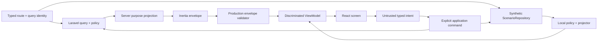
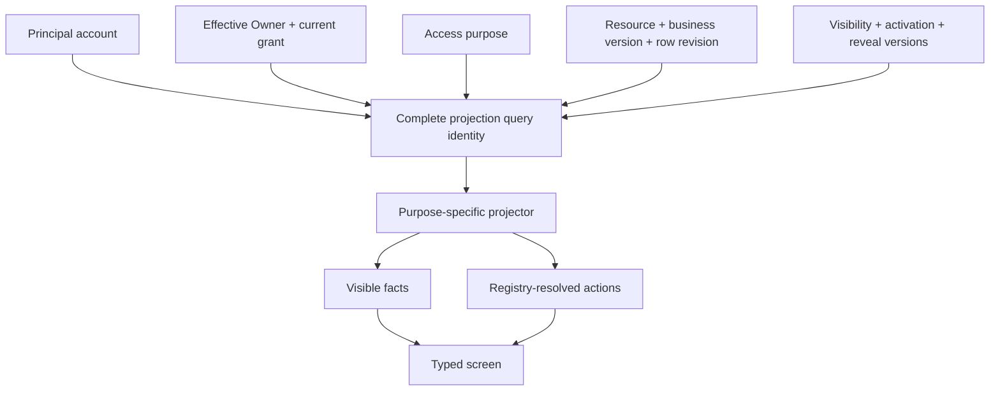

# Architecture Spine — Serbizyu Frontend View Projection

## Design Paradigm

**Frontend ports-and-adapters with relationship-scoped view projections.** React feature screens depend on purpose-specific query/intent ports and discriminated view models. Production authorization and projection run in Laravel before Inertia serialization; the browser adapter validates the resulting envelope. Only the deterministic Scenario composition projects normalized synthetic state locally. Presentation components receive facts and resolved actions, never raw authority-bearing aggregates.



## Inherited Invariants

| Inherited | From parent | Binds here |
| --- | --- | --- |
| AD-1 | Serbizyu Marketplace Platform | Canonical authority chain; visual prototypes and downstream research cannot override promoted product/domain contracts. |
| AD-3 | Serbizyu Marketplace Platform | IdentityAccess owns delegation/consent; frontend acting context cannot mint or reinterpret grants. |
| AD-4 | Serbizyu Marketplace Platform | Order, Work, Payment, Evidence, Dispute, Consent, and Hold remain independent states and panels. |
| AD-5–AD-6 | Serbizyu Marketplace Platform | Every formation mechanism ends at the same immutable Order agreement seam and exact source versions. |
| AD-7 | Serbizyu Marketplace Platform | A1/A3/A4/A9 projections preserve the common Work kernel and shape-specific state. |
| AD-9 | Serbizyu Marketplace Platform | Capacity and reservation identity/versions remain exact through formation views. |
| AD-12 | Serbizyu Marketplace Platform | First-party UI and simulation use the same application-shaped query/command contract; transport does not own policy. |
| AD-17 | Serbizyu Marketplace Platform | Deal Chains coordinate independent child Orders and never own pooled money or sibling truth. |
| AD-18 | Serbizyu Marketplace Platform | Mutation, attribution, idempotency, versioning, event, and outbox semantics remain atomic. |
| AD-19 | Serbizyu Marketplace Platform | Recovery, inspection, disablement, and operational evidence are part of every activated capability. |
| AD-20 | Serbizyu Marketplace Platform | A capability is incomplete until its state, action, denial, recovery, accessibility, and browser behavior are explainable. |
| AD-27 | Serbizyu Marketplace Platform | Activation is fail-closed and checked immediately before mutation; UI visibility is not authorization. |
| AD-23–AD-26 | Serbizyu Marketplace Platform | One-lane obligations, runtime/data-plane separation, atomic formation ownership, and relational lineage constrain F3–F5. |
| AD-28–AD-29 | Serbizyu Marketplace Platform | Evidence/provider security and exact maker/checker approvals constrain sensitive projections and actions. |

## Invariants & Rules

### AD-1 — Installed frontend stack is retained [ADOPTED]

- **Binds:** all frontend implementation changes.
- **Prevents:** a React/Svelte split, duplicate component ecosystems, and abandonment of working Inertia integration.
- **Rule:** Production frontend work uses React 19, TypeScript 5.9, Inertia React 3, Vite 7, Tailwind CSS 4, and the existing `resources/js` composition root. Svelte is not introduced without a separate replacement decision.

### AD-2 — The HTML prototype is visual evidence only [ADOPTED]

- **Binds:** `docs/design-kit/*.html`, `docs/design-kit/sessions/*.html`, deliberately published static copies, and future role/state work.
- **Prevents:** one large HTML document becoming a second product model, router, permission engine, and state store.
- **Rule:** Static mobile HTML may guide composition, density, tokens, imagery, isolated visual refinements, and fixed-perspective session snapshots. One URL fixes one fictional actor/relationship/resource state; shared tokens/assets are allowed and repeated markup is preferred over a static role/state runtime. Static files contain no role switcher, shared mutable scenario, policy engine, fake auth, persistence, command dispatcher, or backend call. Dynamic role-, lifecycle-, bidding-, and authorization-dependent behavior belongs in React against this spine. No OpenSpec acceptance cites static HTML as behavioral authority.

### AD-3 — Account capabilities are additive; transaction roles are contextual [ADOPTED]

- **Binds:** session, navigation, Activity, listing, request, quote, Order, Agent, and operations screens.
- **Prevents:** a global Buyer/Provider switch and stale role state leaking controls between resources.
- **Rule:** Session state identifies one account and additive capabilities. Closed relationship vocabulary is `guest`, `member`, `listing_owner`, `requester`, `eligible_responder`, `bidder`, `buyer`, `provider`, `invited_partner`, `acting_agent`, `ops`, and `reviewer`. `acting_agent` augments rather than replaces a resource relationship; `reviewer` exists only in Scenario composition. Projection context carries principal account, effective Owner, resolved grant ID/version, relationship set, and access purpose separately. IdentityAccess resolves current grants. Overlapping grants never permit one principal/effective party to control both sides of agreement formation; self-award and dual-party control fail closed.

### AD-4 — A view is a policy projection, not a raw entity [ADOPTED]

- **Binds:** all screen queries and props.
- **Prevents:** hidden private fields remaining in browser memory, templates re-implementing permission policy, and request/listing CTA contamination.
- **Rule:** Every screen query resolves:
  `projection = f(viewer, actingContext, resourceKind, resourceState, relationship, visibilityPolicy, activationPolicy)`.
  Production queries authorize and construct purpose-specific projections server-side before Inertia serialization; local projection applies only to synthetic Scenario data. Projection identity binds composition/environment/evidence class, access purpose, resource kind/ID, immutable source/business versions, aggregate row revision, principal, effective Owner, grant version, visibility/activation policy versions, reveal phase, and list/filter inputs. Cross-identity cache reuse is forbidden; mutation, logout, perspective/Owner/grant/policy/reset changes invalidate affected projections.

### AD-5 — Resource kinds use discriminated view contracts [ADOPTED]

- **Binds:** Browse cards, detail screens, sticky action docks, and composers.
- **Prevents:** `Add to Picks` on Requests, `Submit bid` on Listings, and generic components accumulating incompatible booleans.
- **Rule:** `ListingCardView`, `RequestCardView`, `ListingDetailView`, `RequestDetailView`, `QuoteView`, and `OrderWorkspaceView` are distinct registered envelope schemas with exhaustive relationship, status, action, omission, and overlay semantics. Shared visual primitives may be reused; business screens may not accept a union they cannot exhaustively render. Unknown envelope/resource versions return `projection_unsupported` with no commercial action.

### AD-6 — Actions are resolved data [ADOPTED]

- **Binds:** every visible CTA and menu action.
- **Prevents:** leaf components guessing authority from `isOwner`, role strings, or resource fields.
- **Rule:** A projection provides zero or one primary action plus ordered secondary and recovery actions from one closed `ActionDispatchRegistry`. Each executable action maps to exactly one owning module, target kind, application command, payload schema, row-revision source, result projection, and invalidation set. Browser input is an untrusted allowlisted intent; it never supplies authoritative actor, effective Owner, or grant. Disabled educational actions carry no executable target and reveal only allowlisted non-sensitive reasons. Unauthorized/private actions are omitted. Production application services derive authority from session/current stores and reauthorize immediately before mutation.

### AD-7 — Production and simulation are separate compositions [ADOPTED]

- **Binds:** authentication, storage, routing, and fixture selection.
- **Prevents:** fictional actor switching impersonating real auth, simulated state polluting production data, and fixture shortcuts leaking into consumer navigation.
- **Rule:** Composition selection is server/build-controlled and immutable for the page lifetime—never selected by URL query, page data, or browser storage. Production code cannot import `scenario/**`; Scenario code consumes shared contracts only. Prefer excluding Scenario modules/routes from production builds; if deployed, `/review/scenarios` requires explicit environment activation and reviewer authorization on a separate origin/application without production cookies, APIs, storage, cache, or service worker. ScenarioRepository accepts only `dataOrigin: "synthetic"`.

### AD-8 — Deterministic JSON is an executable domain surrogate [ADOPTED]

- **Binds:** Scenario Lab state and fixtures.
- **Prevents:** static JSON snapshots that always succeed, unordered mutable blobs, and UI behavior with no backend-shaped semantics.
- **Rule:** Scenario state is normalized, schema-versioned, and seeded from immutable synthetic JSON. It uses stable typed IDs, a deterministic clock, distinct immutable business/source versions and mutable aggregate row revisions, append-only event sequence, explicit evidence class, repository revision/CAS, durable idempotency fingerprint/result records, and exact reset/migration behavior. Concurrent Lab writers are rejected unless a repository lock/CAS succeeds. Corrupt, incompatible, quota, or write failures fail closed with explained reset/export recovery. This simulates behavior only—not PostgreSQL transactions, row locks, durable outbox/inbox, crash recovery, audit completeness, or production security.

### AD-9 — Simulation commands preserve backend semantics [ADOPTED]

- **Binds:** every simulated mutation.
- **Prevents:** a frontend demo approving actions the eventual backend must reject.
- **Rule:** Browser `CommandIntent` carries only allowlisted action code, target ID, expected row revision, idempotency key, and validated payload. Trusted execution context derives principal, effective Owner, current grant, adapter, environment, and policy from authoritative stores. Every action resolves through the registry to one explicit command handler; no reflective generic dispatcher exists. The deterministic adapter checks current session, relationship conflicts, grant, visibility, activation, version, and transition guards before one atomic state/event/idempotency-result update. Production repeats these checks below transport; prior action visibility is never authorization.

### AD-10 — Server-shaped projections are the adapter contract [ADOPTED]

- **Binds:** deterministic and Laravel adapters.
- **Prevents:** rebuilding screens when backend slices arrive and coupling components to Inertia prop quirks.
- **Rule:** Both planned compositions expose registered versioned projection envelopes. Laravel authorizes and projects on the server; the production browser adapter only validates/translates an already-safe envelope and cannot import the local projector. ScenarioRepository/local projectors operate only on synthetic records. Existing camel/snake compatibility fields are migrated at adapter boundaries during each cutover; new projection-consuming components use canonical camelCase. OPS projections require purpose/case/data-class scope and audit sensitive reads.

### AD-11 — Vertical slices reveal product gaps [ADOPTED]

- **Binds:** delivery order and OpenSpec decomposition.
- **Prevents:** a platform-wide frontend rewrite and another disconnected screen gallery.
- **Rule:** Implement complete resource journeys in this order: (1) Browse plus Listing/Request discrimination; (2) request detail and role-safe action projection; (3) quote/bid compose, sealed/open visibility, negotiation, and requester decision; (4) accepted Order/Work/Obligation consequence; (5) partner/Deal-Chain views; (6) operations recovery. Each slice includes cross-perspective consequence, refresh/reset, denial, stale/expiry, mobile behavior, and action-leak checks.

### AD-12 — Domain uncertainty is represented explicitly [ADOPTED]

- **Binds:** fixture schemas, view models, and planning gaps.
- **Prevents:** UI convenience silently creating canonical states, fields, deadlines, fees, or guarantees.
- **Rule:** Fixture-only concepts carry `authority: "simulation"`; canonical concepts carry their source/version. Unknown policy produces `unavailable`, `policyPending`, or a recovery action—not invented defaults. Findings from UI refinement are recorded as proposed domain decisions and resolved upstream before production behavior adopts them.

### AD-13 — OpenSpec changes are vertical implementation packets [ADOPTED]

- **Binds:** frontend OpenSpec work.
- **Prevents:** one 500-task package becoming unreviewable and independent screen work diverging.
- **Rule:** The full use-case/matrix contract lives in the companion documents. One OpenSpec change implements one coherent vertical slice and cites local ADs, inherited ADs, canonical UX/domain IDs, and exact matrix rows. A packet cannot change canonical product/domain policy; conflicts reopen the authority chain.

### AD-14 — Version identities are distinct [ADOPTED]

- **Binds:** projections, query keys, commands, sources, and accepted terms.
- **Prevents:** immutable commercial versions being confused with optimistic concurrency counters.
- **Rule:** Every relevant projection names stable resource ID, immutable source/business version IDs, mutable aggregate row revision, envelope schema version, and policy versions separately. Expected concurrency checks use row revision only; accepted terms pin immutable source/business versions.

### AD-15 — Sealed information flow is end-to-end [ADOPTED]

- **Binds:** sealed Requests/Quotes across reads, UI, operations, and telemetry.
- **Prevents:** competitor inference through counts, ordering, timing, errors, notifications, caches, history, logs, or analytics.
- **Rule:** Sealed classification governs purpose-specific queries, list/search/sort/aggregates, notifications, errors, support/audit/export, logs/analytics, cache/prefetch/history, and async response commit—not only fields. Context/reveal-phase changes invalidate projections; privileged access is purpose-scoped and audited; denials are non-enumerating. Sealed means application access control, not cryptographic commitment. Production remains default-deny until reveal/count/early-award/notification policy versions are promoted.

### AD-16 — Brownfield cutover has one owner [ADOPTED]

- **Binds:** `resources/js/types.ts`, `ProductExperience.tsx`, Browse, and Listing detail.
- **Prevents:** legacy and projection paths both resolving CTAs or permissions.
- **Rule:** Each vertical packet names one integration owner and migrates complete callers to the registered projection contract. During cutover, legacy transport aliases exist only inside adapters. Once a screen migrates, direct raw-record props, local business-action inference, and duplicate route/component implementations for that screen are removed; no compatibility business-policy shim remains.

### AD-17 — Activation snapshot is explicit [ADOPTED]

- **Binds:** all projected and dispatched conditional actions.
- **Prevents:** independently interpreted feature flags and queued actions bypassing a new deny.
- **Rule:** Projection metadata records environment, cohort, geography, Owner, category/profile version, mechanism, Work shape, lane/provider, client/adapter, policy versions, and matching activation decision. Any matching current deny wins; enablement requires no deny plus a current enable. Command execution re-evaluates current activation immediately before mutation and returns `capability_inactive` without effect on mismatch.

### AD-18 — Projection schemas and action registry evolve together [ADOPTED]

- **Binds:** `application/contracts`, adapters, feature screens, and caches.
- **Prevents:** one slice changing a required fact/status/action without compatibility handling.
- **Rule:** A central registry owns `ResourceKind → ProjectionSchemaVersion → facts/status/relationship/action vocabulary` and `ActionCode → command/target/payload/result/invalidation`. Schema changes that alter required meaning increment the resource envelope version. Both adapters validate envelopes; unsupported versions render explicit safe recovery with zero commercial actions.

### AD-19 — Scenario persistence has a bounded failure protocol [ADOPTED]

- **Binds:** ScenarioRepository and reviewer tools.
- **Prevents:** lost events, duplicate effects, corrupt mixed fixtures, and false production durability claims.
- **Rule:** One repository commit compares repository revision, writes aggregate changes plus event sequence plus idempotency result atomically within the declared browser adapter, then publishes the new revision. Storage/migration/CAS failure leaves the prior valid snapshot authoritative. Reset clears every namespace for that scenario/schema only and restores the immutable seed; production-origin data is rejected.

### AD-20 — Authoring, agreement, and execution interfaces are distinct [ADOPTED]

- **Binds:** Listing manager, Request builder, Quote composer, Work specification builder, Order/Work workspaces, Agent workspace, and Deal Chain builder.
- **Prevents:** one generic editor overwriting published terms, accepted Work structure, child Order truth, or authority boundaries.
- **Rule:** Listing, Request, and Quote authoring edit their own versioned drafts and invoke a registered shape-specific Work specification builder before agreement. Final agreement atomically creates the accepted ordinary Order and its required one-or-more same-Order Work Instances. After acceptance, shape-specific Work workspaces append guarded execution events; structure changes require an affected-party terms amendment. Deal Chain authoring edits Needs/dependencies/invitations only, never child Order/Work state. Agent surfaces reuse these interfaces under current acting grants rather than forking them.

### AD-21 — Canonical Chain Archetypes & Cascading Review Invariant [ADOPTED]

- **Binds:** Deal Chain Catalog, Cart staging, Order formation, and Review subsystem.
- **Prevents:** database catalog explosion from duplicate chain definitions, and review fatigue from multi-order completions.
- **Rule:** Chain topologies are normalized into an acyclic DAG of Need Types and dependency edges, identified by a deterministic SHA-256 fingerprint (`chain_archetypes.fingerprint` UNIQUE). Specific provider pairings are decoupled into barangay-scoped co-occurrence projections (`chain_proven_pairings`). Completed Deal Chains permit a single unified 5-star review that cascades across all child orders by default, while supporting granular per-node overrides for exceptions. Ratings simultaneously update provider listing reputations and the community archetype catalog score.

### AD-22 — Work-Step Dependency Gates & Cross-Node Relay Invariant [ADOPTED]

- **Binds:** Work workspaces, Deal Chain execution engine, and Event Bus.
- **Prevents:** coarse whole-order execution freezes, cross-order database lock deadlocks, and uncoordinated provider disputes.
- **Rule:** The macro coordination graph (Deal Chain Needs & edges) is strictly decoupled from micro Work execution (internal steps owned by a single Work Instance). Internal steps are not global graph nodes. Cross-node synchronization is mediated exclusively by `work_step_dependency_gates`. A work step remains in `WAITING_FOR_DEPENDENCY` until predecessor conditions emit verified completion. Producer transactions commit only their own child Order fact + outbox; asynchronous event consumers validate the immutable graph version and mark gates `unblocked`. Explicit gate bypass (`DealChainGateBypassed`) requires verified substitute evidence. Disruption delays emit `DealChainNodeDisrupted` to park dependent steps with updated ETAs without triggering sibling order cancellations or penalties.

## Consistency Conventions

| Concern | Convention |
| --- | --- |
| Source root | `resources/js` is the production Inertia root. Existing `frontend/src` remains a non-production prototype/reference until explicitly retired; no new production work lands there. |
| Feature layout | `features/<resource>/{contracts,queries,commands,projector,components,pages}` with shared primitives under `components/ui`. |
| View envelope | Central registry under `application/contracts`; each resource schema distinguishes envelope version, immutable source/business versions, aggregate row revision, exhaustive status/relationship/action vocabulary, omission, and unsupported-version recovery. |
| Action dispatch | Central `ActionDispatchRegistry`; stable verb-object code maps to one owner, target, explicit command, payload/result schema, row-revision source, and invalidation set. |
| Query/cache identity | Composition/environment/evidence, purpose, resource/version/revision, principal/effective Owner/grant version, policy/reveal versions, and all list inputs; cross-identity reuse prohibited. |
| IDs | Opaque branded TypeScript IDs; UUIDv7-shaped deterministic fixture values where canonical entities are simulated. |
| Money | Integer minor units plus ISO-4217 currency; formatting only in presentation. |
| Time | ISO-8601 UTC values; deterministic Lab clock; explicit presentation timezone. |
| Errors | Discriminated safe codes: validation, auth, capability, permission, not-found, stale, expired, unavailable, retryable, policy-pending, projection-unsupported, invalid-action, idempotency-conflict, invariant. |
| Storage | ScenarioRepository only behind a StorageAdapter using repository CAS and synthetic-origin/schema validation; product preferences use separate bounded adapters. |
| Tests | Pure projector/action-matrix tests plus focused component tests and Playwright scenario journeys; no source-text assertions. |

## Stack

| Name | Version observed 2026-09-08 |
| --- | --- |
| PHP | 8.4 |
| Laravel Framework | 12.68.0 |
| Inertia Laravel | 3.2.1 |
| Inertia React | 3.6.1 |
| React / React DOM | 19.2.8 |
| TypeScript | 5.9.3 |
| Vite | 7.3.6 |
| Tailwind CSS | 4.3.3 |
| Vitest | 4.1.10 |
| Playwright | 1.62.1 |

## Structural Seed

```text
resources/js/
  app.tsx                         # selects production composition
  application/
    contracts/                    # projection schema + action dispatch registries
    adapters/                     # safe Inertia envelope validation only
  scenario/
    contracts/                    # scenario schema and fixture authority labels
    fixtures/                     # immutable normalized JSON seeds
    projectors/                   # relationship and visibility projections
    commands/                     # deterministic guarded transitions
    repository/                   # storage, clock, migration, reset
    review/                       # reviewer-only composition and inspector
  features/
    discovery/
    listings/
    requests/
    quotes/
    orders/
    work/
    obligations/
    deal-coordination/
  components/
    ui/                           # visual primitives only
```



## Capability → Architecture Map

| Capability / area | Lives in | Governed by |
| --- | --- | --- |
| Browse discrimination | `features/discovery`; discovery query/projection port | AD-4–AD-6, AD-10–AD-11, AD-14–AD-18 |
| Listing detail and booking | `features/listings`; Listings-owned query/command projection | AD-3–AD-6, AD-10, AD-14, AD-16–AD-18; parent AD-5–AD-6, AD-9 |
| Request detail and bidding | `features/requests`, `features/quotes`; Listings-owned query/command projections | AD-3–AD-6, AD-9–AD-18; parent AD-5–AD-6 |
| Listing/Request/Quote authoring | Separate lifecycle manager, Request builder, Quote composer, and registered Work specification builder | AD-5–AD-6, AD-14, AD-16–AD-18, AD-20; parent AD-5–AD-7 |
| Scenario Lab | `scenario/review`, `scenario/repository`; synthetic-only composition | AD-7–AD-10, AD-12, AD-14, AD-18–AD-19; parent AD-24 |
| Production projection | Laravel application query/policy plus `application/adapters` envelope validator | AD-4, AD-9–AD-10, AD-14–AD-18; parent AD-12, AD-27 |
| Agent acting-for | IdentityAccess grant query plus shared structured execution context | AD-3–AD-4, AD-6, AD-9, AD-14, AD-17; parent AD-3, AD-29 |
| Activity and notifications | Derived purpose projections owned by relevant aggregate plus Communication/Support events | AD-4, AD-10–AD-11, AD-14–AD-18; parent AD-18–AD-20 |
| Safety, support, evidence, dispute, hold | `features/support` projections over TrustSupport-owned authority | AD-4, AD-10–AD-12, AD-14–AD-18; parent AD-4, AD-19, AD-28–AD-29 |
| Order/Work/Obligation consequence | `features/orders`, `features/work`, `features/obligations`; separate owner ports | AD-4–AD-6, AD-9–AD-18; parent AD-4–AD-7, AD-23–AD-26 |
| Shape-specific Work execution | Per-Work-Instance workspace under its ordinary Order | AD-5, AD-10–AD-11, AD-14, AD-18, AD-20; parent AD-4, AD-7, AD-25–AD-26 |
| Quick Deal | Separate future formation projection; no Browse-card action | AD-3–AD-6, AD-11–AD-18; parent AD-5–AD-6, AD-25–AD-26 |
| Deal coordination | `features/deal-coordination` after ordinary slices | AD-3–AD-6, AD-11–AD-18; parent AD-17, AD-23–AD-29 |
| Operations recovery | Separate purpose/scoped operations projection and explicit commands | AD-3–AD-6, AD-10–AD-18; parent AD-19, AD-28–AD-29 |

## Deferred

- Exact tender eligibility thresholds, response-rate limits, and public-versus-authenticated discovery exposure: defer until their policy versions are founder-approved; projections already represent unavailable/pending.
- Whether an `open_tender` exposes live Bid terms to unrelated viewers remains a founder/domain decision. Current proposed policy means open participation and public-safe Request discovery, not a public price book; the safe projection omits exact competitor terms.
- Full partner/Deal-Chain execution UI: defer until listing/request/quote/Order projections prove the ordinary bilateral path; the canonical foundation remains inherited.
- Organization/team tenancy: defer under parent AD-22; the frontend uses one human account plus explicit acting-for grants.
- Live connected payment, identity-document collection, provider webhooks, and production Tiwala: remain behind parent activation gates and are not enabled by scenario fidelity.
- SSR, realtime, external search, and native shells: parent architecture owns these operational choices; none is required for the frontend discovery loop.
- Identity/onboarding, full Quick Deal, Activity/notification, support/safety, and Admin breadth from MFAO/QDS/AOP remain outside the first projection-kernel OpenSpec. Their owner boundaries above are binding; implementation waits for dedicated vertical packets and cannot be claimed complete from the kernel.
- The old `frontend/src` prototype remains read-only implementation evidence until an explicit retirement packet decides what to port or delete; no production behavior or dependency is added there.
