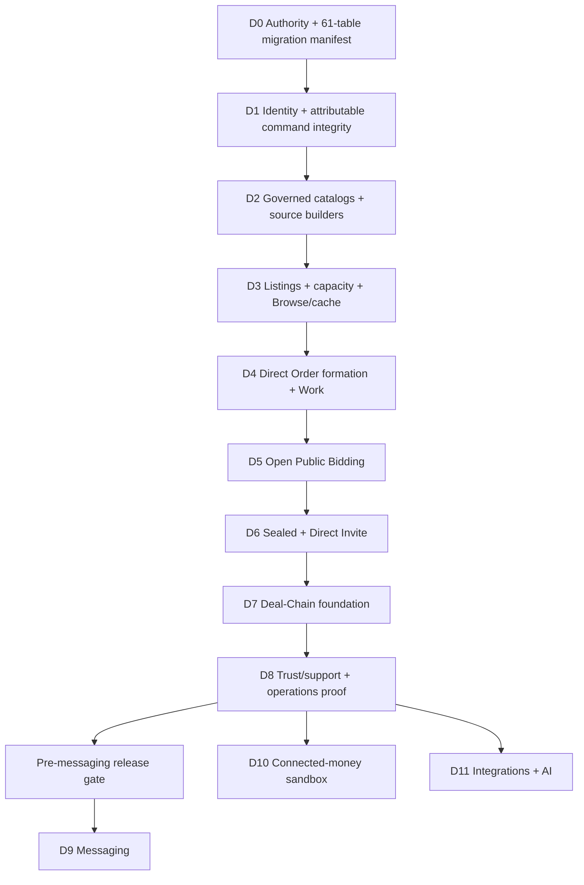

# Serbizyu 2.0 — Canonical Master Delivery Plan

## 1. Outcome and boundary

Deliver the dependable marketplace foundation in one dependency-safe sequence:

1. attributable identity and application/operations integrity;
2. governed category, Work, and Deal-Chain catalogs plus source-specification builders;
3. real Listings, capacity, discriminated Browse, and freshness-safe discovery caching;
4. the sole atomic ordinary Order formation seam and registered Work consequences;
5. Open Public Bidding over Request → Quote → Order;
6. Sealed Bidding and Direct Invite over that same spine;
7. bounded Deal-Chain authoring and isolated child formation;
8. trust/support/operations proof;
9. then Messaging as the next bounded capability.

Connected-money sandbox and owner-scoped integrations/AI remain later conditional capabilities. They cannot block or redefine the non-connected foundation.

## 2. Authority chain

Implementation packets must cite current revisions of:

- `prd-rebuilt.md` — PRD-001–084;
- `domain-state-contracts-rebuilt.md` — especially §§16–17;
- `canonical-schema-rebuilt.md` — canonical 61-table inventory;
- `adr-catalog-rebuilt.md` — ADR-R-041–044;
- `architecture-rebuilt.md` — §§16–17;
- frontend `ARCHITECTURE-SPINE.md` — AD-1–23 plus AD-22A/AD-22B;
- frontend `VIEW-PROJECTION-MATRIX.md`;
- `ux-spec-rebuilt.md` — UX-001–036;
- `epics.md` — 12 epics and 68 implementation stories.

Historical 58-table plans are explicitly superseded and cannot authorize ordering, schema readiness, or implementation.

## 3. Fixed implementation invariants

1. A Tender is a Request; a Bid is an immutable Quote revision; successful award creates an ordinary Order.
2. UI action `quote.select_and_finalize` dispatches `SelectAndFinalizeBid` (`select_and_finalize_bid`), which invokes the sole `FinalizeOrderAgreement` transaction.
3. Selection, complete Order graph, award, competing-lineage consequences, audit, idempotency, and outbox commit together or none commit. No durable `contract_pending` authority exists.
4. Sealed gives a bidder only their own lineage/submission result; all other response signals remain hidden from requester, competitors, and public until committed `selection_open`.
5. Direct Invite Quote submission and award bind one exact current, unexpired, same-Request/provider/purpose Request Invitation. Invitation acceptance is neither a Bid nor an Order.
6. `Catalogs` owns immutable Work and Deal-Chain authoring accelerators. OrdersWork and DealCoordination retain formation/runtime authority.
7. The Work catalog, retained contract resolver, source-specification builder, and validator precede every Listing/Request/Quote/award path that requires Work.
8. PostgreSQL projections are the default Browse path. Shared discovery cache is disabled until measured latency/load/resilience evidence and an accountable expiring activation show net benefit.
9. If activated, cache contains only stable public/coarse fields; one batched PostgreSQL query verifies current revision, phase, visibility/policy qualification, capacity/availability, and activation before serialization.
10. Committed-event invalidation and TTL remain optimizations. No net benefit, privacy/freshness regression, failure, or miss returns to PostgreSQL. Required session/queue Redis health remains separate and truthful.
11. Deal Chain coordinates only. Invitation acceptance may mark a Need `partner_confirmed` but is not agreement; every `in_progress` or later execution state is backed by one isolated ordinary child Order with independent parties, terms, Work, Obligations, disputes, cancellation, replacement, and liability.
12. Messaging consumes settled participant, purpose, privacy, lineage, audit, notification-intent, and projection contracts. Chat never substitutes for structured commercial state.
13. Reverse-sourcing policy content comes only from immutable `category_versions.sourcing_policy`; dimensioned enable/deny comes only from history-preserving `capability_activations`. Publication pins checksum, winning enable, and complete decision fingerprint; every later command re-evaluates under lock.
14. Essential notices precede Messaging through an exact intent/attempt lifecycle. Cancellation and route success cancel pending attempts, block every new claim/retry/route, and use `cancellation_requested`/`delivery_settling` while providers are in flight. Bounded lease reconciliation records authentic or `outcome_unknown` evidence; late results append evidence without reopening effects, and no transaction waits on provider I/O.

## 4. Dependency graph

The graph is intentionally conservative and acyclic. Each delivery unit is independently demonstrable at exit and may rely only on completed predecessors.

## 5. Delivery units

### D0 — Authority and migration manifest

**Stories:** 2.1.

**Deliver:** reconcile the observed 47-table baseline, already-migrated `work_catalog_versions` and `deal_chain_catalog_versions`, Request Invitations, and remaining approved extensions into one 61-table manifest. Map each not-yet-needed table/alteration to its first consuming story; do not pre-create unrelated future persistence.

**Exit:** inventory, ERD, owners, migration dependencies, clean/in-place path, rollback/restore, retention, and production-shaped fixtures agree; historical 58-table gates are non-authoritative.

### D1 — Identity and attributable command integrity

**Stories:** 1.1–1.8.

**Deliver:** secure registration/sign-in/recovery, additive capabilities, gated identity evidence, Agent grants, actor/effective-Owner context, deny-by-default authorization, idempotency, audit/outbox, exact approval primitives, conditional L0/L1 feature-phone/kiosk operating and safety controls, and a purpose-safe essential in-app/SMS/email notification transport used by downstream commands.

**Exit:** direct requests, workers, acting-for actions, and assisted sessions derive authority server-side; revocation/expiry, missing training/safety/operating-model evidence, confirmation failure, and maker/checker denial have no partial effect. Account/security notices prove exact intent/attempt transitions, current mandatory cancellation guard, parent-first claim/cancel/success locking, `cancellation_requested`/`delivery_settling`, authentic or bounded unknown settlement, late-result evidence without reopened effects, deduplication, retry/dead-letter/new-generation recovery, source inbox acknowledgment independence, and no conversation/business authority.

### D2 — Governed catalogs and builders

**Stories:** 2.2–2.8.

**Deliver:** category/profile business versions first; then exact-dimension activation authority and temporal cutover; Work catalog; retained A1/A3/A4/A9 resolver; Work source-specification builder/validator; governed Listing/Request/Tender authoring contracts; Deal-Chain recipes/builder foundation.

**Exit:** every source pins exact versions and emits a typed canonical payload/hash; activation category/profile FKs exist before activation rows, enable/deny cutover is usable before any conditional publisher, templates never become runtime authority, and stale re-resolution fails explicitly.

### D3 — Listings, capacity, Browse, and optional cache

**Stories:** 3.1–3.5.

**Deliver:** Listing lifecycle, immutable publication, capacity buckets/reservations, discriminated Listing/Request Browse, current detail projections, measured PostgreSQL query/index/pagination baseline, and only when evidence passes, an activated shared stable-field cache with batched PostgreSQL qualification/availability overlay and immediate disable/fallback.

**Exit:** concurrent capacity tests reject oversell; Direct Invite/private states cannot enter Browse; PostgreSQL meets explicit targets or the cache activation names the measured failure mode and proves net benefit; cancellation/visibility/capacity changes cannot survive as public actionable output, and cache disablement returns safely to PostgreSQL.

### D4 — Direct agreement, atomic Order, and Work

**Stories:** 4.1–4.6.

**Deliver:** bounded proposals, fixed-lock `FinalizeOrderAgreement`, immutable accepted terms, required Work/Obligations/reservations, and A1/A3/A4/A9 execution consequences.

**Exit:** all formation mechanisms can target one proven seam; failure creates no accepted Order or required child; payment cannot complete Work.

### D5 — Open Public Bidding

**Stories:** 5.1–5.7.

**Deliver:** Open Request publication using exact immutable category sourcing-policy content plus matching dimensioned activations, structured Bid revision states, revision/withdrawal, atomic close→`selection_open`, requester comparison, atomic select/finalize, deadline jobs, unfulfilled/recovery paths.

**Exit:** policy/activation rows lock; checksum, winning enable, and complete decision fingerprint pin and revalidate; accountable Product/Operations evidence owners, bounded controls, genuine geography/category responder-liquidity evidence, observable temporal disablement, and fail-closed absence/expiry/deny/fingerprint change are proven. Public/providers receive no competitor terms/identities/counts; only current eligible `submitted` revisions compare; award succeeds only with the complete ordinary Order graph.

### D6 — Sealed Bidding and Direct Invite

**Stories:** 6.1–6.5.

**Deliver:** Sealed publication and bidder-own-only pre-close projection; atomic reveal boundary; atomic Direct Invite publication plus exact non-enumerating Request Invitations; exact invitation-linked Bid submission; invitation lock/revalidation through award.

**Exit:** Sealed and Direct Invite Requests are reachable from validated drafts under the same activation/abuse gate; no derivative channel leaks Sealed competitor participation; no guessed Direct Invite identifier reveals existence; synchronous expiry/revocation prevents submission and award.

### D7 — Deal-Chain foundation

**Stories:** 7.1–7.6.

**Deliver:** Chain/Need authoring, same-Chain acyclic dependencies, ordinary source mechanisms, distinct `INVITED_PARTNER` purpose, isolated child formation, derived rollups, and replacement/recovery.

**Exit:** parent/sibling mutation and pooled authority are impossible; one active child per Need; each child remains an ordinary independently accountable Order.

### D8 — Trust, support, and operational proof

**Stories:** 8.1–8.5 and 9.1–9.6.

**Deliver:** External Cash/Digital Proof truth, evidence, completion/reviews, disputes/holds, safety/support, purpose-scoped operations inspection, production-shaped proof/recovery of ordered async and established essential notices, rehearsal of the already-established activation command, restore/degradation rehearsal, and genuine metrics.

**Exit:** foundation has tested denial, activation concurrency/emergency disablement, recovery, replay, notice delivery/unknown-outcome settlement/dead-letter/support behavior, backup/restore, low-data/accessibility, browser, and human-UAT evidence. Sandbox/synthetic activity and uncollected money do not enter pilot success claims.

### D9 — Messaging handoff and implementation

**Stories:** 10.1–10.4.

**Entry gate:** D0–D8 complete; participant and acting-context identity, Request/Bid/Order/Work/Deal lineage, purpose/privacy classes, audit/outbox, notification intents, support escalation, retention, and projection schemas are stable.

**Deliver:** purpose-bound conversations, attributable messages, conversation notifications over the established transport, abuse controls, retention/export, and non-Messaging recovery.

**Exit:** membership derives from settled relationships; revocation is effective; no message or attachment mutates commercial truth.

### D10/D11 — Conditional later capabilities

**Stories:** Epic 11 and Epic 12.

Connected money remains provider-neutral and permanently sandbox-labeled until independent legal/security/financial/reconciliation/operations activation gates pass. Integrations/AI remain Owner-scoped, revocable, environment-bound, and exact-approval constrained.

## 6. Tender vertical packets

Each packet includes its first-needed migration/constraint, application command/query, policy, purpose projection, Inertia surface, browser scenario, focused behavior tests, audit/idempotency/outbox, operations recovery, activation, and rollback/disable behavior.

| Packet | User-visible result | Stories | Predecessor |
|---|---|---|---|
| TV-1 | Author and publish an Open Tender under activation/abuse gates | 2.3–2.5, 2.7, 5.1 | D4 proven |
| TV-2 | Submit one exact private Open Bid under bounded controls | 5.2 | TV-1 |
| TV-3 | Revise/withdraw with immutable lineage | 5.3 | TV-2 |
| TV-4 | Atomically close and enter selection | 5.4 | TV-3 |
| TV-5 | Compare only current eligible `submitted` versions | 5.5 | TV-4 |
| TV-6 | Select and atomically form ordinary Order | 5.6 | TV-5 + D4 |
| TV-7 | Expire/recover unfulfilled Tenders | 5.7 | TV-4 |
| TV-8 | Publish Sealed and enforce own-Bid-only privacy/reveal | 6.1–6.2 | TV-6 |
| TV-9 | Atomically publish Direct Invite with exact invitations | 6.3 | TV-6 |
| TV-10 | Decline/submit under exact invitation | 6.4 | TV-9 |
| TV-11 | Lock/revalidate invitation through award | 6.5 | TV-10 + TV-6 |

## 7. Packet acceptance contract

No packet is implementation-ready until its LLD/OpenSpec contains:

1. actor, principal/effective Owner, relationship, purpose, and authorization matrix;
2. source/aggregate/business/payload/policy versions and stale behavior;
3. exact state transitions and no-effect failures;
4. table/column/FK/check/index changes first needed by this packet;
5. fixed transaction/lock order and idempotency fingerprint/result;
6. audit/outbox ordering and consumer inbox behavior;
7. purpose-specific projections, omissions, cache identity, and invalidation;
8. complete loading/empty/validation/denial/stale/expired/offline/degraded/retry/support UX;
9. privacy/security threat cases, including guessed IDs and derivative channels;
10. scheduler/worker health, retry, gap, dead-letter, replay, and operator recovery;
11. focused regression tests for consumer-visible invariants;
12. actual browser smoke path and cross-perspective consequence;
13. low-data, keyboard/touch accessibility, and target-user comprehension proof;
14. activation/default/disable/rollback and accountable evidence owner;
15. canonical requirement/story/matrix references with no unresolved authority decision.

### 7.1 Engineering implementation review matrix

The 15-section packet is necessary but not sufficient. Every implementation packet must answer this matrix with evidence or an explicit **not applicable + reason**. Patterns are selected by failure mode and measured need; cache, CDN, queues, circuit breakers, distributed locks, microservices, and sharding are never default checkboxes.

| Area | Required questions/evidence |
|---|---|
| Requirement and ownership | What exact user outcome and non-goal apply? Which bounded context owns each write and source of truth? What derived copies exist? |
| Domain correctness | What preconditions, postconditions, invariants, legal states/transitions, and fail-closed rules apply? What must remain separate? |
| Input and contracts | What is accepted, normalized/canonicalized, rejected, versioned, and returned? Which HTTP/API status and compatibility contract applies? |
| Authentication and authorization | Who is the principal/effective Owner? What relationship, purpose, grant, step-up, maker/checker, object-level/BOLA, and non-enumerating rules apply? |
| Threat and privacy model | What can be spoofed, tampered with, replayed, enumerated, inferred, uploaded, exported, or leaked through logs/cache/errors/timing? Which defense-in-depth layers apply? |
| Data model and integrity | Which normalized entities/value objects/aggregates are first needed? Which PK/FK/NOT NULL/CHECK/unique/composite/partial indexes and delete/retention rules enforce truth? |
| Historical truth | Which values are current authority, immutable snapshot, derived state, cache, or append-only correction? Which business/row/event/payload versions are distinct? |
| Transaction boundary | Which writes, audit, idempotency result, reservations, and outbox intents commit or roll back together? Which external calls are forbidden inside the transaction? |
| Concurrency and TOCTOU | Which rows lock, in what fixed order? Which optimistic revision/CAS, database exclusion/uniqueness, atomic increment, race, deadlock, and retry behavior applies? |
| Idempotency and duplicates | What is the operation fingerprint/scope/key? What prior result returns on exact replay, and what conflict returns for reused key/different payload? |
| Side effects and consistency | Which effects are synchronous correctness and which are eventual? What outbox/inbox, ordering, deduplication, compensation, or reconciliation contract applies? |
| External dependency resilience | What timeout/deadline, retry budget, exponential backoff/jitter, authenticity/business binding, circuit-breaker/bulkhead/fallback, and provider-degradation behavior is justified? |
| Queue and scheduler behavior | What delivery semantics, job timeout, concurrency/backpressure, gap, poison/dead-letter, replay, graceful shutdown, and last-success health apply? |
| Query and index design | What access paths, selectivity/cardinality, composite/covering indexes, pagination strategy, eager/batch loading, N+1 guard, query plan, and bounded result/payload are required? |
| Performance and capacity | What measured latency/throughput/payload/query target matters for this slice? What profiling/load evidence identifies a bottleneck? Which optimization is deliberately unnecessary now? |
| Cache and delivery | Is caching needed at all? If yes: authority boundary, key identity, TTL, invalidation, stampede/hot-key control, private/public HTTP semantics, fallback, and freshness fence. CDN/compression/code splitting/image work requires an identified asset or latency need. |
| Observability | Which structured events, correlation/causation/request IDs, safe log fields, counters/gauges/histograms, RED signals, traces, dashboards, alerts, and support diagnostics prove health without leaking data? |
| UX and accessibility | What loading, empty, validation, pending, success, partial/unknown, stale/conflict, offline, denied/private, expired, degraded, retry, support, focus/live-region, touch, contrast, and low-data states exist? |
| Test strategy | Which behavior belongs in unit, feature/integration, PostgreSQL constraint/concurrency, contract, browser E2E, security, migration, performance/load, or human UAT evidence? Tests must target plausible consumer-visible failure. |
| Migration and deployment | Is the schema change backward compatible/expand-contract? What backfill, lock risk, mixed-version compatibility, deploy order, feature activation, canary/disable, roll-forward, rollback/restore, and data verification apply? |
| Runtime and recovery | What liveness/readiness, required versus optional dependency, graceful degradation/shutdown, backup/restore, RPO/RTO, retention/purge, incident owner, and runbook apply? |
| Maintainability | Is the module cohesive and API narrow? Is logic duplicated, coupled, over-abstracted, or hidden in framework/UI/database layers? What obsolete path is removed on cutover? |
| Complexity challenge | What simpler design was considered? Which patterns were rejected because the measured scale/failure model does not justify their operational cost? |

The review order is **correctness → data integrity → security/privacy → reliability/recovery → maintainability → observability → measured performance/scalability → UX/accessibility**. A packet fails readiness if it adds an optimization without a named bottleneck/failure mode or omits a correctness/security/recovery control because performance work received more attention.

## 8. File-churn decision

Listings, Requests, Quotes, and projection registries recur across D2, D3, D5, and D6. They remain separate because each boundary has a genuine proof/feedback gate:

- D2 proves governed source contracts without publication;
- D3 proves supply/discovery/freshness without bidding;
- D5 proves the simplest public bidding mechanism and atomic award;
- D6 adds privacy/invitation risk only after D5 is stable.

One integration owner per packet migrates all callers for that slice and removes superseded paths. This avoids both an omnibus rewrite and repeated parallel conventions.

## 9. Pre-messaging release gate

Messaging may start only when all statements are evidenced:

- canonical inventory is 61 and each implemented migration matches its first consumer;
- Work resolver/builder precedes every source/formation path;
- PostgreSQL Browse baseline meets measured query/latency/load targets, or any optional cache activation proves net benefit and cannot serialize stale lifecycle/visibility/availability/actionability;
- reverse-bidding response eligibility, anti-spam limits, expiry/selection handling, accountable evidence owners, genuine geography/category liquidity evidence, observability, and dimensioned disablement pass;
- `FinalizeOrderAgreement` is the sole accepted-Order seam;
- Open, Sealed, and Direct Invite privacy matrices pass across UI, API, cache, logs, analytics, notifications, support/export, and async responses;
- exact Request Invitation authority is enforced relationally and revalidated through award;
- Deal-Chain child isolation and cycle guards pass at PostgreSQL and application boundaries;
- outbox/inbox, scheduler, replay, dead-letter, restore, activation, and disablement are observed;
- essential notice intent/attempt transitions, mandatory cancellation guard, ordered claim/cancel/success locks, persisted in-flight settlement, authentic/unknown/late-result evidence, deduplication, bounded retry/dead-letter/replay, and provider-independent business acknowledgment pass;
- connected browser journeys and human UAT pass for Epics 1–9;
- no Messaging implementation is required to clarify, accept, award, complete, dispute, or recover structured marketplace state.

## 10. Next action

Harden **Story 2.1** into the first 15-section LLD/OpenSpec, then execute D1–D8 in order. Do not reopen the superseded 58-table train plan or start Messaging before the pre-messaging release gate.