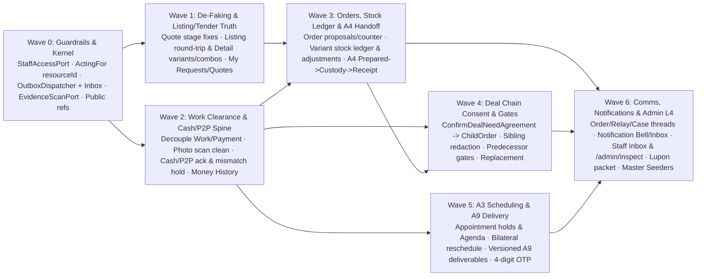

# Serbizyu 2.0 — Master Macro-to-Micro Execution Blueprint

**Status:** Canonical Pre-Execution Master Plan (Macro Architecture → Micro File/Schema/Route/Seeder/Ticket Specification)  
**Date:** 2026-10-25  
**Visual Authority:** `docs/design-kit/sessions/final-*.html` & `docs/design-kit/sessions/admin-workspace-kit.html` (9 unified static pages)  
**Domain Authority:** `CONTEXT.md`, `.ai/rules/{architecture,admin,payments,agent-delegation,trust-safety,ui-kit}.md`

---

## 1. Executive Architecture Spine & Core Invariants

### 1.1 Keep / Refactor / Replace Verdict

| Surface / Layer | Verdict | Exact Action |
|---|---|---|
| **Modular Monolith (`app/Modules/*`), PostgreSQL Batch 001–007 Schema, Auth/OTP, Onboarding, Browse (`Browse.tsx`), Builders (`CreateService`, `CreateProduct`, `CreateRequest`)** | **KEEP** | Retain existing tables, module namespaces, and mobile-first navy/white/mango builders. Add **forward additive migrations only** (never rewrite applied Batch 001–007 migrations). Fix module-isolation leaks (`StageDealChain -> DealChainCatalog`, `WorkExecutionService -> WorkCatalog`, `TenderService -> IdentityAccess` direct imports) via `app/Shared/Contracts/*`. |
| **`ListingDetail.tsx` & `Requests/Show.tsx` + `QuoteComposerSheet.tsx`** | **REFACTOR IN PLACE** | Render seller-authored `variants` (with live capacity), `work_specification` (`required_proofs` + `control_mode`/`approval_method`), and `deal_chain_combinations` instead of hardcoded category packages/turnkey toggles. Strip the false `"Tiwala Escrow Protection"` banner (`ListingDetail.tsx:2287`). Preserve `clearanceMode` & `approvalMethod` in `QuoteComposerSheet.tsx` and validate nested `milestone_stages.*` in `RequestController.php`. Add `GET /my-requests` and `GET /my-quotes`. |
| **`Orders/Index.tsx` & `Orders/Show.tsx`** | **REFACTOR IN PLACE** | Keep `/orders` and `/orders/{id}`. Strip fake `₱665` escrow fallback, fake ETA/addresses, fake auto-settled payment badge, and `setTimeout` chat/support simulations. Render independent **Agreement · Work · Payment (· Stock · Case)** rails, the locked Glovo wave `PaymentObligationSheet`, A4 custody steps, A3 reschedule cards, A9 deliverable versions, and persisted 1:1 `ConversationDrawer`. |
| **Merchant Order Queue, Stock Ledger (`Stock/Index.tsx`, `Stock/Show.tsx`), Money History (`Payments/MoneyHistory.tsx`), Provider Agenda (`Agenda/Index.tsx`), Notification Bell & Inbox Drawer** | **ADD MISSING SURFACES** | Implement the operational views already locked in `final-orders-stock.html`, `final-payments.html`, `final-scheduling-work.html`, and `final-notifications-messages.html`. |
| **Deal Chain (`Orders/DealChainDetail.tsx`)** | **REFACTOR IN PLACE** | Wire `RespondToDealInvitation` → customer confirmation (`ConfirmDealNeedAgreement`) → `ChildOrderFormationPort` (`FormDealNeedChildOrder`). Enforce server-side `work_step_dependency_gates` (`part_ready`, `delivery_signed`), redact sibling prices/phones/payments per actor, replace fake chat with scoped `deal_chain_relay`, and add partner withdrawal/replacement. |
| **Admin Pages (`resources/js/Pages/Admin/*` & `routes/web.php:164-209`)** | **LOCK ROUTES & REPLACE MOCK UI** | Guard **every** `/admin/*` route behind unified `StaffAccessPort` (`primary_access_tier === 'L4'` **OR** active `admin`/`operate` role). Delete client-hardcoded arrays (`INITIAL_QUEUE_ITEMS`, `KNOWN_RECORDS`, `SAMPLE_DISPUTES`) and `setTimeout` mutations. Replace with `Operations` read models powering the **Staff Inbox** (`Assigned to me`, `Waiting on me`, `Waiting on others`, `Closed`) and **Universal Record Workspace** (`/admin/inspect?ref=...`), plus guarded TrustSupport case/hold/Lupon commands. |

---

### 1.2 Seven Non-Negotiable Cross-Domain Invariants

1. **Module Isolation (`.ai/rules/architecture.md`):** Code inside `app/Modules/{A}` MUST NEVER import `app/Modules/{B}`. Cross-module reads and commands cross `app/Shared/Contracts/*` only.
2. **Independent State Rails (`.ai/rules/admin.md`):** Agreement (`orders`), Work (`work_instances`), Payment (`payment_obligations`), Stock (`listing_capacity` / `stock_movements`), and Case (`support_cases` / `administrative_holds`) are independent state machines. Completing Work NEVER marks external cash/P2P `settled`; flagging a payment mismatch NEVER freezes sibling orders or reverses Work acceptance.
3. **Strict Acting-For Attribution (`.ai/rules/agent-delegation.md`):** Every delegated mutation and message carries `actor_user_id` (authenticated operator) and `owner_user_id` (principal) verified at mutation time against an active `consent_grants` row matching exact `(resource_type, resource_id, action)` and `starts_at <= now < expires_at`. Agents never custody funds.
4. **Non-Custodial Financial Truth (`.ai/rules/payments.md`):** Canonical lanes are `external_cash`, `p2p_transfer`, and sandbox-only `protected_digital`. External lanes carry zero platform fee, zero wallet balance, and require recipient acknowledgement (or authorized case resolution) to reach `settled`.
5. **Stock Ledger Equation:** For every tracked product variant `(listing_id, resource_key)`:  
   $$\text{available} = \text{on\_hand} - \text{held} - \text{committed\_unfulfilled}$$
   Physical `on_hand` changes only on `opening_balance`, `receiving`, `damaged`, `recount`, and physical `fulfillment` (custody departure)—never on reservation hold/release.
6. **Transactional Outbox + Idempotent Consumers:** Domain mutations write `audit_events` + `outbox_messages` (and synchronous `NotificationIntent` via `NotificationsPort`) in one DB transaction. `OutboxDispatcher` delivers envelopes to registered `InboxConsumer` handlers (`DealCoordination` dependency gates, `Operations` in-app notification delivery).
7. **Zero Simulated Success:** No live React component may use `setTimeout()`, `alert()`, or local state mutation to fake server persistence, chat delivery, payment release, or admin recovery.

---

## 2. Shared Cross-Module Contracts (`app/Shared/Contracts/*`)

| Contract | Implemented By | Consumed By | Purpose |
|---|---|---|---|
| `StaffAccessPort` | `IdentityAccess` | `EnsureAuthenticated`, `Operations`, `Admin*Controller` | Enforces active user + (`L4` tier OR active effective `admin`/`operate` role). |
| `ActingForAuthorizer` *(extended)* | `IdentityAccess` (`ConsentActingForAuthorizer`) | All write services | Rechecks exact `(resource_type, resource_id, action)`, unrevoked status, and `starts_at <= now < expires_at` under the mutation transaction (null `resource_id` is reserved for creation). |
| `RoleCapabilityReaderPort` | `IdentityAccess` | `Tenders`, `Listings`, `OrdersWork` | Removes direct `RoleAssignmentService` imports across modules. |
| `WorkSpecificationPort` *(extended)* | `Catalogs` (`WorkCatalog`) | `Listings`, `Tenders`, `OrdersWork` | Exports `WORK_TOOLS`, normalizes stage `tool_config`/metrics/checklists/clearance, computes structural signatures. |
| `DealChainRecipeCatalogPort` | `Catalogs` (`DealChainCatalog`) | `DealCoordination` (`StageDealChain`) | Removes `StageDealChain -> DealChainCatalog` direct import. |
| `SlotCandidateSupplyPort` | `Listings` | `Catalogs`, `DealChainController` | Queries real active approved listings for Deal Chain slot candidates without cross-module SQL in `Catalogs`. |
| `QuoteAwardOrderFormationPort` | `OrdersWork` | `Tenders` (`TenderService::acceptQuote`) | Forms Order, parties, snapshot, Work, and Obligation atomically on quote award without `Tenders` writing `OrdersWork`/`PaymentObligations` tables. |
| `OrderCapacityPort` *(extended)* | `Listings` (`OrderCapacityAdapter`) | `OrdersWork` | Variant `resource_key` holds/commits/releases/fulfills + A3 appointment interval holds/commits/swaps. |
| `OrderPaymentObligationPort` *(extended)* | `PaymentObligations` | `OrdersWork`, `TrustSupport`, Controllers | `createPrimary`, `markDueFromWorkFact`, `chooseLane`, `reportCashPayment`, `acknowledgeCashReceipt`, `submitP2pProof`, `verifyP2pProof`, `rejectP2pProof`, `flagPaymentMismatch`, `resolvePaymentMismatch`, `projectForOrder`. |
| `PaymentMismatchCasePort` | `TrustSupport` | `PaymentObligations` | Atomically opens/links `support_cases`, `disputes`, and obligation-only `administrative_holds` on payment mismatch. |
| `DealWorkGatePort` | `DealCoordination` | `OrdersWork` | Registers confirmed Need/Work identities and checks every current predecessor before native or generic Work progression. Clearing a gate never starts Work. |
| `WorkMilestoneReaderPort` | `OrdersWork` | `DealCoordination` | Verifies persisted preparation, actual recipient receipt, customer-authorized sign-off, or exact A9 delivery acceptance without foreign-module SQL. |
| `CommunicationsPort` & `*CommunicationScopePort` | `TrustSupport` + scope adapters in `OrdersWork`, `DealCoordination`, `TrustSupport` | Controllers, `Operations` | Opens/reads/posts idempotent messages for `order`, `deal_chain_relay`, and `support_case` threads. |
| `NotificationsPort` | `Operations` | `OrdersWork`, `Tenders`, `DealCoordination`, `PaymentObligations`, `TrustSupport` | Records transactional `NotificationIntent` and dispatches in-app deliveries + recipient inbox/read actions. |
| `EvidenceScanPort` & `EvidenceAccessPort` | `OrdersWork` / Shared storage | `OrdersWork`, `PaymentObligations`, `TrustSupport` | Runs deterministic malware/MIME verification (`quarantined -> clean | infected | failed`) and authorizes private streaming. |

---

## 3. Forward Database Migrations Plan (Additive Only)

Never edit Batch 001–007 migrations. Add forward migrations in dependency order and update `CanonicalMigrationManifestTest` / `DatabaseCatalogContractTest` in the same slice:

1. **`2026_10_25_000100_add_public_references_and_order_proposal_lineage.php`**
   - Add unique `public_reference text` + sequence allocators (`ORD-`, `OBL-`, `CASE-`, `REQ-`, `QTE-`, `DC-`) to `orders`, `payment_obligations`, `support_cases`, `disputes`.
   - `CASE-*` references share one sequence across `support_cases` and `disputes`; a forward-only migration reassigns only collisions while preserving existing non-colliding references so the universal resolver can resolve by reference alone.
   - Create `order_proposals` (`id`, `order_id`, `proposal_version`, `parent_proposal_id`, `kind`, `status`, `proposed_by_user_id`, `owner_user_id`, `consent_grant_id`, `responded_by_user_id`, `responded_at`, `source_listing_version_id`, `scope jsonb`, `amount_minor`, `currency`, `terms_hash`, `expires_at`, `correlation_id`, timestamps).
   - Add `current_proposal_id`, `current_terms_snapshot_id`, `accepted_at`, `completed_at`, `cancelled_at` to `orders`; migrate `pending_acceptance -> proposed`, `closed -> completed` (archiving the 4 snapshot-less legacy demo rows `0f0100000001..4` cleanly).
2. **`2026_10_25_000200_add_variant_stock_ledger_and_movements.php`**
   - Add `stock_policy`, `availability_status` (`open|out_of_stock|shortage|paused`), `low_stock_threshold` to `listing_capacity`; partial unique index on `(listing_id, resource_key) WHERE capacity_type = 'quantity'`; relax `ck_listing_capacity_quantities` so `remaining_quantity` can go negative **only** when `availability_status = 'shortage'` while `quantity >= 0`.
   - Add `fulfilled_quantity`, `released_quantity`, `fulfilled_at`, `actor_user_id`, `owner_user_id`, `consent_grant_id` to `listing_capacity_reservations` and allow `'fulfilled'` status.
   - Create append-only `stock_movements` (`id`, `listing_capacity_id`, `source_listing_version_id`, `reservation_id`, `order_id`, `movement_type`, `delta_on_hand`, `delta_held`, `delta_committed`, `balance_on_hand`, `balance_held`, `balance_committed`, `balance_available`, `counted_quantity`, `reason`, `reference`, `evidence_file_id`, `actor_user_id`, `owner_user_id`, `consent_grant_id`, `command_scope`, `idempotency_key`, `correlation_id`, `occurred_at`, `created_at`).
   - Follow-up forward migrations `2026_10_25_002001_restore_default_capacity_bucket_uniqueness.php` and `2026_10_25_002002_allow_reservation_movements.php` preserve the legacy empty-key bucket uniqueness and record hold, commit, and release deltas in the append-only ledger.
3. **`2026_10_25_000300_cutover_payment_obligation_lifecycle.php`**
   - Update `payment_obligations` lane constraint to `('external_cash', 'p2p_transfer', 'protected_digital')` and status constraint to `('not_due', 'due', 'payer_reported_cash', 'payer_submitted_p2p_proof', 'proof_rejected', 'disputed_mismatch', 'settled', 'cancelled', 'superseded')`.
   - Add `supersedes_obligation_id`, `due_at`, `settled_at`; enforce zero platform/processor fees on `external_cash` and `p2p_transfer`.
4. **`2026_10_25_000400_add_scheduling_a9_deliveries_and_work_challenges.php`**
   - Create `provider_schedule_resources`, `provider_agenda_blocks`, and `work_schedule_change_requests` (bilateral A3 rescheduling).
   - Create `work_deliveries`, `work_deliverable_files`, and `work_revision_requests` (versioned A9 digital artifacts); add `current_delivery_id` to `work_instances`.
   - Create `work_clearance_challenges` (hashed 4-digit `presence_otp` and `worker_dropoff` tokens with expiry, attempt counter, and single-use consumption) and `order_handoff_transfers` (two-party A4 custody transfer).
5. **`2026_10_25_000500_add_deal_chain_consent_and_dependency_gates.php`**
   - Add stable `node_key`, `recipe_code`, `recipe_version`, `replaces_need_id` to `deal_needs`; create `deal_need_confirmations` (customer agreement proof pairing with accepted `deal_invitations`).
   - Create `work_step_dependency_gates` (`id`, `deal_chain_id`, `dependency_id`, `predecessor_need_id`, `successor_need_id`, `successor_order_id`, `target_node_id`, `condition_code`, `status` `blocked|satisfied|invalidated`, `satisfied_by_event_id`, `satisfied_at`, `graph_version`).
6. **`2026_10_25_000600_extend_communications_notifications_and_cases.php`**
   - Extend `conversations` with `scope_type` (`order|deal_chain_relay|support_case`), nullable `deal_chain_id`, nullable `support_case_id`, `last_message_sequence`, and partial unique indexes per scope.
   - Extend `messages` with `owner_user_id`, `consent_grant_id`, `sequence`, `audience` (`participants|staff_internal`).
   - Extend `notifications` with `purpose`, `source_event_id`, `actor_user_id`, `owner_user_id`, `read_at`, `row_version`, and `outbox_messages` with aggregate stream sequence/version and contract-version metadata; allocate sequence values through a locked stream row in the same transaction as each outbox insert (`outbox_streams`).
   - Extend `support_cases` (`subject_type`, `subject_id`, `title`, `waiting_on_kind`, `waiting_on_user_id`, `next_action_code`, `next_action_due_at`, `last_activity_at`, `dispute_id`, `handoff jsonb`) and `administrative_holds` (`support_case_id`, `approval_set_id`, `released_by_user_id`).

---

## 4. Domain-by-Domain Micro Implementation Plan

### Domain 1 — Catalog, Listing Detail, Builders & Requests/Tenders
*(Full detail from `RevCatalogRequests`)*
- **Immediate Bug Fixes:**
  - `resources/js/components/quotes/QuoteComposerSheet.tsx:158-166`: Preserve `clearanceMode`, `approvalMethod`, `gateType`, `requiredProofs`, `handoffParty`, `metricUnit`; reset state on request/quote prop change; remove hardcoded stage/capacitor/Danny Express defaults.
  - `app/Http/Controllers/RequestController.php:68-86,196-208`: Validate `pipeline.stages.*` and `milestone_stages.*` / `stages.*` element shapes (object, unique `id`, nonblank `title`, valid `evidence_type`, `required_proofs.*`, `clearance_mode`, `approval_method`); normalize via `WorkSpecificationPort`.
- **Builder & Repository Lossless Round-Trip:**
  - `app/Modules/Listings/Infrastructure/ListingRepository.php`: Unify version payload writer across `create`, `update`, and `submit` so `submit()` never drops `media`, `deal_chain_combinations`, `deal_chain_specification`, `work_set_version`, `prep_lead_time`, or `variants`.
  - `resources/js/Pages/Listings/CreateProduct.tsx`: Send `set_code` (`set-product-market-handoff`) instead of family code; fix `is_default` ↔ `isDefault` hydration; render governed 3-step A4 Handoff preview card; preserve variant IDs and stock quantities in listing versions. Provision `(listing_id, resource_key)` `listing_capacity` buckets + opening `stock_movements` under #20.
  - **#14 implemented:** listing version payload preserves authored media, variants, preparation terms, catalog provenance, full Work node mechanics, and Deal Chains across create/update/submit; staff review decisions and seller lifecycle controls are wired without projected telemetry.
- **Public `ListingDetail.tsx` Truth Cutover:**
  - **#15 implemented:** Public detail projects authored variant prices and ledger-derived stock against stable `resource_key`, current listing version, authored package/add-on terms, Work Spec node duration/proofs/clearance/approval, and saved named Deal Chain combinations/slots. Unavailable products are disabled rather than priced or stocked from fallbacks.
  - Removed static category packages, partner catalog, default add-ons, and escrow-guarantee copy; booking and every Picks checkout path preserve `variant_id` / `package_id`, quantity, listing version, selected add-ons, and combination. Legacy Picks UUID keys migrate once at the storage read boundary; composite IDs without a canonical listing id are not guessed. Server resolves current authored terms and totals from the pinned listing version.
- **Tenders Lifecycle & Tracking Workspaces:**
  - Implemented #16: submissions, revisions, and counters allocate request-wide `MAX(quote_version) + 1` under the request lock. Revisions preserve superseded commercial terms; counter and acceptance commands enforce counterparty authority.
  - `TenderService::acceptQuote()` calls `QuoteAwardOrderFormationPort`; `OrdersWork` atomically creates the Order, parties, pinned terms, not-started Work, and not-due obligation. A9 awards retain the governed database revision allowance.
  - `GET /my-requests` and `GET /my-quotes` expose owner-scoped records, deadlines, response turns, and awarded-order links. Expired requests stay in owner history but are excluded from public Browse. Staff listing review endpoints are implemented under #14.

### Domain 2 — Orders, Stock Operational Ledger & A4 Product Handoff
*(Full detail from `RevOrdersStockA4`)*
- **Order Proposals, Queue & Amendments:**
  - Implemented #21: `SubmitOrderProposal` writes v1 and holds the exact variant bucket without changing physical on-hand. Counterparty-only accept, decline/release, immutable counters, and bilateral amendments use version checks and idempotent replay.
  - Accepted agreements pin `current_terms_snapshot_id`; all Order consumers use `proposed → accepted → in_progress → completed | cancelled`. The legacy finalize route is removed. Quote and Deal Need formation set the same current pointers.
  - `POST /orders/{order}/accept|decline|counter|amend` and `/proposals/{proposal}/accept` power the live Needs Action / Active / Done queue and proposal sheet.
  - Monetary amendment acceptance supersedes an unreported primary obligation with a linked full-amount successor. Existing payment evidence, mismatch, or settlement requires reconciliation instead of rewriting financial facts; scope-only amendments preserve the obligation.
  - Migration backfill uses bounded batches, real SHA-256 terms hashes, and authoritative terms/proposal amounts. The four named snapshotless demo orders remain cancelled; unknown snapshotless accepted records and unresolved cancellation requests fail closed.
- **Stock Ledger & Adjustments (`StockController` + `Stock/Index.tsx`, `Stock/Show.tsx`):**
  - Endpoints: `GET /stock`, `GET /stock/{capacity}`, `POST /stock/{capacity}/adjustments`, `POST /stock/{capacity}/evidence`.
  - `RecordStockAdjustment`: Handles `receiving`, `damaged`, and `recount` with optimistic `expected_row_version` and idempotency. If `recount < held + committed_unfulfilled`, record physical count, set `availability_status = 'shortage'`, block new holds, and return affected Order references without cancelling accepted orders.
- **Governed A4 Handoff (`A4HandoffService`):**
  - Implemented #22: `POST /orders/{order}/handoff/prepared`, `/custody`, `/custody/{transfer}/accept`, and `/receipt` replace the removed legacy courier bypasses. Generic Work progression cannot complete A4.
  - Merchant preparation and custody offers, assigned courier or buyer counter-pickup acceptance, and final-recipient receipt require exact server-derived authority plus clean scanned Work evidence.
  - Deduct physical `on_hand` and `committed_unfulfilled` (`fulfillForOrder`) once at verified custody departure; doorstep receipt records a separate fact and never touches stock. Emit `work.ready_for_collection`, `work.delivered_to_site`, and `work.completed`; final receipt may make payment due but never settled or starts downstream Work.
- The accepted immutable `listing_type` separates tracked physical `product` fulfillment (committed variant reservation required) from `service` courier A4 custody/receipt (no stock movement); unknown legacy types fail closed.
  - Linked product quote awards pin listing version, variant, stock resource, quantity, and authored price provenance. The Order is inserted before its capacity commitment; the accepted proposal retains the reservation consumed at departure. Negotiated totals remain exact, including non-divisible unit prices.
  - Confirmed couriers require the exact product Need dependency branch and current active child agreement. Nonparty couriers receive only `/orders/{order}/handoff` public summary/custody props; they cannot access the full commercial Order page.

### Domain 3 — Payment Obligations, Cash/P2P Settlement & Money History
*(Full detail from `RevPaymentsObligations`)*
- **Decouple Work from Payment:**
  - Remove `payment_obligations` `status = 'released'` writes from `OrderController::signoffWork()`, `OrderController::courierHandoff()`, and `WorkExecutionService::advanceNode()`. Instead invoke `OrderPaymentObligationPort::markDueFromWorkFact()`.
- **Payment Commands & Evidence (`PaymentObligationController` + `PaymentEvidenceController`):**
  - `POST /orders/{order}/payment-obligations/{obligation}/lane` (`chooseLane` with linked supersession before report).
  - `POST .../cash/report` (`due -> payer_reported_cash`) and `POST .../cash/acknowledge` (`payer_reported_cash -> settled`, recipient only).
  - `POST .../p2p/proof` (private `evidence_files` upload + reference + amount → `payer_submitted_p2p_proof`), `POST .../p2p/verify` (`-> settled`), `POST .../p2p/reject` (`-> proof_rejected`, allowing proof replacement without altering amount/ref).
  - `POST .../mismatch` (`flagPaymentMismatch` → calls `PaymentMismatchCasePort::openOrLink()` in same transaction, setting `disputed_mismatch` and placing an obligation-only `administrative_holds` row).
- **UI Surfaces:**
  - Refactor `Orders/Show.tsx` (`isWorkCompleted` ≠ `isPaymentSettled`, independent Payment rail + `PaymentObligationSheet` inside `GlovoWaveModal`).
  - Add `GET /money-history` (`Payments/MoneyHistory.tsx`) showing non-custodial Receivables, Awaiting Acknowledgement, Under Review, and Settled Outside Serbizyu.

### Domain 4 — Scheduling (A3), Work Execution (A1/A3/A4/A9) & Work Tools
*(Full detail from `RevWorkSchedulingTools`)*
- **Work evidence scanning (implemented):**
  - Work-photo uploads are private and begin quarantined, with scan requests written transactionally to the outbox. The registered local scanner transitions supported JPEG/PNG/WebP payloads to `clean`; unsupported, mismatched, corrupted, or flagged content becomes `infected`, and unreadable storage becomes `failed`. Only clean evidence is selectable for Work progression or private participant downloads.
- **A3 Capacity & Bilateral Rescheduling:**
  - Implemented #26: listing slot/hold endpoints, `GET /listings/{listing}/appointment-booking`, quote-version-scoped `GET /requests/{request}/quotes/{quote}/appointment-slots` and `POST .../appointment-holds`, Provider Agenda/block CRUD, and bilateral schedule-change requests.
  - Listing and quote bookings share a locked provider resource, half-open intervals, and full server-authored duration. Temporary holds use the configured TTL; expiry releases only held capacity. Committed bookings remain intact when blocks are added or a replacement time is proposed.
  - Direct acceptance, quote award, and Deal child confirmation commit the customer's exact source/version hold and schedule Work. Requesters may choose holds for their own counter-offers without self-accepting; providers accept only a valid customer-owned hold.
  - Only counterparty acceptance swaps appointments and writes schedule history. Terminal Order/Work rejects acceptance without changing the original slot, history, audit, or outbox; rejection/withdrawal may release the proposed hold. Capacity and request mutations record attributed audit/outbox facts transactionally.
  - The first authorized A3 Work action moves scheduled Work and its Order into progress. Runtime proof exercised a 75-minute booking, normal completion, terminal reschedule rejection, cleanup, and full transaction rollback.
- **A9 Versioned Digital Delivery:**
  - Routes: `POST /orders/{order}/deliveries`, `POST .../files`, `POST .../submit`, `POST .../revision-requests`, `POST .../accept`, plus participant-only private attachment downloads.
  - Providers attach up to 12 private files per version (JPEG, PNG, WebP, PDF, or UTF-8 plain text; 25 MB each). Every artifact uses the quarantine/outbox scanner before inclusion in the immutable SHA-256-addressed manifest (`v1`, `v2`, …).
  - Customers can download only clean artifacts with `private, no-store` headers. Lock the Work row while enforcing `revisions_used < revisions_allowed` and exact submitted-version acceptance; final acceptance completes Work and only marks an eligible obligation due, never settled.
  - Delivery event idempotency is keyed by Work, event type, and delivery identity, not correlation ID. Reusing one correlation across a v1 → revision → v2 flow preserves distinct version events; the production runtime exercise and HTTP regression cover this path.
  - Authored checklist responses and named measurements are validated before submission and bound to the immutable delivery manifest with the Work signature/version. A revision collects fresh proof; acceptance validates proof-node identity sets independently of JSON object key order.
  - Preparing the first draft is the provider's explicit A9 start action. Native draft, submission, revision, and acceptance honor predecessor gates and write attributed audit/outbox facts transactionally. Generic Work completion routes cannot bypass exact delivery acceptance.
- **Work Tools & 4-Digit Presence OTP:**
  - Implemented Work clearance: **4-digit** `presence_otp` is issued only to the authorizing customer and verified by the provider; **6-digit** `worker_dropoff` is issued by the actual delivering actor and verified by the receiving counterparty. A4 code verification consumes the token and records governed receipt atomically.
  - Challenges store secret-keyed HMAC digests, expiry, attempt bounds, single-use consumption, node/Work-version binding, and a SHA-256 fingerprint of the immutable Work signature. Plaintext appears only in the authorized issuance response and issuer-local UI state—not shared props, events, or logs.
  - `checklist_items`/`checklist_responses` use stable item identities; `metric_requirements`/`metric_readings` use authored names, units, required flags, and optional targets/bounds. Ingress timestamps are server-owned; persisted-proof revalidation preserves them. Retired anonymous metric units and blanket checklist completion are rejected.
  - Schema-v2 capability selection propagates through listing, quote, proposal, snapshot, and Work formation, including clearance-only specifications. Changed inverter/electrical Work Sets publish as version 2; historical version-1 definitions remain immutable. Generic A3 measurement templates require provider-authored names/units rather than invented readings.

### Domain 5 — Deal Chain Combinations, Partner Consent & Predecessor Gates
*(Full detail from `RevDealChainCoordination`)*
- **Staging & Independent Child Formation:**
  - Implemented #23: stable `node.key` and recipe version survive staging across listing, Browse, and Picks flows. Server listing versions supply provider and commercial terms; staging creates no child Orders.
  - `GET /deal-invitations` exposes only the signed-in provider's current invitations and scoped offer terms. Real accept/decline responses use invitation version and transactional idempotency; acceptance waits for customer confirmation and forms no Order.
  - `POST /deal-chains/{dealChain}/needs/{need}/confirm-agreement` validates coordinator, need version, accepted invitation, canonical terms hash, active listing version/owner, and current capacity hash. `ChildOrderFormationPort` inserts the child Order before linking capacity, then creates Work, current accepted terms, and the independent payment obligation atomically. A3 children require the customer's exact appointment hold.
  - Failed confirmation rolls back idempotency and all child artifacts, allowing the same key after capacity is restored. Successful replay returns the original child identifiers. Invitation-only providers remain outside the full-chain projection.
- **Server-Side Sibling Privacy (`DealChainController::show`):**
  - Implemented actor-derived projections: coordinators see the chain's per-slot commercial overview; formed partners see their own terms/payment/order links plus allow-listed sibling readiness. Sibling prices, payment statuses, descriptions, phones, and chain totals are omitted from raw partner props. Query parameters cannot elevate authority; invitation-only providers use the private invitation inbox.
- **Predecessor Dependency Gates (`work_step_dependency_gates`):**
  - Verified `work.ready_for_collection`, recipient-authorized `work.delivered_to_site`, and customer-authorized `work.completed` facts pass through the durable Outbox/Inbox consumer. All matching current dependency edges clear idempotently; retained source facts also apply when a successor is confirmed later.
  - Guards fail closed for missing, unconfirmed, replaced, or stale predecessors—even before a gate row can be materialized. Generic Work, physical courier pickup, and native A9 mutations return 409 before progression when blocked. Source verification stays behind `WorkMilestoneReaderPort`; gate lifecycle changes record audit/outbox facts in the same transaction.
  - Custody departure emits `work.custody_departed`, not delivery confirmation. Only the actual receipt or legitimate completed service can satisfy the matching delivery condition; downstream Work remains untouched until its provider acts.
- **Partner Withdrawal & Replacement:**
  - `POST /deal-chains/{dealChain}/needs/{need}/withdraw` and `/replace` implement current-slot withdrawal and replacement. Only the coordinator or exact current partner may withdraw; provider actions also appear on the worker view and accepted invitations awaiting customer confirmation.
  - Unstarted provider Work, scheduled-but-unstarted A3 appointments, and courier Work before collection are eligible. The OrdersWork boundary locks the exact linked product Orders, Work, and transfer rows before checking custody; departed/received custody or started non-courier Work is irreversible.
  - Cancellation releases only the child's unfulfilled quantity reservation or exact committed appointment. Partial courier withdrawal preserves accepted terms, Work evidence, and the current obligation and opens one scoped reconciliation case; no refund, split, settlement, sibling hold, or sibling cancellation is inferred. A missing obligation is allowed only when the immutable accepted terms prove zero consideration.
  - Replacement creates a linked Need and fresh invitation, then requires provider acceptance and customer confirmation. Retargeted dependency versions stale old gates; unchanged completed upstream facts may satisfy new incoming gates, but withdrawn-source identities cannot authorize downstream progression. Candidate classification and authored variant pricing use the same server conventions as the picker.
  - Chain completion keeps required vacant replacement slots incomplete. Reviews select current completed children only and use real settlement timestamps; chain-first locking orders Need/confirmation, Order, and payment reads consistently. Historical cancelled/superseded children never re-enter review eligibility.

### Domain 6 — Notifications, Scoped Messaging & L4 Admin Workspace
*(Full detail from `RevCommsAndAdminL4`)*
- **Scoped Conversations (`CommunicationsService` in `TrustSupport`):**
  - Authenticated scope openers cover Order 1:1, current Deal Chain relay, and support Cases. `GET /conversations/{conversation}` is the real Inertia notification destination; message paging, sending, and private attachment downloads use the scoped conversation APIs. Order support opens an existing Case or creates the Case and initial report transactionally.
  - Messages persist pinned `actor_user_id`, `owner_user_id`, `consent_grant_id`, monotonic `sequence`, and `audience`. Every access rechecks live principal policy and exact consent; Order-related Cases use their exact subject Order grant, while unrelated or generic Case grants cannot expand that scope. Completed current partners retain relay membership; withdrawn partners do not.
  - Scope rows, consent, and current payment facts lock before conversation mutation/archiving. Message keys are scoped by conversation, actor, and principal; identical authorized retries acknowledge the existing row even after archival, while changed payloads conflict. Only completed Work/Order together with the settled current obligation archive an Order thread.
  - Attachments require exact clean, private, related Work or current P2P evidence and rechecked download authority. Audience filtering precedes attachment-reference selection; nonstaff APIs and notifications omit staff-internal notes. Case reports and participant messages record their recipient-scoped notification intents in the same transaction.
  - `ConversationDrawer` replaces seeded chat rows and simulated support replies. It loads actual pages, merges polling and acknowledgements by sequence without duplicates, preserves unacknowledged drafts and retry identities, and blocks concurrent sending. The standalone page, Order support, and server-authorized relay share that implementation.
- **Transactional In-App Notifications (`Operations`):**
  - `NotificationsPort` records typed `NotificationIntent` values inside the existing source transaction. `DatabaseNotificationsAdapter` persists the recipient-scoped intent and `notification.intent.recorded` outbox envelope together; replay returns the original intent, while conflicting content is rejected.
  - Quotes/counters/awards, ordinary and Deal child agreements, Work approval/code requests, A9 submission, cash/P2P reports and mismatches, invitations, predecessor unlocks, and short-stock recounts emit through that port. Operational A4 recipients use the narrow handoff page; unformed invitees use the invitation inbox. Payloads exclude clearance secrets, private file paths, and sibling financial data.
  - The registered `InAppNotificationHandler` uses the durable Outbox/Inbox runner to deliver `in_app` once. `GET /notifications`, `GET /notifications/summary`, and `POST /notifications/{notification}/read` expose only the authenticated recipient's delivered records, stable cursor pagination, unread attention counts, and idempotent persisted `read_at`; reading never changes delivery status.
  - One shared, visibility-aware polling provider consumes the safe Inertia `notificationSummary`. Desktop navigation, Browse, and AppShell mobile navigation expose the same Bell and inbox. Read acknowledgements use the current XSRF cookie, and navigation/count changes wait for successful acknowledgement. Guests cannot poll or open private notification data.
- **L4 Admin Inbox & Universal Record Workspace (`Operations` + `TrustSupport`):**
  - Lock all `/admin/*` routes under `EnsureAuthenticated:admin` backed by `StaffAccessPort`.
  - Replace mock Admin pages with `StaffInboxQuery` (`Admin/Triage.tsx` → saved views `All open`, `Assigned to me`, `Waiting on me`, `Waiting on others`, `Closed`), `UniversalRecordWorkspaceQuery` (`/admin/inspect?ref=...` resolving `ORD-*`, `OBL-*`, `CASE-*`, `DC-*`, `IDV-*`, `LST-*` with 4 independent rails + current responsibility + honest 404 on unknown ref), and real list queries for Orders, Payments, Cases, Listings, Users, and Telemetry.
  - Wire guarded `SupportCaseService`, `AdministrativeHoldService` (with `command_approvals` maker-checker), and `LuponHandoffService` (generating real private transmittal, SHA-256 exhibit manifest, and unsigned Kasunduan worksheet without judicial claims).

---

## 5. Master Deterministic Seeder Architecture (`DatabaseSeeder`)

All demo seeders run **only** in `local`, `testing`, `capstone`, `team`, `training` environments, use deterministic UUIDv5 / constant IDs, and are idempotent on rerun:

1. **`CapstoneContractSeeder`** — Preserves first-slice contract identities (`Rosa Tagudin`, `Maya Tagudin`) without overwriting enriched browse terms on subsequent reads.
2. **`WorkCatalogSeeder` & `DealChainCatalogSeeder`** — Publishes A1, A3, A4, and A9 Work Sets (with explicit `required_proofs`, `control_mode`, `approval_method`, metric/checklist schemas) and versioned Deal Chain recipes (`Cool Again`, `Quick Fix`) with accurate `part_ready` / `delivery_signed` edge conditions.
3. **`TagudinBrowseCatalogSeeder` *(upgraded)*** — Creates distinct principals (`Tagudin Hardware`, `Danny Express`, `Kuya Ben`, `Lola's Bibingka`, `Ana's Bakery`, `Juan Carpentry Works`, `Mang Jose Electrical`), seeds all active service & product listings with full `work_specification`, seller-authored `deal_chain_combinations`, product `variants` (`Holcim Excel 40kg`, `35µF Capacitor`, `Bibingka`), and opening `listing_capacity` buckets.
4. **`RequestQuoteSeeder` *(new)*** — Seeds 6 realistic Tagudin requests (open & sealed tenders, future deadlines + 1 expired request) with multi-provider quotes, v1→v2 counter-offer lineage, and 1 awarded request linked to a real Order.
5. **`OrdersStockSeeder` *(new)*** — Seeds `Holcim Excel 40kg` (`20 on hand`, `4 held` on `ORD-2722`, `5 committed` on `ORD-2712`, `11 available`) with movement history (`RCV-040`, `ADJ-008` damaged, `INV-TH-204` receiving, recount) plus an isolated short-stock recount scenario.
6. **`DealChainExecutionSeeder` & `PaymentObligationScenarioSeeder` *(upgraded)*** — Seeds the canonical **Cool Again** chain (`ORD-2710 / OBL-1041` ₱180 settled cash, `ORD-2711 / OBL-1042` ₱80 settled cash, `ORD-2714 / OBL-1048` ₱850 `not_due` awaiting sign-off = ₱1,110 informational sum), `ORD-2731 / OBL-1088` (₱650 vs ₱500 cash mismatch + `CASE-0413` + active obligation-only hold), and `OBL-772` (₱360 GCash P2P proof with real private fixture image).
7. **`WorkExecutionScenariosSeeder` *(new)*** — Seeds A1 in-progress with clean scanned photo + metric proof, A3 Kuya Ben agenda (`booked`, `held`, `open`, `blocked`) + pending reschedule, A4 counter/courier handoff, and A9 greeting-card v1→v2 revision review.
8. **`AdminWorkspaceSeeder` *(new)*** — Seeds `CASE-0412..0418` (`6 open`, `4 waiting on me`, `2 waiting on others`, `1 closed`), persisted `conversations` & `messages` (including Carlo's `Acting-For` message with `consent_grant_id`), and delivered `in_app` `notifications`.

---

## 6. Master Execution Wave Graph (Tracer-Bullet Order)

### Wave-by-Wave Ticket Roster (Ready for `/to-spec` → `/to-tickets` → `/implement-spec`)

| Wave | Tickets Included | Outcome Unlocked |
|---|---|---|
| **Wave 0 — Security, Delegation, Outbox & Scan Kernel** | `D6-01` (Admin `StaffAccessPort` guard on all `/admin/*` + exact `resource_id` `ActingForAuthorizer`), `D4-01` (Work contract registry + remove cross-module imports), `D4-02` (Real `EvidenceScanPort` `quarantined -> clean` round-trip), `D6-02a` (`OutboxDispatcher` + `InboxConsumer` runner + `public_reference` migration) | Zero unguarded admin routes; real photo scanning; working internal event bus; strict agent delegation. |
| **Wave 1 — Catalog, Listing Detail & Requests/Quotes Truth** | `D1-01` (Quote stage clearance preservation + nested validation), `D1-02` (Lossless listing create/edit/submit round-trip), `D1-03` (Admin listing approve/reject + MyListings lifecycle), `D1-05` (`ListingDetail` variants, Work tools, saved Deal Chain combos, remove fake escrow), `D1-06` (`QuoteAwardOrderFormationPort` + immutable counter-offers), `D1-07` (`GET /my-requests` & `GET /my-quotes`) | Discovery, builders, `ListingDetail`, and Request/Quote tendering are 100% honest and end-to-end. |
| **Wave 2 — Independent Work Acceptance & Cash/P2P Settlement** | `D3-01` (`payment_obligations` lifecycle migration), `D3-02` & `D4-03` (Remove auto-release from Work sign-off; unify Work completion), `D3-03` (Lane selection + `GlovoWaveModal` `PaymentObligationSheet`), `D3-04` (Cash report → recipient ack), `D3-05` (Mismatch → `PaymentMismatchCasePort` case + isolated hold), `D3-06` (Private P2P proof upload/verify/reject), `D3-08` (3 independent rails in `Orders/Show` + `GET /money-history`) | First complete service/product order-to-settlement loop with non-custodial Cash & P2P proof. |
| **Wave 3 — Merchant Orders, Stock Ledger & A4 Product Handoff** | `D2-01` (Truthful `OrderQueueQuery` & `scope.title` fix), `D2-02` & `D1-04` (Variant `(listing_id, resource_key)` stock ledger + `Stock/Index` & `Stock/Show`), `D2-03` (Stock adjustments + recount-below-held shortage alert), `D2-04` & `D2-05` (Merchant Queue Accept/Decline/Counter + `order_proposals` lineage), `D2-06` (Order lifecycle cutover), `D2-07` (`A4HandoffService` Prepared → Custody → Receipt + single stock deduction; delete courier bypass) | Full e-commerce operational inventory ledger and governed physical handoff. |
| **Wave 4 — Deal Chain Consent, Privacy & Predecessor Gates** | `D5-01` (Stable `node.key` staging across `ListingDetail`/`Browse`/`Picks`), `D5-02` (`ConfirmDealNeedAgreement` → `FormDealNeedChildOrder`), `D5-03` (Server-side sibling price/phone/payment redaction in `DealChainController`), `D5-04` & `D5-05` (`work_step_dependency_gates` + `DealWorkGatePort` server enforcement), `D5-06` & `D5-07` (Partner withdrawal & replacement), `D5-08` (Frontend cutover) | Multi-party Deal Chains form real independent child orders with enforced handoff gates and strict partner privacy. |
| **Wave 5 — A3 Scheduling, A9 Digital Delivery & Presence Codes** | `D4-04` (A3 interval slot holds & booking), `D4-05` (`GET /agenda` + provider blocks), `D4-06` (Bilateral reschedule requests), `D4-07` (Itemized checklists & named metric readings), `D4-08` (4-digit `presence_otp` & `worker_dropoff` code verification), `D4-09` (A9 versioned deliverables + revision loop) | All four Work Shapes (`A1`, `A3`, `A4`, `A9`) and catalogued Work tools operate end to end. |
| **Wave 6 — Notifications, Scoped Messaging, Admin L4 & Master Seeders** | `D6-02b` (Transactional in-app notifications + `NotificationBell` & `NotificationInboxDrawer`), `D6-03` (Order 1:1 `ConversationDrawer` + Acting-For attribution), `D6-04` (Scoped `deal_chain_relay`), `D6-05` (`SupportCaseController` + `Admin/Triage` Staff Inbox saved views), `D6-06` (`/admin/inspect?ref=...` Universal Record Workspace), `D6-07` (Surgical holds + `command_approvals`), `D6-09` (RA 7160 Barangay Lupon 3-artifact packet), `D6-10` & `D6-11` (Admin lists cutover + Master Seeders `RequestQuoteSeeder`, `OrdersStockSeeder`, `PaymentObligationScenarioSeeder`, `WorkExecutionScenariosSeeder`, `AdminWorkspaceSeeder`) | Platform-wide turn-taking notifications, real scoped messaging, L4 Admin investigation/recovery, and deterministic demo seed data across every screen. |

---

## 7. Settled Policy Decisions Recorded for Execution

To prevent ambiguity mid-build, these micro-policies are fixed across all waves:
1. **Work Presence OTP vs. Auth OTP:** Work `presence_otp` is **4 digits** (`CONTEXT.md` + `final-work-tools.html#tool-presence-otp`); phone sign-in OTP remains **6 digits**.
2. **Stock Recount Below Held Quantity:** Recording a physical recount lower than `held + committed_unfulfilled` **succeeds**, records the true physical `on_hand`, sets `availability_status = 'shortage'`, blocks new holds, notifies the merchant, and lists affected orders for explicit counter/cancellation—**never** silently cancelling an accepted or held order.
3. **Appointment Slot Hold Expiry (A3):** Temporary pre-acceptance slot holds expire after a configurable server TTL (`config('serbizyu.scheduling.slot_hold_minutes', 10)`), restoring slot capacity idempotently without touching committed appointments.
4. **Partial-Work Cancellation & Payment Mismatch:** Neither triggers automatic split math or refunds. Both preserve accepted terms and completed Work evidence, freeze only the disputed obligation (if applicable), and route to bilateral amendment or `TrustSupport` case resolution.
5. **Offline Evidence Queue & Video/Voice Capture:** Kept explicitly out of live Waves 0–6 (remain labeled `proposed` in the static kit) so core web/mobile-web transactions ship cleanly without browser-IndexedDB sync debt.

---

## 8. Published GitHub Issue Graph (Parent Spec `#9` + 24 Sub-Issues `#10`–`#33`)

All issues carry `ready-for-agent` and native GitHub sub-issue + `blocked_by` dependency edges:

- **Parent Spec:** `#9` — *Master Spec: Truthful Hybrid Commerce, Work, Deal Chain, Stock Ledger, Scoped Comms & L4 Admin Cutover (Waves 0–6)*

| Issue | Wave / Key | Blocked By | Deliverable |
|---|---|---|---|
| `#10` | `W0-T01` | *None (Initial Frontier)* | Unify L4/role Admin guard, resource-scoped Acting-For authorization, and module boundary ports |
| `#11` | `W0-T02` | *None (Initial Frontier)* | Add sequence-backed public references and operational OutboxDispatcher-to-InboxConsumer runner |
| `#12` | `W0-T03` | `#11` | Ship production Work evidence quarantine-to-clean scan lifecycle |
| `#13` | `W1-T04` | `#10` | Preserve stage clearance authority in QuoteComposerSheet and validate nested milestone stages |
| `#14` | `W1-T05` | `#10` | Make listing create/edit/submit/approve lifecycle lossless across variants, Work specs, and Deal Chains |
| `#15` | `W1-T06` | `#14` | Render truthful Listing Detail variants, Work Specifications, and saved Deal Chain combinations |
| `#16` | `W1-T07` | `#13` | Complete collision-free quote counter-offers, port-based quote award formation, and My Requests / My Quotes |
| `#17` | `W2-T08` | `#10`, `#11` | Migrate PaymentObligations to canonical lifecycle and decouple Work completion from payment settlement |
| `#18` | `W2-T09` | `#12`, `#17` | Implement lane selection, External Cash report & recipient acknowledgement, and Glovo wave PaymentObligationSheet |
| `#19` | `W2-T10` | `#18` | Implement private P2P proof upload/verification, payment mismatch case + isolated hold, and Money History |
| `#20` | `W3-T11` | `#14`, `#11` | Build stable variant Stock Operational Ledger, Stock/Index & Stock/Show views, and Stock Adjustments |
| `#21` | `W3-T12` | `#15`, `#18`, `#20` | Implement versioned Order proposals, Merchant Order Queue (Accept/Decline/Counter), and truthful Order projections |
| `#22` | `W3-T13` | `#12`, `#21` | Ship governed A4 Product Handoff (Prepared -> Custody -> Receipt) with single physical stock fulfillment |
| `#23` | `W4-T14` | `#15`, `#17`, `#21` | Persist stable Deal Chain node keys on staging and wire Partner Invitation + Customer Confirmation to ChildOrderFormationPort |
| `#24` | `W4-T15` | `#11`, `#22`, `#23` | Enforce server-side Deal Chain sibling privacy redaction and predecessor dependency gates |
| `#25` | `W4-T16` | `#24` | Implement Deal Chain partner withdrawal and replacement without affecting completed siblings |
| `#26` | `W5-T17` | `#10`, `#21` | Ship A3 Appointment slot holds, Provider Agenda with blocks, and bilateral reschedule requests |
| `#27` | `W5-T18` | `#12`, `#17` | Ship A9 versioned Digital Delivery artifacts with bounded customer revision requests |
| `#28` | `W5-T19` | `#12`, `#22` | Complete itemized checklists, named metric readings, 4-digit Presence OTP, and 6-digit Drop-off code clearance |
| `#29` | `W6-T20` | `#11`, `#16`, `#19`, `#21`, `#24` | Implement transactional In-App Notifications, NotificationBell, and NotificationInboxDrawer |
| `#30` | `W6-T21` | `#10`, `#12`, `#24`, `#29` | Replace fake chat drawers with persisted Order 1:1, Agent Acting-For, Deal Chain Relay, and Case conversations |
| `#31` | `W6-T22` | `#10`, `#19`, `#22`, `#24`, `#30` | Build L4 Admin Staff Inbox (saved views) and Universal Record Workspace (/admin/inspect?ref=...) |
| `#32` | `W6-T23` | `#31` | Implement maker-checker Surgical Administrative Holds and RA 7160 Barangay Lupon handoff packets |
| `#33` | `W6-T24` | `#16`, `#19`, `#22`, `#25`, `#26`, `#27`, `#28`, `#32` | Land Master Deterministic Seeders across all 6 domains and enforce zero-fake-surface regression gate |
