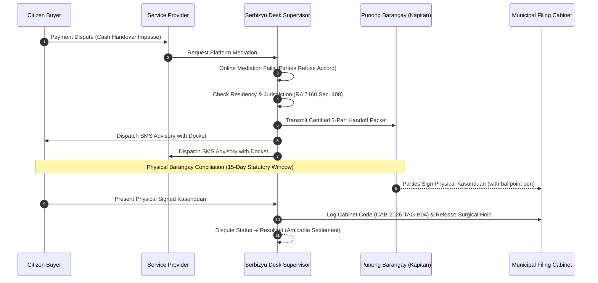

# Serbizyu 2.0 - Admin Operations Workbench Architecture & Concrete Implementation Specification

## 1. Executive Purpose & Core Thesis
The Admin System in Serbizyu 2.0 is a **desktop investigation, mediation, and recovery workspace** designed for municipal operators and desk supervisors (e.g., Officer Santos) in Tagudin, Ilocos Sur. It is **not a vanity metric dashboard**, nor is it a duplicate of the consumer marketplace.

> **Central Operational Invariant:**  
> Admin exists to notice, understand, and safely remediate exceptional system states.  
> **Investigation context must always precede control execution.**

```text
TRIAGE (What needs operational attention?) [OPS-001]
       ↓
INSPECTOR (What actually happened across all aggregates?) [OPS-003, OPS-004]
       ↓
GUARDED ACTION (What surgical remediation or legal handoff is required?) [OPS-002, OPS-005, OPS-007]
       ↓
AUDIT EVENT (Who changed it, under what legal justification, and what was the prior state?) [OPS-009]
```

---

## 2. Separation of State Invariants (Decoupled 3-Pipeline Model)

The admin surface strictly preserves the domain boundary separation defined in canonical architecture:

$$\text{Order Agreement} \neq \text{Work Execution} \neq \text{Payment Obligation} \neq \text{Evidence Proof} \neq \text{Dispute / Hold}$$

1. **Order Agreement State:** Terms, agreed total ($₱$), buyer/provider parties, locked snapshot ($v1$).
2. **Work Execution State:** Milestone DAG flow, physical/digital progress ($66\%$), verified evidence gates.
3. **Payment Obligation State:** Custody lane (External Cash vs Digital Escrow), attestations, reconciliation status.
4. **Evidence Proof:** Checkpoint photos, EXIF timestamps, GPS coordinates, and SHA-256 integrity hashes.
5. **Dispute & Administrative Hold:** Surgical freeze on a specific aggregate without blocking unrelated work.

> **Standing Invariant (Surgical Holds):**  
> Placing an administrative hold on a contested payment obligation (e.g., `#OBL-881`) **must never terminate or freeze physical on-site work execution** unless explicit emergency safety grounds are cited.

---

## 3. Dual-DAG Architecture in Universal Inspector (`/admin/inspect`) [OPS-003]

Serbizyu 2.0 explicitly models and displays two distinct levels of Directed Acyclic Graph (DAG) coordination:

```text
┌────────────────────────────────────────────────────────────────────────────────────────┐
│ 1. MACRO-LEVEL: DEAL CHAIN DAG RELAY (Vendor-to-Vendor Coordination)                   │
│                                                                                        │
│ [ Merchant: Parts Sourcing ] ──► [ Courier: Express Transit ] ──► [ Tech: Installation ] │
│   (Tagudin Hardware ₱450)        (Tricycle Courier ₱60)          (Arman Electric ₱90)  │
│        [Completed ✓]                   [Completed ✓]             [CURRENT ORDER ⚡]    │
│                                                                        │               │
│                                           [ Gate: Customer Acceptance ] ┘               │
│                                                        ↓                               │
│                                           [ Inspector: Safety Audit ₱0 ]               │
│                                                    [Gated 🔒]                          │
└────────────────────────────────────────────────────────────────────────────────────────┘

┌────────────────────────────────────────────────────────────────────────────────────────┐
│ 2. MICRO-LEVEL: WORK MILESTONE DAG CHAIN (Step-to-Step Physical Execution)              │
│                                                                                        │
│ [ Step 1: Disassembly ] ──► [ Gate Cleared ✓ ] ──► [ Step 2: Soldering ] ──► [ Gated ] │
│   (Photo Verified ✓)        (Casing Removed)       (In Progress ⚡)       (Load Test) │
│                                                                                ↓       │
│                                                                     [ Step 3: Spin ]   │
│                                                                        (Multimeter)    │
└────────────────────────────────────────────────────────────────────────────────────────┘
```

### 3.1 Macro-Level: Deal Chain DAG Relay
- **Concept:** Represents multi-vendor commercial contracts where multiple independent merchants, couriers, and technicians collaborate to fulfill a complex request.
- **Visual Presentation:** A horizontal connected node relay showing vendor roles (`merchant`, `courier`, `technician`, `inspector`), individual fees, gate prerequisites, and an explicit **`[INSPECTED ORDER]`** badge highlighting the current transaction.
- **Standalone Contrast:** Orders that are bilateral (e.g., A4 Bakery retail) clearly state: *Standalone Direct Order (No Upstream/Downstream Dependencies)*.

### 3.2 Micro-Level: Work Milestone DAG Chain
- **Concept:** Represents the physical or digital milestones of the specific service being rendered under governed blueprints (A1, A3, A4, A9).
- **Visual Presentation:** Rendered on a dot-matrix flow canvas (`bg-[radial-gradient(...)] 16px 16px`) with milestone cards, active pulse indicators, and transition gates (`Gate Cleared ✓` vs `Gated 🔒`).
- **Evidence Verification:** Each milestone card embeds its mandatory evidence checkpoint (e.g., `Photographic disassembly`, `Parts store receipt`, `Digital multimeter load test`).

---

## 4. Barangay Lupon Tagapamayapa Handoff & Evidentiary Custodian Protocol (RA 7160 / REQ-GOV-03)

### 4.1 Real-World Role Boundary
The Serbizyu Admin Operator (e.g., Officer Santos) is **NOT a judicial official, Punong Barangay, or Lupon Member**.  
The platform acts strictly as an **Evidentiary Custodian** under PRD §6.5 (REQ-GOV-03):
- The platform does not adjudicate legal guilt.
- The platform compiles an official, notarization-ready case file when online mediation reaches an impasse.
- The platform steps aside while local barangay officials conduct statutory conciliation.



### 4.2 The 3-Part Certified Handoff Packet
When an admin clicks **`Prepare Handoff Packet for Kapitan`**, the system compiles a 3-part document packet ready for physical printing via `window.print()`:

1. **Part 1: Transmittal Letter to the Punong Barangay (Kapitan):**
   - Official LGU Tagudin heading with receiving Barangay Hall name.
   - Bilingual (Tagalog/English) legal transmittal summarizing the transaction facts, claims, and reason for impasse under Chapter 7, Title I, Book III of RA 7160.
   - Endorsed by the Desk Supervisor as an attested factual record.
2. **Part 2: Certified Evidentiary Exhibit Index:**
   - Detailed ledger of all uploaded checkpoint photographs, inspection timestamps, GPS tags, and **SHA-256 tamper-evident integrity hashes** (`sha256:8f4c...`).
   - Attested true copies extracted from immutable server logs.
3. **Part 3: Pre-Formatted Kasunduan sa Pag-aayos (Amicable Settlement) Worksheet:**
   - Traditional Philippine Katarungang Pambarangay settlement template.
   - Ruled pen lines for the Kapitan and parties to hand-write agreed compromise terms at the Barangay Hall session.
   - Physical signature blocks with dotted lines for:
     - `Nagrereklamo (Complainant)`
     - `Inirereklamo (Respondent)`
     - `Hon. Punong Barangay / Lupon Chairman`
     - `Barangay Secretary (Witness)`

### 4.3 Logging Returned Physical Paperwork
When the parties or LGU liaison return from the Barangay Hall with the paper document:
- Operator clicks **`Log Document Returned from Barangay Hall`**.
- Records whether a **Signed Kasunduan** or a **Katibayan (Certificate to File Action)** was received.
- Enters the presiding Punong Barangay's name, settlement terms, and the physical filing cabinet reference code (e.g., `CAB-2026-TAG-B04`).
- The system automatically clears the surgical hold on the obligation, updates dispute status to `Resolved`, and writes an immutable audit event to the case history.

---

## 5. Least-Privilege Identity & Credential Vetting Studio (`OPS-002` / RA 10173)

### 5.1 Legal & Privacy Mandate (Data Privacy Act of 2012)
Citizen identity documents (PRC Board Licenses, DTI Business Registrations, TESDA NC2 Certificates, Barangay Clearances, and LTO Driver's Licenses) contain sensitive personal information (PII). In accordance with RA 10173:
1. **Default-Masked Display:** Raw government ID numbers, birthdates, and portrait photos are blurred with an opaque overlay by default (`[🔒 PII Document Masked under RA 10173]`).
2. **Audited Reveal Challenge:** Unmasking a document requires the supervisor to submit an operational justification (e.g., *Auditing dry seal / anti-tamper watermark*, *Cross-checking registration number with LGU database*).
3. **Attributable Watermark:** When unmasked, an immutable watermark badge (`Audited View · Officer Santos`) is embedded over the preview, and an entry is written to the append-only audit trail.

### 5.2 Four-Point Credential Checkpoints
Every credential must pass four standardized checkpoints before authorization:
- `Issuer Authority Recognized:` Verification against PRC, TESDA, DTI, or LGU Tagudin authority databases.
- `Validity & Expiry Active:` Verification that the document has not expired.
- `Name Matches Citizen Profile:` Exact string comparison between legal document name and registered platform identity.
- `Anti-Tamper Hologram / Security Check:` Visual confirmation of official watermarks, dry seals, or QR verification codes.

### 5.3 Granular Trade Capability Gates (A1/A3/A4/A9)
Accreditation is strictly **capability-bound** rather than a blanket verification badge:
- **A1 Residential Electrical Repairs:** Unlocks residential breaker replacement and high-voltage wiring; requires 1000V insulated hand tools and multimeter.
- **A1 Custom Carpentry & Furniture:** Unlocks structural timber millwork; requires circular saw and thickness planer.
- **A3 Centrifugal Pump Diagnostics:** Unlocks on-site heavy machinery diagnostic assessment; requires bearing puller, pressure gauge, and LOTO safety kit.
- **A4 Retail Batch Food Handoff:** Unlocks commercial food preparation; requires sanitary sealed containers and thermal delivery carriers.
- **A9 Motorcycle Courier Relay:** Unlocks express parcel delivery; requires DOT helmet and waterproof carrier box.

---

## 6. Executive Unit Economics & GMV Target Governance (`OPS-004` & `OPS-008` / PRD-059)

### 6.1 Inviolable Zero-Commission External Cash Rule (PRD-059)
- Serbizyu **NEVER collects commission or takes custody of direct Peer-to-Peer Cash** transacted between citizens and local providers in Tagudin.
- Declared P2P Cash volume (e.g., $₱14,250.00$) balances to strictly **$₱0.00$ platform fee**.
- Reporting cash volume as platform revenue is an audit failure.

### 6.2 Executive Target Cards
The financial console features 3 high-impact executive target cards:
1. **Marketplace GMV (Gross Economic Activity):** Displays total commercial volume ($₱182,450.00$) with a built-in progress bar tracking the municipal pilot goal ($73\%$ of $₱250\text{k}$ Target).
2. **Peer-to-Peer Cash (Zero Platform Take):** Highlights non-custodial direct cash volume ($₱14,250.00$) with $0\%$ platform take badge.
3. **Net Platform Margin (Runway Sustainability):** Earned catalog revenue ($₱3,500.00$) minus fixed monthly infrastructure costs ($₱1,840.00$) yielding $+₱1,660.00$ net margin ($+47.4\%$ margin).

### 6.3 Double-Entry General Ledger & Trial Balance
- Uses standardized 4-digit chart of accounts:
  - `1010` — External Cash Clearing (Debits = Credits = $₱14,250.00$, Drift = $0.00\%$)
  - `1020` — External Digital Proof Clearing (GCash / Maya screenshots)
  - `2010` — Tiwala Escrow Custodial Liability (Held in digital custody)
  - `4010` — Earned Catalog Promotion Revenue (Boosted listings)
  - `5010` — Operating Infrastructure Expense (SMS gateway + VPS hosting)
- Trial balance maintains zero ledger drift: $\sum \text{Debits} = \sum \text{Credits}$.

---

## 7. System Reliability, Outbox & Verifiable Disaster Recovery (`OPS-007` & `OPS-009`)

### 7.1 Transactional Outbox Dead-Letter Replay (OPS-007)
- Guaranteed asynchronous message and webhook delivery without dual-write race conditions.
- Failed tasks (e.g., Semaphore/TextBee SMS gateway $504$ timeouts) park in the Dead-Letter Queue after 3 retries.
- Replaying a message is **idempotent**: it dispatches the exact payload without altering business aggregates or double-charging.
- Payload Inspector Sheet allows examining raw JSON headers, correlation IDs, and execution diagnostic traces.

### 7.2 Verifiable Disaster Recovery Rehearsals (OPS-009)
- **Standing Invariant:** Backup and recovery readiness is **never assumed or green by default**; it must be proven via verifiable drill evidence.
- Benchmarks:
  - **Recovery Point Objective (RPO):** $15\text{ Minutes}$ via continuous PostgreSQL Write-Ahead Logging (WAL) archiving.
  - **Recovery Time Objective (RTO):** $42\text{ Minutes}$ benchmarked restore time into an isolated container.
  - **Schema Checksum Parity:** $100\%$ match across all 58 canonical tables with $0$ drift.
- Live Terminal Console displays automated restore drill logs; operators can trigger an on-demand disposable sandbox rehearsal.

---

## 8. Concrete Database Schema & Migration Roadmap

To implement the backend for these administrative capabilities, the following database tables must be migrated:

```sql
-- 1. Administrative Surgical Holds
CREATE TABLE administrative_holds (
    id UUID PRIMARY KEY DEFAULT gen_random_uuid(),
    reference VARCHAR(32) UNIQUE NOT NULL, -- e.g. HLD-2026-0881
    target_aggregate_type VARCHAR(64) NOT NULL, -- e.g. PaymentObligation, WorkInstance
    target_aggregate_id VARCHAR(64) NOT NULL, -- e.g. OBL-881
    order_id UUID NOT NULL REFERENCES orders(id),
    placed_by_user_id UUID NOT NULL REFERENCES users(id),
    hold_reason_code VARCHAR(64) NOT NULL, -- e.g. cash_mismatch, quality_variance
    audit_justification TEXT NOT NULL,
    status VARCHAR(32) NOT NULL DEFAULT 'active', -- active, released, superseded
    released_by_user_id UUID REFERENCES users(id),
    released_at TIMESTAMPTZ,
    release_reason_code VARCHAR(64),
    release_notes TEXT,
    created_at TIMESTAMPTZ NOT NULL DEFAULT NOW(),
    updated_at TIMESTAMPTZ NOT NULL DEFAULT NOW()
);

-- 2. Barangay Lupon Tagapamayapa Referrals (RA 7160)
CREATE TABLE barangay_lupon_referrals (
    id UUID PRIMARY KEY DEFAULT gen_random_uuid(),
    docket_number VARCHAR(64) UNIQUE NOT NULL, -- e.g. KP-2026-TAG-082
    dispute_id UUID NOT NULL REFERENCES disputes(id),
    order_id UUID NOT NULL REFERENCES orders(id),
    receiving_barangay VARCHAR(64) NOT NULL, -- e.g. Barangay Farola
    municipality VARCHAR(64) NOT NULL DEFAULT 'Tagudin',
    province VARCHAR(64) NOT NULL DEFAULT 'Ilocos Sur',
    complainant_user_id UUID NOT NULL REFERENCES users(id),
    respondent_user_id UUID NOT NULL REFERENCES users(id),
    referral_grounds VARCHAR(64) NOT NULL, -- cash_mismatch, quality_breach, impasse
    mediator_case_notes TEXT,
    evidence_manifest_hash VARCHAR(128) NOT NULL, -- SHA-256 seal of all exhibits
    status VARCHAR(32) NOT NULL DEFAULT 'in_conciliation', -- in_conciliation, amicable_settled, certificate_issued
    statutory_deadline_at TIMESTAMPTZ NOT NULL, -- referral_date + 15 days
    outcome_recorded_at TIMESTAMPTZ,
    outcome_officer_name VARCHAR(128),
    outcome_terms TEXT,
    physical_cabinet_ref VARCHAR(64), -- e.g. CAB-2026-TAG-B04
    created_at TIMESTAMPTZ NOT NULL DEFAULT NOW(),
    updated_at TIMESTAMPTZ NOT NULL DEFAULT NOW()
);

-- 3. Audited Credential Vetting & Access Challenges (RA 10173)
CREATE TABLE identity_vetting_dossiers (
    id UUID PRIMARY KEY DEFAULT gen_random_uuid(),
    reference VARCHAR(32) UNIQUE NOT NULL, -- e.g. ID-2026-45
    user_id UUID NOT NULL REFERENCES users(id),
    document_classification VARCHAR(64) NOT NULL, -- prc_board_license, tesda_nc2, dti_bnr, lgu_clearance
    document_type_label VARCHAR(128) NOT NULL,
    masked_document_number VARCHAR(64) NOT NULL,
    encrypted_document_path VARCHAR(255) NOT NULL,
    target_trade_capability VARCHAR(64) NOT NULL, -- e.g. A1_RESIDENTIAL_ELECTRICAL
    work_shape_code VARCHAR(8) NOT NULL, -- A1, A3, A4, A9
    valid_until_date DATE NOT NULL,
    status VARCHAR(32) NOT NULL DEFAULT 'pending_review', -- pending_review, approved, needs_info, rejected
    reviewed_by_user_id UUID REFERENCES users(id),
    reviewed_at TIMESTAMPTZ,
    decision_notes TEXT,
    created_at TIMESTAMPTZ NOT NULL DEFAULT NOW()
);

CREATE TABLE identity_unmask_audit_logs (
    id UUID PRIMARY KEY DEFAULT gen_random_uuid(),
    dossier_id UUID NOT NULL REFERENCES identity_vetting_dossiers(id),
    operator_user_id UUID NOT NULL REFERENCES users(id),
    access_reason_code VARCHAR(64) NOT NULL,
    custom_justification TEXT,
    client_ip VARCHAR(45) NOT NULL,
    accessed_at TIMESTAMPTZ NOT NULL DEFAULT NOW()
);
```

---

## 9. Downstream Implementation Checklist for Engineers

- [ ] **Middleware:** Ensure `EnsureAdminAccess` checks role assignments, not access tiers.
- [ ] **Database Seeders:** Seed the 43 Tagudin Barangays into a reference lookup table.
- [ ] **PDF Generator / Printing:** Utilize standard print CSS (`@media print`) so the 3-part Handoff Packet prints cleanly on letter/A4 paper with page breaks.
- [ ] **Audit Trailing:** Ensure every hold placement, hold release, document unmasking, and Lupon outcome recording writes an immutable row to `admin_audit_logs`.
- [ ] **SMS Integration:** Connect `dispatchSmsNotice` to the TextBee GSM / Semaphore gateway service via the Transactional Outbox.
- [ ] **Zero-Fee Integrity:** Add unit test ensuring that transactions with `lane === 'external_cash'` always evaluate platform commission to $0.00$.
