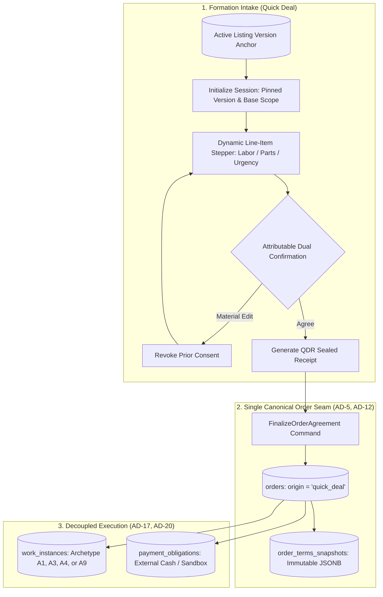
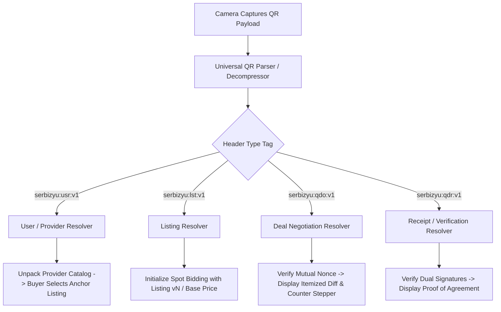
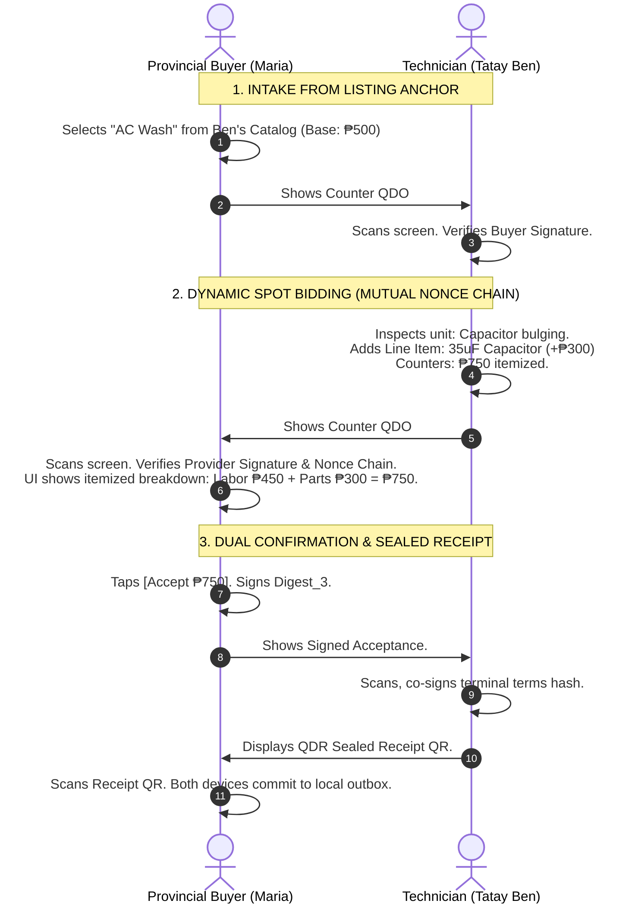
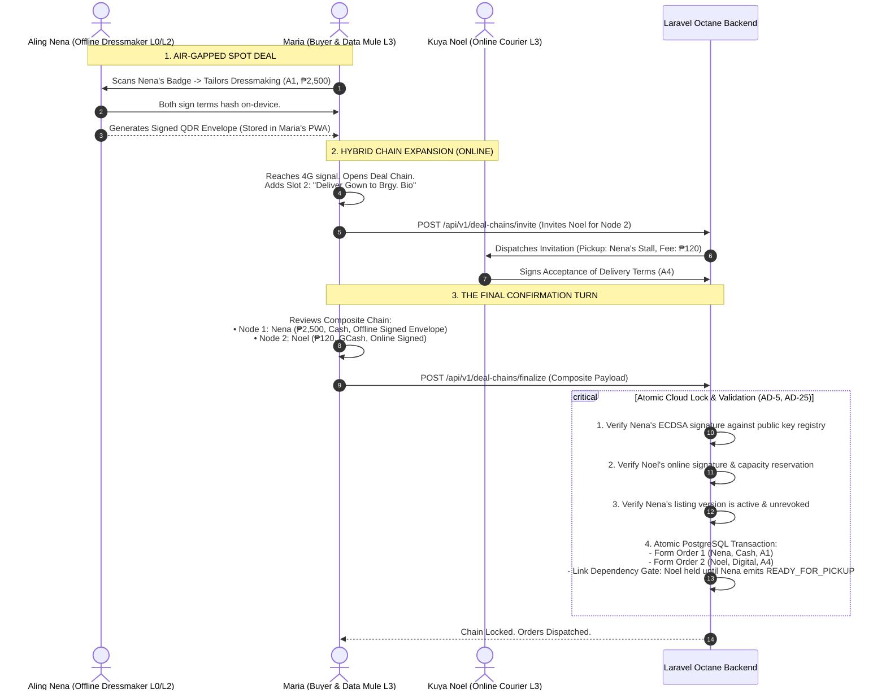
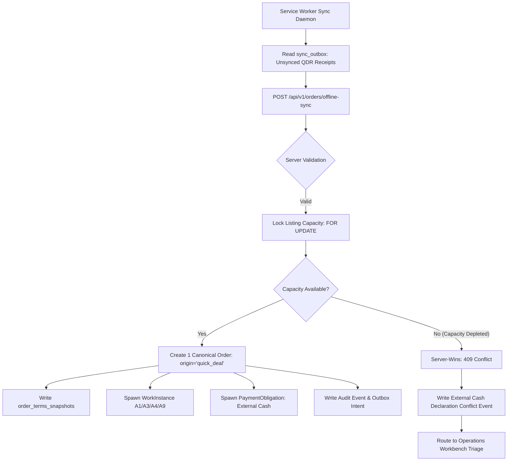

# Serbizyu 2.0 — Quick Deal, Universal Resolver & Hybrid Deal-Chaining Architecture Specification

**Document Reference:** `docs/architecture/quick-deal-and-universal-resolver-architecture.md`  
**Status:** RATIFIED SYSTEM SPECIFICATION  
**Scope:** Universal QR Resolution, Air-Gapped Optical Data Transfer (Fountain Codes), Listing-Anchored Spot Bidding, Mutual Nonce Chaining, Hybrid Data-Mule Deal Chaining, and Server-Wins Reconciliation.  
**Binds:** `ARCHITECTURE-SPINE.md` (`AD-5`, `AD-12`, `AD-13`, `AD-17`, `AD-20`, `AD-22`, `AD-25`), `WAD-1`, `WAD-3`, `QDS-REQ-001..008`.

---

## 1. Architectural Foundations & Invariants



### 1.1 Mandatory Invariants
1. **The Listing is the Atomic Anchor (`AD-5`, `WAD-1`):** An Order cannot form without a listing anchor. The selected active, owned Listing Version provides the validated Work Archetype (**A1** Linear Project, **A3** Appointment, **A4** Handoff, **A9** Digital Deliverable), Category safety policies, and capability profiles.
2. **Quick Deal is Spot Bidding, Not a Parallel System (`AD-12`):** Quick Deal is strictly an order-formation mechanism. It replaces simple price bumping with line-item bidding (labor deltas, materials/parts, urgency surcharges, inclusions/exclusions). All deals converge onto the canonical `orders` table with `origin: 'quick_deal'`.
3. **The Cloud Truth Boundary (`ADR-013`, `ADR-R-017`):** Real digital money balances, escrow holds, and split payouts reside exclusively in the cloud PostgreSQL 16 + Xendit gateway. Offline air-gapped transactions default strictly to **External Cash**. Offline digital escrow generates only a non-authoritative provisional intent.
4. **Decoupled Fulfillment & Payment:** Work completion does not move money; payment release does not prove work quality.
5. **Zero Pooled Escrow (`AD-17`, `AD-20`):** In multi-party Deal Chains, there is no parent wallet, pooled escrow, or collective balance. Each slot forms an independent bilateral child Order with an isolated `PaymentObligation`.
6. **Cross-Provider Liability Shield:** Sibling providers are legally independent. If Node B fails or is delayed, Node A (completed) is settled under its own independent terms; Node B emits `replacement_needed`. Cross-provider penalties are prohibited.
7. **Confirmation Turn at the End:** Every deal slot requires an attributable, version-bound confirmation from both the buyer and the responsible provider before the chain is locked.

---

## 2. Universal QR Resolver Architecture

The camera operates as a typed universal resolver, parsing structured payloads prefixed with the `serbizyu:` URI scheme.



### 2.1 Typed Wire Protocol Specifications

| Type Tag | Meaning | Packing & Format | Offline Behavior |
|---|---|---|---|
| `serbizyu:usr:v1:<data>` | Provider Badge & Mini-Catalog | CBOR + Deflate + Base45 | Unpacks provider ID, P-256 public key, and active multi-listing catalog (`CAT`). Buyer taps one listing to start a Quick Deal. |
| `serbizyu:lst:v1:<data>` | Single Listing Snapshot | Static single-frame QR | Decodes listing ID, version, base price, category, archetype, and standard inclusions without network. |
| `serbizyu:qdo:v1:<data>` | Active Deal Offer / Counter | Animated Fountain or Single Frame | Carries session ID, round number, line-item adjustments, parent nonce, terms hash, and issuer signature. |
| `serbizyu:qdr:v1:<data>` | Sealed Deal Receipt | Static or 2-frame QR | Contains final terms hash, dual ECDSA signatures, settlement mode (`EXTERNAL_CASH`), and offline timestamp. |

### 2.2 Wire Schemas

#### A. Provider Multi-Listing Catalog (`CAT`)
```json
{
  "t": "CAT",
  "v": 1,
  "uid": "USR-BEN-01",
  "name": "Ben's Refrigeration & HVAC",
  "pubkey": "MFkwEwYHKoZIzj0CAQYIKoZIzj0DAQcDQgAE...",
  "area": "Tagudin Centro",
  "items": [
    {
      "lid": "SRV-101",
      "ver": "3",
      "title": "AC Chemical Wash",
      "price": 50000,
      "shape": "A1",
      "options": ["Split Type", "Window Type"]
    },
    {
      "lid": "SRV-102",
      "ver": "1",
      "title": "Capacitor Replacement",
      "price": 35000,
      "shape": "A1",
      "options": ["Fan Run", "Compressor Start"]
    }
  ],
  "ts": 1784930400,
  "sig": "MEQCIC8x9..."
}
```

#### B. Itemized Counter-Offer Frame (`QDO`)
```json
{
  "t": "QDO",
  "v": 1,
  "sid": "QD-7F89B2",
  "lid": "SRV-101",
  "lver": "3",
  "round": 2,
  "issuer": "USR-BEN-01",
  "parent_nonce": "9a8b1c2d",
  "lines": [
    { "type": "LABOR", "desc": "Split Inverter Deep Chemical Wash", "amount": 45000 },
    { "type": "MATERIAL", "desc": "35uF OEM Run Capacitor", "amount": 30000 }
  ],
  "total_amount": 75000,
  "currency": "PHP",
  "scope_mods": {
    "inclusions": ["Blower wheel removal", "Drain pan flush"],
    "exclusions": ["Circuit board repair"]
  },
  "settlement": "EXTERNAL_CASH",
  "nonce": "e3f4a5b6",
  "ts": 1784930610,
  "sig": "MEQCID3k9L8..."
}
```

#### C. Sealed Deal Receipt (`QDR`)
```json
{
  "t": "QDR",
  "v": 1,
  "sid": "QD-7F89B2",
  "oid": "ORD-OFFLINE-9821A",
  "terms_hash": "0x4b89e2f491c...",
  "final_amount": 75000,
  "settlement": "EXTERNAL_CASH",
  "buyer_id": "USR-ROSA-01",
  "buyer_sig": "MEQCID3k9L8...==",
  "provider_id": "USR-BEN-01",
  "provider_sig": "MEQCIH8a1P2...==",
  "sealed_at": 1784930720
}
```

---

## 3. Optical Transport & Physical Bounds

### 3.1 Erasure Coding: BC-UR Luby Transform Reality
* **Standards Realignment:** Blockchain Commons Uniform Resource (BC-UR) multipart uses **Luby Transform (LT)** rateless codes, not RFC 6330 RaptorQ.
* **Overhead Factor:** LT requires an overhead multiplier $\gamma \approx 1.25\text{--}1.35$ (i.e., capturing $1.3 \times K$ frames on average to solve the linear system).
* **CRC32 vs Cryptography:** The CRC32 embedded in BC-UR frames provides transport integrity only. Cryptographic attribution and tampering prevention are provided strictly by the ECDSA P-256 payload signatures.

### 3.2 Optical Latency Formulation & The 3-Second Boundary
The total physical scan time is governed by:
$$T_{\text{scan}} = t_{\text{focus}} + \frac{K \cdot \gamma}{\text{FPS} \cdot p_{\text{good}}} + t_{\text{decode}}$$

Where:
* $t_{\text{focus}} + t_{\text{decode}} \approx 1.0\text{s}$ on budget Android camera sensors under ambient glare.
* $\text{FPS} = 3.5$ frames per second (285ms frame hold to accommodate camera exposure cycles).
* $p_{\text{good}} \approx 0.65$ (probability of an unblurred, readable frame capture during hand shake).

$$\text{For } T_{\text{scan}} \le 3.0\text{s}: \quad \frac{K \cdot 1.3}{3.5 \cdot 0.65} \le 2.0\text{s} \implies K \le 3.5 \text{ source blocks}$$

### 3.3 Frame Budget & Packing Capacity
* **Module Density:** QR Code Version 5 (37×37 modules) with Medium (M) Error Correction yields $\approx 86$ usable bytes per frame after Base45 and UR headers.
* **Effective Single-Frame Limit:** $3.5 \times 86 \text{ bytes} \approx 300\text{ bytes}$ uncompressed payload capacity.
* **Catalog Capacity Ceiling:** A multi-listing catalog compressed via Deflate Level 9 averages $\approx 80\text{ bytes}$ per listing. 
  * **Rule:** A provider QR badge can stream **at most 3 to 5 compact listings** while remaining within the 3-second scan ceiling. Catalogs exceeding 5 listings must use online static rendezvous or require the provider to select a single listing to display as an `LST` QR.

---

## 4. Spot-Bidding State Machine & Mutual Nonce Chaining



### 4.1 Mutual Nonce Chaining Formula
To prevent replay attacks, offer re-ordering, or un-agreed term injection, each round $n$ computes:
$$\text{Digest}_n = \text{SHA256}\left(\text{SessionID} \parallel \text{Round}_n \parallel \text{Nonce}_{\text{issuer}} \parallel \text{Nonce}_{\text{peer\_echo}} \parallel \text{TermsHash}_n \parallel \text{Digest}_{n-1}\right)$$

* Round 1 (Initiator): Generates random $\text{Nonce}_1$.
* Round 2 (Counterparty): Echoes $\text{Nonce}_1$, generates random $\text{Nonce}_2$, and binds new terms.
* Round $n$: Echoes $\text{Nonce}_{n-1}$, generates $\text{Nonce}_n$.
* Terminal Receipt: Both parties sign $\text{Digest}_{\text{terminal}}$. The server enforces `UNIQUE(session_id, terminal_digest)` and `UNIQUE(nonce, signer_id)`.

---

## 5. Hybrid Deal-Chaining & The Data Mule Pattern



### 5.1 Data Mule Protocol Rules
1. **The Data Mule Bridges Bytes, Not Authority:** An L3 buyer or runner carrying an L2 provider's signed `QDR` envelope acts as an untrusted carrier. The cloud authenticates the envelope against the provider's registered public key and re-validates listing versions and capacity under a database lock.
2. **The Final Confirmation Turn:** A Deal Chain is never locked piecemeal. The buyer, offline provider, and online courier must all have current, version-bound signed terms. Only when all slots are confirmed does the transaction coordinator commit the graph.
3. **Execution Gating via Macro/Micro Separation:** Noel (the courier) is not dispatched immediately. Node 2 is held at `WAITING_FOR_DEPENDENCY` until Nena (the dressmaker) reaches her work milestone and emits `READY_FOR_PICKUP`.


### 5.2 The 4 Connectivity States & Transport Carrier Matrix

| State | Provider | Buyer | Initial Scan | Negotiation Medium | Total Optical Scans | Final Order Authority |
|---|---|---|---|---|---|---|
| **1. Online-Online** | L3 (4G) | L3 (4G) | `RDV` (Opaque Pointer) | WebSockets (Reverb) | **1 Scan** | Immediate Cloud Commit |
| **2. Air-Gapped** | L2 (PWA) | L2 (PWA) | `CAT` / `LST` (Full Payload) | Optical Frames (`QDO`) | **2–3 Scans** | Local Outbox → Reconnect Sync |
| **3. Hybrid (Mule)**| L2 (PWA) | L3 (4G) | `CAT` / `LST` (Full Payload) | Dual Optical Loop | **2 Scans** | Immediate via Mule Uplink |
| **4. Hybrid (SMS)** | L0 (Phone)| L3 (4G) | `USR` / Verbal Code | Cloud SMS Gateway | **0–1 Scan** | SMS OTP Inbound Webhook |

#### A. State 1 (Online $\leftrightarrow$ Online): Single-Scan Rendezvous
* QR encodes an ephemeral 16-byte random token (`https://serbizyu.app/q/<token>`, ~44 raw bytes, QR Version 2, 25×25 modules).
* Buyer scans **once**; both subscribe to private presence channel `private-quickdeal.{token}` on Laravel Reverb.
* Negotiation, line-item adjustments, and dual confirmations pass over WebSockets in real time. **Zero further optical scans.**
* Server executes `FinalizeOrderAgreement` atomically under a database lock (`AD-5`), reserving capacity and creating the accepted Order instantly.

#### B. State 2 (Offline $\leftrightarrow$ Offline): Multi-Turn Optical Ping-Pong
* Full optical air-gapped protocol: Turn 1 Catalog Ingestion (`CAT`/`LST`) $\to$ Turn 2 Counter-Offer (`QDO`) $\to$ Turn 3 Dual Sealed Receipt (`QDR`).
* Uses BC-UR v2 (dCBOR + minimal Bytewords) with Luby Transform (LT) erasure coding.
* Settled strictly in **External Cash**. Sealed receipt committed to IndexedDB outbox.

#### C. State 3 (Hybrid: Provider Offline L2, Buyer Online L3): Verified Mule Protocol
* Buyer scans provider's offline listing QR.
* Buyer's phone posts `POST /api/v1/quick-deal/propose-hybrid` with proposed terms; cloud places a 10-minute provisional capacity hold and returns a cloud-leased proposal token.
* Buyer displays return `QDO` QR to offline provider; provider inspects terms and signs on-device with their P-256 private key.
* Provider displays signed `QDR` envelope; buyer scans and uploads to `POST /api/v1/quick-deal/finalize-hybrid`.
* Cloud verifies provider's signature against public key registry and finalizes order atomically. **The online party cannot commit unilaterally without the offline party's on-device cryptographic signature.**

#### D. State 4 (Hybrid: Provider L0 SMS, Buyer Online L3)
* Buyer initiates deal online; cloud sends SMS challenge to provider: `"Serbizyu: Maria Santos proposes AC Cleaning for ₱750 cash. Reply APPROVE 8492 to accept or DECLINE."`
* Provider replies `APPROVE 8492` via SMS. Cloud validates OTP via TextBee webhook and commits order.

### 5.3 Mid-Flight Network Transitions & Downgrade Prevention

1. **Mid-Flight 4G Drop (WebSocket $\to$ Optical Fallback):**
   * When connection drops mid-session, PWA performs a **CAS Epoch Handoff**: preserves active session ID, pinned listing version, round number, and accumulated nonce digest.
   * Seamlessly renders the active state as an optical `QDO` QR frame so parties continue air-gapped.
   * If negotiation started with digital escrow online, dropping offline **forces an explicit settlement reconfirmation**: *"Connection lost. To continue air-gapped, this deal must switch to External Cash."*
2. **Anti-Downgrade Safeguards:**
   * Client network claims are untrusted. A malicious user cannot turn on airplane mode to evade account suspension or capacity limits.
   * When an offline QDR is synced later, the cloud executes real-time capacity and suspension checks under a database lock. Depleted capacity triggers `409 Conflict (capacity_exhausted)` and logs an `EXTERNAL_CASH_DECLARATION_CONFLICT` audit event without reversing physical cash.
---

## 6. Server-Wins Conflict Resolution & Partition Tolerance

When an offline deal is uploaded to `POST /api/v1/orders/offline-sync`:



### 6.1 Conflict Decision Matrix
1. **Advisory Offline Clocks:** `offline_created_at` recorded by mobile devices is treated as advisory metadata. Server receive time controls database sequence, TTL validation, and outbox scheduling.
2. **Capacity Depletion on Reconnect:**
   * If a provider transacted a Quick Deal offline, but their capacity slot was depleted by an online booking in the interim, the server enforces **Server-Wins**.
   * The transaction fails with `409 Conflict (capacity_exhausted)`.
   * **Cash Irreversibility Rule:** Because physical currency was already exchanged face-to-face, the platform cannot seize or reverse cash. The server records an immutable `EXTERNAL_CASH_DECLARATION_CONFLICT` audit event and flags the provider account for field operator reconciliation.
3. **Idempotent Duplicate Replay:**
   * Idempotency key: $\text{SHA256}(\text{BuyerSig} \parallel \text{ProviderSig} \parallel \text{Nonce})$.
   * Concurrent uploads from both the buyer and provider return `200 OK` with the identical Order ID; no duplicate rows are created.

---

## 7. Prototype Remediation Plan (`app/Http/Controllers/DealChainController.php`)

An adversarial code audit identified four critical defects in the current Deal Chain backend controller:

```
[Defect 1: Line 369]
- Error: Sets `status = 'pending'` on `deal_invitations` insertion.
- Constraint: `ck_deal_invitations_status` allows only ('draft', 'sent', 'viewed', 'accepted', 'declined', 'expired', 'revoked', 'superseded', 'cancelled').
- Fix: Change insert status to 'sent' (or 'draft').

[Defect 2: Line 351]
- Error: Indexes `$slotOverrides[$node['key']]`, but React callers submit `node.type` ('store', 'delivery', 'labor').
- Impact: Selected provider candidate overrides are silently discarded.
- Fix: Standardize lookup: `$slotOverrides[$node['key']] ?? $slotOverrides[$node['type'] ?? '']`.

[Defect 3: Lines 332-340]
- Error: Staged Need insertion writes only title, description, and quantity text; discards listing ID and version.
- Impact: The chain loses its Listing Version anchor, violating AD-5.
- Fix: Persist `listing_id`, `listing_version`, and `provider_id` in the staged Need record.

[Defect 4: Lines 590-594]
- Error: `slotCandidates()` injects fake string IDs ('can_cour_bicycle', 'can_recycle_1').
- Impact: Causes foreign key failures; candidates cannot form valid child Orders.
- Fix: Replace synthetic IDs with seeded, active Listing Version UUIDs.
```

---

## 8. Verification & Test Evidence Contracts

Every implementation of Quick Deal and Universal Resolver must satisfy the following automated verification gates:

1. **Optical Envelope Decode Test:** Verify that CBOR + Deflate payloads correctly unpack `USR`, `LST`, `QDO`, and `QDR` formats across simulated camera frame loss.
2. **Mutual Nonce Replay Resistance:** Attempting to submit a counter-offer frame with an echoed nonce from round $n-2$ must fail validation with `STALE_NONCE_CHALLENGE`.
3. **Confirmation Revocation Test:** Updating any line item in a session with prior buyer confirmation must immediately reset `buyer_confirmed_at` to null.
4. **Data Mule Atomic Finalization:** Submitting a hybrid Deal Chain containing one offline signed QDR envelope and one online courier invitation must either create both child Orders and dependency gates atomically or abort with zero database state changes.
5. **Capacity Overdraft Reconnection:** Simulating an offline QDR sync against a depleted listing must produce an `EXTERNAL_CASH_DECLARATION_CONFLICT` audit log and leave financial ledger balances at 0% drift.
