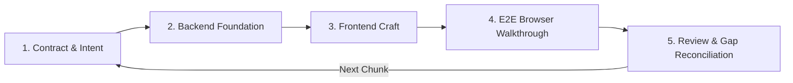
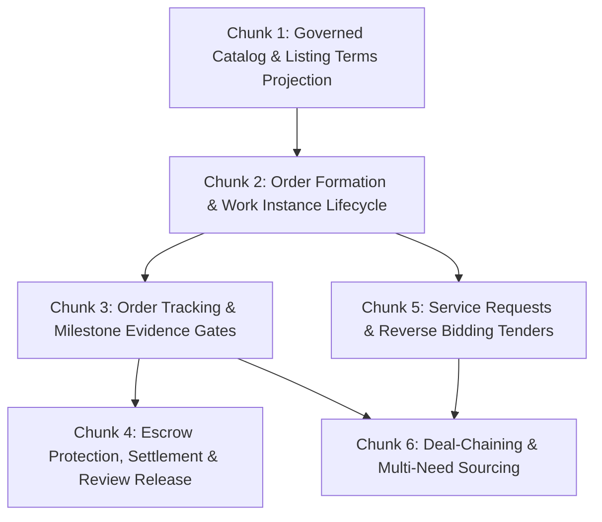

# Serbizyu Iterative Engineering & Cadence Protocol

**Status:** Canonical Engineering Standard  
**Authority:** Architecture Spine (`_bmad-output/planning-artifacts/architecture/architecture-serbizyu-platform-2026-08-09/ARCHITECTURE-SPINE.md`)  
**Scope:** Full-stack development cycle across Listings, Deal-Chaining, Orders/Work, Payments, Trust/Safety, and Citizen UX  

---

## 1. Purpose & Principles

This protocol governs the engineering rhythm for Serbizyu 2.0. It bridges the gap between high-level architectural contracts, exploratory frontend design prototypes, and production backend code.

### Core Principles:
1. **Real Foundations First**: Every user-facing feature must be anchored in real database schemas, migrations, seeders, and application ports. Front-end hardcoded data maps are strictly transient discovery tools and must be replaced by real backend projections.
2. **Zero Dead Ends**: No button, link, or checkout CTA may terminate in a dummy `alert()`, console log, unhandled route, or broken screen. Every interaction must advance the user state machine.
3. **In-Situ Experience**: Overlays (drawers, modals) must feel native—single scrollbar, body scroll locking, overscroll containment, and responsive full-screen behavior on mobile.
4. **Iterative Audit & Gap Reconciliation**: Every completed phase must undergo an End-to-End Browser Walkthrough and Adversarial Review to catch UI friction and architectural drift before the next foundational chunk begins.

---

## 2. The 5-Stage Phase Loop Protocol

Every capability chunk follows a strict, repeatable 5-stage loop:

### Stage 1: Contract & Intent
* Define the domain models, state machines, and API boundary for the slice.
* Reconcile requirements against canonical schema (`canonical-schema-rebuilt.md`) and mockups (`docs/design-kit/` and `old-docs/mockup/screens/`).

### Stage 2: Backend Foundation
* Implement schema migrations, seeders, repository adapters, and command/query services.
* Validate all invariants, optimistic locking, and database constraints with Pest feature tests.
* Verify idempotent command execution and outbox events.

### Stage 3: Frontend Integration & Visual Craft
* Build or upgrade React Inertia views matching the Royal Blue (`#0F2F58`) brand system on clean slate `#F8FAFC`.
* Eliminate slop: use Lucide SVG icons, declare elevation once, eliminate nested cards, and provide high-contrast Plus Jakarta Sans typography.
* Connect all controls directly to backend props and real HTTP routes.

### Stage 4: End-to-End Browser Walkthrough
* Exercise the real user journey in Chromium (desktop $1400\text{px}$ and mobile $390\text{px}$).
* Verify zero dead ends, single-scrollbar enforcement, smooth transitions, and persistent state across page reloads.

### Stage 5: Adversarial Review & Gap Reconciliation
* Audit the resulting code against the architectural spine.
* Document any discovered gaps or edge cases and resolve them before graduating the phase.

---

## 3. Zero-Dead-End Audit Standard

Before any phase is marked complete, it must satisfy the following checklist:

| Criterion | Requirement | Failure Mode (Prohibited) |
|---|---|---|
| **Action Resolution** | Every CTA triggers an API call, navigation, or state update. | Firing `alert()`, `console.log()`, or no-op handlers. |
| **Auth Boundary** | Guest clicks trigger graceful redirect to `/auth/sign-in` (with phone OTP) preserving return intent. | Silent failure, 401 unhandled crash, or infinite reload loops. |
| **Scroll Ergonomics** | Modals and drawers lock `document.body` overflow and prevent double scrollbars or layout shifts. | Two scrollbars on desktop; background page scrolling under modal. |
| **Mobile Form Factor** | Drawers and complex flows become full-screen views on mobile ($< 1024\text{px}$) with explicit back navigation. | Narrow 40px backdrop slivers or cramped mobile sidebars. |
| **Persistence** | Staged items, active filters, and drafts survive refresh via URL query params, `localStorage`, or database records. | Form state wiping out unexpectedly on navigation or refresh. |
| **Error Recovery** | Validation errors and conflict states render actionable notices with recovery paths. | White screens, cryptic JSON errors, or blocked interfaces. |

---

## 4. The 6 Foundational Chunks Delivery Sequence

### Chunk 1: Governed Catalog & Listing Terms Projection
* **Goal**: Persist structured package tiers and work milestone stages inside `listing_versions.terms` JSON.
* **Backend**: Enhance `TagudinBrowseCatalog.php` and `SeedTagudinBrowseCatalog.php` to store package options and milestones. Update `PublicListingDetailQuery.php` and `PublicListingsQuery.php` to project them.
* **Frontend**: Replace hardcoded `CATEGORY_PACKAGES` in `ListingDetail.tsx` with server-projected package tiers.
* **Exit Gate**: Selecting a package tier in `ListingDetail.tsx` is completely driven by database terms; Pest seeder tests and Vitest tests pass.

### Chunk 2: Order Formation & Work Instance Lifecycle
* **Goal**: Formalize immutable agreement creation, terms snapshots, and initial Work & Obligation instances.
* **Backend**: Consolidate `SubmitOrderProposal` and `FinalizeOrderAgreement` with full discriminated source verification, immutable terms snapshots, and canonical Work kernels (A1/A3/A4/A9).
* **Frontend**: Connect `ListingDetail` booking CTA directly to the order proposal route without alerts; render live agreement status on `OrderShow.tsx`.
* **Exit Gate**: Executable test proves transition from listing selection to proposal to finalized accepted order with immutable terms snapshot.

### Chunk 3: Order Tracking & Milestone Evidence Gates
* **Goal**: Provider uploads photo evidence per milestone without conflating upload with contract completion.
* **Backend**: Implement evidence registration in `evidence_files` and shape-specific transitions (A1 progress proposal, A3 attendance verification, A4 handoff confirmation, A9 artifact delivery).
* **Frontend**: Order tracking workspace (`/orders` & `/orders/{id}`) with milestone checklist, photo upload trigger, and role-separated views for buyer and provider.
* **Exit Gate**: Provider submits photo evidence, milestone status reflects verified proof gate, and buyer inspects without unprompted payout release.

### Chunk 4: Escrow Protection, Settlement & Review Release
* **Goal**: Implement the completion ritual (`release` -> `review` -> `rebook`) with canonical hold and dispute checks.
* **Backend**: Implement release command verifying due conditions, absence of active disputes/holds, and balanced ledger posting; persist review into `reviews` table.
* **Frontend**: Buyer completion interface with milestone OTP sign-off, release confirmation, and 5-star review submission form matching `07-review.html`.
* **Exit Gate**: Funds release from escrow only when all holds/dispute checks pass; submitted review immediately projects into the listing's public review suite.

### Chunk 5: Service Requests & Reverse Bidding Tenders (`/requests/create`)
* **Goal**: Enable demand-side tender posting and provider bids.
* **Backend**: Implement `CreateRequest` and `SubmitQuote` commands in `Listings` module with capability profile and category verification.
* **Frontend**: Step-by-step Request Creator (`/requests/create`) and Bid Comparison dashboard (`screens/18` to `screens/21`).
* **Exit Gate**: Citizen posts tender, provider submits quote, and tender acceptance forms an ordinary Order via `FinalizeOrderAgreement`.

### Chunk 6: Deal-Chaining & Multi-Need Sourcing
* **Goal**: Form multi-party deal chains through explicit Deal Needs and per-child agreement finalization.
* **Backend**: Implement Deal Need creation, slot reservations (`deal_slot_reservations`), and child order binding via explicit `FinalizeOrderAgreement` calls.
* **Frontend**: Picks tray checkout, multi-party pipeline visualizer, and Deal Tracker (`screens/25` to `screens/27`).
* **Exit Gate**: Authorizing a deal chain creates parent `deal_chains` + explicit child orders with non-cascading settlement; single failure does not collapse sibling obligations.

---

## 5. Phase Entry & Exit Gates

Before starting a chunk:
* **Entry Gate**:
  1. Cites accepted authority revision (`canonical-schema-rebuilt.md`, `ARCHITECTURE-SPINE.md`).
  2. All predecessor trains must have passing automated feature tests.
  3. Real database migrations and seeders must be in place.
* **Exit Gate**:
  1. `npx tsc --noEmit` -> Zero errors.
  2. Vitest suite passes all unit/integration tests deterministically.
  3. Pest suite passes all backend feature tests (`docker exec serbizyu-sail-laravel.test-1 php artisan test`).
  4. Executable end-to-end browser walkthrough proves zero dead ends (no dummy `alert()`, no unhandled errors).
  5. Clean git commit recorded with verified deliverable evidence.
