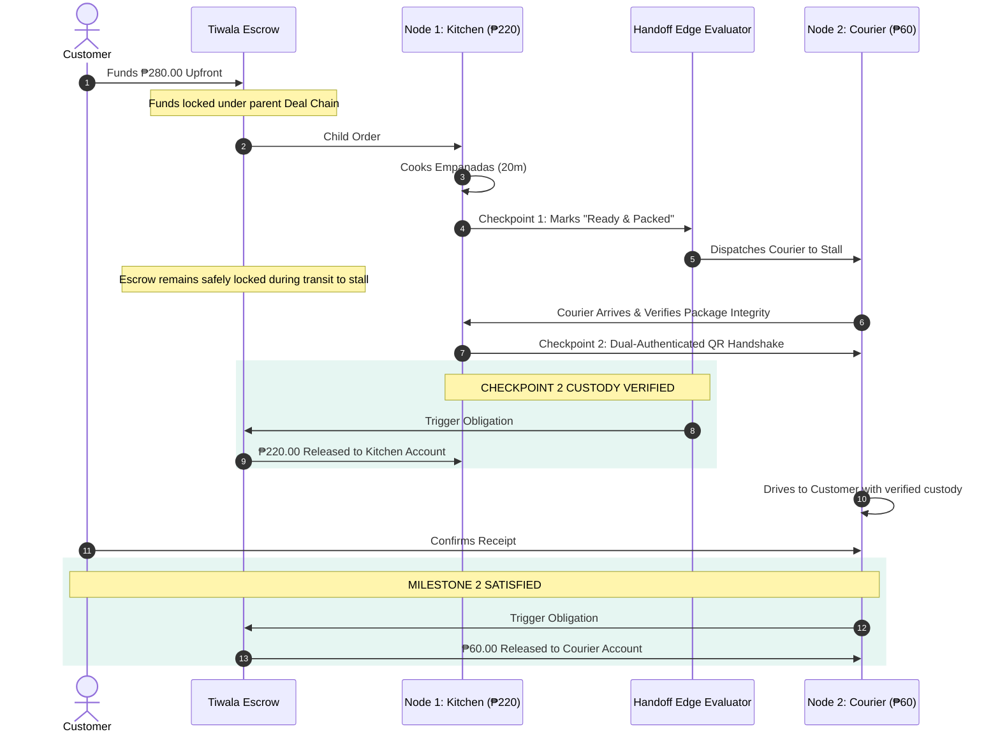
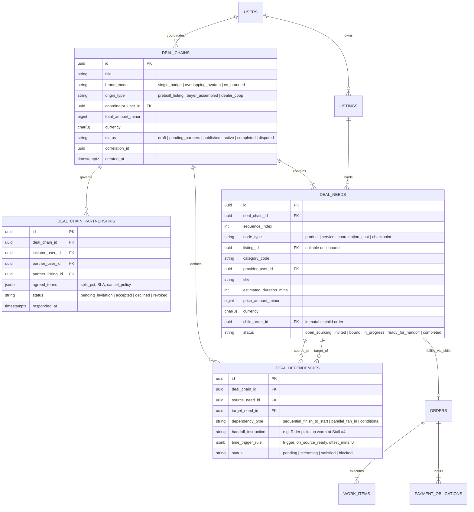

# Serbizyu 2.0 — Deal-Chaining DAG and Settlement Exploration Record

**Document Reference:** `docs/planning-hardening/15-deal-chaining-dag-node-architecture-and-staggered-settlement.md`  
**Status:** HISTORICAL EXPLORATION — NOT AN APPROVED ARCHITECTURE OR SETTLEMENT CONTRACT
**Date:** 2026-09-06  
**Authority:** Supporting discussion only; subordinate to the founder charter and canonical domain/schema/architecture contracts.
**Scope:** Preserved exploration of nodes, handoffs, settlement, and presentation; not migration or implementation authority.

> **Correction:** The text below originally promoted unapproved ideas into architectural decisions. Read the [Deal-Chaining logic soundness review](17-deal-chaining-logic-soundness-review.md) before using this material. The original discussion is preserved as evidence, not endorsed.
>
> In particular: a node is a Deal Need, not the mutable listing itself; chat/checkpoint cards are not approved new Need kinds; the ERD is not canonical (`work_instances` is the existing table, not `work_items`); parent pooled funds and automatic milestone releases are excluded; handoff does not establish payment authority or immunity from disputes; correlation IDs do not deduplicate effects. The proposed branch and readiness-trigger behavior needs explicit domain contracts.

---

## 1. Executive Architectural Summary

Traditional e-commerce architectures rely on a **Shopping Cart**—a flat, uncoordinated bucket of independent items where checkout is a single atomic financial debit. This paradigm fails for local service and on-demand labor platforms because:

1. **Services require human availability, job sites, and scheduling windows**, not simple inventory deductions.
2. **Multi-party jobs carry real-world dependencies:** A plumber cannot install an aircon capacitor that has not yet been delivered; a courier cannot deliver food that has not yet been cooked.
3. **Financial liability must be isolated:** If a delivery rider has an accident en route, the food vendor who already cooked the meal must still be paid. A single failure must not cascade into total financial forfeiture.

To solve this, Serbizyu 2.0 models complex fulfillment as a **Directed Acyclic Graph (DAG) Execution Engine** (inspired by workflow automation platforms like **n8n**), while retaining **ordinary, immutable child orders** at the execution and settlement layer.

---

## 2. Ontological Foundations

### 2.1 Listing as Node (vs. Person as Node)
A human provider (e.g. *Michael Santos*) is an identity with credentials, ratings, and vehicle assets. However, an execution graph cannot wire a person directly; it wires a **Listing**.

* A **Listing** is a legally bounded offer with a defined deliverable, fixed/rate-based price (`price_amount_minor`, `currency`), category code (`category_code`), work shape (`work_shape`), and terms.
* A single provider can own multiple distinct listings (e.g. *Listing #LST-101: Express Motorcycle Delivery* vs. *Listing #LST-102: Passenger Tricycle Ride*).
* Wiring the **Listing as the Node** preserves contract immutability, auditability, and accurate pricing.

### 2.2 Intra-Order Work Milestones vs. Cross-Provider Deal-Chaining
To avoid confusing database modeling:

* **Intra-Order Work Milestones (Single Provider):** If a sequence of tasks is performed by the **same provider under one contract** (e.g. Maya’s Print Shop designing a soft-proof, printing 50 linen cards, and packing them), these are internal milestones on a single `orders` and `work_items` record.
* **Deal-Chaining (Cross-Provider Coordination):** When fulfillment requires **separate independent providers, locations, or distinct liability boundaries** (e.g. Cook preparing food $\rightarrow$ Independent courier delivering it), it is modeled as a **Deal Chain** governing independent child orders.

---

## 3. The 4 Node Primitives

Every Deal Chain in Serbizyu decomposes into four node archetypes:

```
┌─────────────────────────────────────────────────────────────────────────────┐
│ 1. PRODUCT NEED NODE (Physical Goods)                                       │
│    • Sourced from stores, eateries, or material suppliers                   │
│    • Output: Physical item prepared or ready on-site                        │
├─────────────────────────────────────────────────────────────────────────────┤
│ 2. SERVICE NEED NODE (Human Labor & Trade Skills)                           │
│    • Sourced from verified craftspeople, technicians, or drivers            │
│    • Output: Completed service labor, installation, or transport            │
├─────────────────────────────────────────────────────────────────────────────┤
│ 3. COORDINATION / COMMUNICATION NODE (Multi-Party Bridge)                   │
│    • Real-time coordination channel bridging customer and providers         │
│    • Automated dispatch broadcasts and status handoff messages              │
├─────────────────────────────────────────────────────────────────────────────┤
│ 4. CHECKPOINT / MILESTONE NODE (Gatekeeper)                                 │
│    • Customer digital sign-off (e.g. approving proof before printing)       │
│    • Site inspection or physical custody transfer verification              │
└─────────────────────────────────────────────────────────────────────────────┘
```

---

## 4. The Edge Contract & Handoff Semantics

In Serbizyu, the connector edge between two nodes is not a passive line; it is an **active contractual handoff**:

```
[ Node 1: Eatery Kitchen ]
  • Item: 2x Special Empanada (₱220.00)
  • Internal Work Status: Cooking
  • Time Attribute: Prep Time = 20 mins (Ready at 11:45 AM)
         │
         │  EDGE CONTRACT (The Baton Pass)
         │  • Condition: Trigger on Node 1 Work = 'ready_for_pickup'
         │  • Handoff Instruction: "Pickup at Market Stall #4, ask for Order #SZ-22"
         │  • Animated Indicator: Fluid particle dotted stream (no arrowheads)
         ▼
[ Node 2: Motorcycle Courier ]
  • Service: Express Delivery (₱60.00)
  • Time Attribute: Dispatched at 11:45 AM · Delivery ETA 12:10 PM
  • Destination: Barangay Pudoc West
```

### Graph Topologies Supported:
1. **Linear Pipeline (`A ➔ B ➔ C`):** Sequential execution where each step begins immediately upon completion of the prior step.
2. **Parallel Fan-In (`[A1 + A2] ➔ B`):** Multiple procurement steps run concurrently (e.g. Hardware Store supplies + Town Center cables) and must both arrive before technician labor begins.
3. **Conditional Branching:** Execution paths vary based on diagnostic outcomes (e.g. *If repairable on-site $\rightarrow$ Complete; If motor burnt out $\rightarrow$ Order replacement motor*).

---

## 5. Financial Architecture & Staggered Settlement

### 5.1 Why "Payment Obligations"?
A `payment_obligation` represents the agreed amount due for **one specific settlement event**. An order or deal chain may contain multiple obligations (upfront deposits, material costs, labor milestones, or variance reimbursements).

Separating obligations from ledger entries guarantees that **agreed liability is distinct from cash movement**.

### 5.2 Staggered Escrow Release (Tiwala Protected Digital)
Customers fund the entire deal chain upfront in a single transaction (e.g. combined ₱280.00). However, **funds are distributed to providers in a staggered, milestone-gated sequence**:



### 5.3 Failure & Dispute Isolation
If the courier has an accident or fails to deliver:
* **The Kitchen's ₱220.00 payout is already settled and protected.** The food vendor fulfilled their contract and cannot suffer financial forfeiture due to downstream delivery failure.
* **Dispute scope is isolated to Child Order #2.** The deal chain can assign a replacement courier or refund only the courier fee, without rolling back or rewriting prior successful nodes.

---

## 6. Visual Presentation & Discovery Standards

To avoid manufactured, clunky marketing titles (such as *"Empanada Feast + Express Delivery"*), the system defines **three visual identity patterns**:

### Pattern A: Delivery Badge Overlay (Default / Minimalist)
* Used when an individual product listing bundles standard delivery.
* **UI Representation:** The primary product card displays a clean pill badge: `🏷️ Delivery Included (by Michael Santos · Yamaha NMAX)`.

### Pattern B: Overlapping Partner Avatars (Co-Op Listing)
* Used for explicit peer-to-peer partnerships between two local providers.
* **UI Representation:** Two interlocking circular avatars: `(Gina Kitchen) ⋈ (Michael Rider)` showing both individual titles and roles connected by an animated streaming dotted line.

### Pattern C: Co-Branded Collectives (Project Packages)
* Used for multi-vendor collectives (e.g. Wedding Setup, Home Renovation).
* **UI Representation:** A shared collective brand title (e.g. *"Tagudin Fiesta Setup · Co-Op by Kuya Ben + Ate Gina + DJ Noel"*), with the individual provider badges and roles itemized clearly in the breakdown.

---

## 7. Canonical Entity-Relationship Diagram (ERD)



---

## 8. State Invariants & Safety Contracts

1. **Every Child Order Remains Sovereign:** A deal chain never becomes a pooled bank account or a monolithic contract. Child orders retain their own audit trail, idempotency keys, and cancellation policies.
2. **Deterministic DAG Execution:** Execution moves strictly in accordance with evaluated edge triggers. No downstream node may execute until its inbound dependencies report `satisfied`.
3. **Escrow Atomicity:** A provider's payment obligation is released immediately upon that provider completing their milestone. Payment releases are decoupled from downstream delivery survival.
4. **Idempotent Transition Outbox:** All node completions and handoff activations are processed through transactional outbox events with unique correlation IDs, preventing duplicate payouts or duplicate dispatches.
