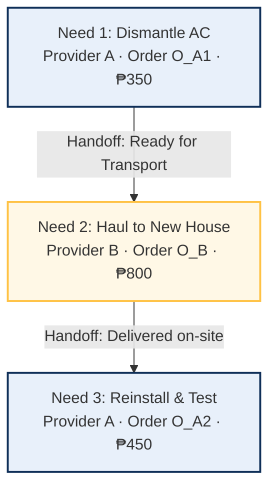
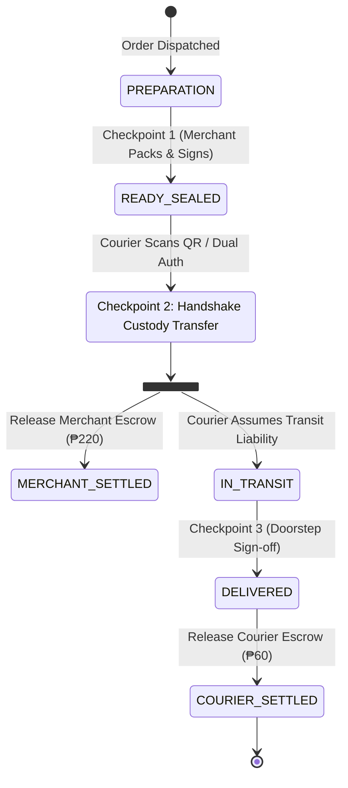

# Serbizyu 2.0 — Deal-Chaining Adversarial Scenario Exploration Record

**Document Reference:** `docs/planning-hardening/16-adversarial-deal-chaining-audit-reentrancy-and-execution-protocol.md`  
**Status:** HISTORICAL EXPLORATION — NOT AN APPROVED AUDIT VERDICT OR OPERATIONAL PROTOCOL
**Date:** 2026-09-06  
**Authority:** Supporting discussion only; subordinate to the founder charter and canonical domain/schema/architecture contracts.
**Scope:** Re-entrant "Boomerang" provider patterns ($A \to B \to A$), physical custody handoffs, micro-work vs. macro-DAG boundaries, parallel fan-in collisions, cash advance protections, and dynamic on-site scope discovery.

> **Correction:** The scenarios below are useful questions, not verified operational findings or approved policy. Read the [Deal-Chaining logic soundness review](17-deal-chaining-logic-soundness-review.md). The original discussion is preserved as evidence, not endorsed.
>
> A returning provider does not inherently create a cycle or force two Orders in every possible model. QR handoff does not automatically authorize payouts or shift liability. The 50/50 liability rule, kiosk bond, operating balance, fixed diagnostic fee, universal timeout, ban on fixed appointments, and calendar roadmap were not approved. `disrupted` and `diagnostic_pause` are not canonical Need states. Branching, active-plan amendments, and checkpoint conditions require explicit contracts before implementation.

---

## 1. Executive Summary & Audit Context

The following historical discussion collected seven adversarial perspectives on hypothetical local-trade scenarios. It was not field validation, an executable test, a legal assessment, or a definitive state-machine contract.

It explored six failure themes; the proposed resolutions below remain subject to the correction above:
1. **The Re-entrant Provider ("Boomerang") Problem:** How a provider can hand off work and re-enter the flow at a downstream node without circular deadlocks.
2. **The Premature Payout Flaw:** Shifting financial release from merchant self-reporting (`ready_for_pickup`) to verified custody handshake.
3. **The Micro-to-Macro Boundary:** Keeping intra-order work items decoupled from cross-provider deal coordination.
4. **Parallel Fan-In Skew & Perishability:** Preventing synchronization deadlocks and perishable cargo spoiling.
5. **The Uncollateralized Cash Advance ("Abono") Trap:** Eliminating courier credit risk in multi-party deals.
6. **Dynamic On-Site Scope Discovery:** Allowing in-flight DAG expansion without breaking original order contracts.

---

## 2. The Re-entrant Provider ("Boomerang") Pattern ($A \to B \to A$)

### 2.1 The Operational Challenge
In physical services, a single provider often executes non-contiguous stages of a multi-party project:
* *Stage 1:* AC Technician dismantles unit at Old House (`₱350.00`).
* *Stage 2:* Multicab Hauler transports unit across town (`₱800.00`).
* *Stage 3:* **Same AC Technician** reassembles, vacuums lines, and tests unit at New House (`₱450.00`).

### 2.2 The Topological Conflict
A Directed Acyclic Graph (DAG) requires strict topological ordering ($Need_1 \to Need_2 \to Need_3$). Binding Provider $A$ to a single database order creates a state-machine deadlock (an order cannot be simultaneously `completed` and `in_progress`). Furthermore, if Provider $A$ fails to appear for Stage 3, a single order cannot be partially canceled without rewriting accounting history.

### 2.3 The Canonical Solution: Node-Split Sovereign Child Orders
1. **The DAG remains strictly acyclic:** The graph connects *Tasks*, not identities:  
   $$Need_1 (\text{Dismantle}) \longrightarrow Need_2 (\text{Haul}) \longrightarrow Need_3 (\text{Reinstall})$$
2. **Order Cardinality:** Provider $A$ is issued **two distinct, sovereign Child Orders**:
   * **Child Order $O_{A1}$** for Stage 1 (`₱350.00`).
   * **Child Order $O_{A2}$** for Stage 3 (`₱450.00`).
3. **Fault Isolation & Reassignment Protocol:**
   If Provider $A$ suffers an emergency and cannot execute Stage 3:
   * Orders $O_{A1}$ and $O_B$ remain **completed, paid, and immutable**.
   * Order $O_{A2}$ is cleanly canceled.
   * $Need_3$ transitions to `disrupted`.
   * A replacement node ($Need_4$) is created with `replaces_deal_need_id = Need_3` and assigned to a replacement provider (*Provider C*), requiring zero financial contagion or rollback of Stages 1 and 2.



---

## 3. Physical Custody & The 3-Checkpoint Settlement Protocol

### 3.1 The Flaw in Self-Reported Readiness
Early specifications suggested releasing escrow to merchants when they marked items `ready_for_pickup`. The adversarial audit proved that if a merchant self-reports readiness but the goods are discovered missing, damaged, or unmade upon courier arrival, the platform absorbs an unrecoverable financial deficit.

### 3.2 The 3-Checkpoint Custody State Machine



1. **Checkpoint 1 (Merchant Prep & Seal):** Merchant packages goods and uploads packaging photo. Status = `ready_sealed`. **Escrow remains locked.**
2. **Checkpoint 2 (Dual-Authenticated Handshake):** Courier arrives at the stall and scans the merchant's physical pickup QR token.  
   👉 **Merchant payment is released from escrow only upon Checkpoint 2.** Physical liability shifts to the courier.
3. **Checkpoint 3 (Doorstep Delivery):** Customer signs off or confirms OTP receipt $\rightarrow$ Courier payout is released.

### 3.3 Latent Defect vs. Transit Damage Fault Allocation
* **Concealed Damage (Improper Packing):** If an item is damaged inside intact packaging, liability rests with Merchant (Node 1).
* **Transit Damage (Crushed Package):** If packaging shows external trauma upon delivery, liability rests with Courier (Node 2).
* **Missing Evidence Default:** If parties fail to capture Checkpoint 2 handover evidence, liability is split 50/50 between the unverified parties.

---

## 4. Dual-Layer Architecture: Micro-Work vs. Macro-DAG

To preserve contract immutability and prevent system bloat, execution is split into two non-overlapping layers:

```
┌─────────────────────────────────────────────────────────────────────────────┐
│                    MACRO LAYER: THE DEAL CHAIN (DAG)                        │
│  • Coordinates independent legal entities, child orders, and distinct payouts│
│  • Manages the "Baton Pass" between separate providers                      │
│  • Emits outbox events; listens for node completion triggers                │
└──────────────────────────────────────┬──────────────────────────────────────┘
                                       │ Binds Child Order ID
                                       ▼
┌─────────────────────────────────────────────────────────────────────────────┐
│                   MICRO LAYER: THE WORK LIFECYCLE                           │
│  • Lives strictly inside ONE child order (governed by Archetypes A1-A9)     │
│  • Internal work items (e.g. 1. Design ➔ 2. Print ➔ 3. Pack)                 │
│  • Internal tasks never touch the public DAG unless an external need arises │
└─────────────────────────────────────────────────────────────────────────────┘
```

### 4.1 Sidecar Expansion (Mid-Job Errand Escalation)
If a provider executing an internal work item requires external assistance mid-flight (e.g. Carpenter runs out of steel brackets):
1. The provider does **not** rewrite the customer's parent order.
2. The provider taps **`Request Sidecar Errand`** in their console.
3. A **Sidecar Deal Need** is spawned and bound to an on-demand courier (`₱60.00`).
4. The provider funds the errand directly from their operating balance or submits a variance proposal for customer approval. The original contract remains pristine.

---

## 5. Parallel Fan-In Synchronization & Perishability Firewalls

When multiple procurement branches converge into a single downstream service (`[Part 1 + Part 2] ➔ Technician Install`):

### 5.1 The Floating Labor Anchor
* Downstream labor nodes in a parallel fan-in **cannot be scheduled to a rigid calendar timestamp upfront**.
* They use a **Floating SLA Rule**: *"Technician appointment window is confirmed within 24 hours of final parallel input check-in."*

### 5.2 The Perishability Firewall
* Every product node carries a `perishability_ttl_mins` attribute.
* The DAG validation engine **rejects** wiring a perishable item (e.g. fresh seafood, 120-minute TTL) into a fan-in containing non-instant multi-day hardware sourcing.

### 5.3 Partial Failure Resolution
If Node 1 (Part A) arrives, but Node 2 (Part B) is permanently out of stock:
* Part A is returned under the store's return policy or retained by the customer.
* Downstream Labor (Node 3) is gracefully canceled without penalty.
* Child Order 1 is settled or credited; Child Orders 2 and 3 are refunded.

---

## 6. Cash Advances ("Abono") & Bogus Buyer Protection

In Philippine errand and pabili commerce, couriers are frequently asked to advance personal cash (*abono*) at stores. In multi-party deal chains, uncollateralized abono creates fatal risk:

1. **The Policy:** Uncollateralized courier cash advances are **strictly prohibited** on multi-party deal chains.
2. **Tiwala Digital Escrow (The Primary Lane):** Customer pre-funds via digital payment (GCash). Providers and couriers carry zero cash liability.
3. **Barya Commitment Bonds (For Cash on Delivery):** If a customer insists on paying Cash on Delivery, they must maintain a minimum ₱50 commitment deposit or place a pre-authorized bond at a partner barangay kiosk before dispatch.

---

## 7. Dynamic Scope Creep & On-Site Diagnostic Pause

When a technician uncovers unforeseen structural damage on-site:

1. **Diagnostic Pause Protocol:**
   * The technician taps `Propose Scope Expansion` in their console.
   * Node status transitions to `diagnostic_pause` with a **30-minute on-site TTL**.
2. **In-Flight Proposal:**
   * A structured change order is pushed to the customer's phone:  
     *"Plumber discovered corroded main stack. Approve additional parts (₱1,200) and labor (₱1,800)?"*
3. **Resolution Branches:**
   * **Branch A (Customer Approves):** Two new Deal Needs (Materials + Expanded Labor) are dynamically injected into the active DAG. Customer funds the variance.
   * **Branch B (Customer Declines):** The job aborts safely. The technician is guaranteed an **automatic Diagnostic/Trip Fee** (`₱200.00`), compensating their travel and inspection.

---

## 8. Phased CEO Roadmap

| Phase | Core Deliverables | Customer & Provider UX |
|---|---|---|
| **Phase 1: Pilot Launch (Day 1)** | **Linear 2-Node Chains Only:**<br>• Product + Delivery (Pabili)<br>• Hardware Part + Pro Install | Glovo-style cards with delivery badges or overlapping partner avatars. Zero graph theory exposed to users. |
| **Phase 2: Post-Pilot (Quarter 2)** | **Parallel Fan-In & Provider Co-Ops:**<br>• Multi-vendor event bundles<br>• Re-entrant Boomerangs ($A \to B \to A$) | Community coordinators package listings into shared deal chains with animated streaming flow lines. |
| **Phase 3: Mature Platform (Year 2)** | **Dynamic In-Flight Injection & Full DAG:**<br>• On-site diagnostic expansion<br>• Desktop node canvas builder for commercial contractors | Full n8n-grade execution engine for institutional multi-party projects. |
