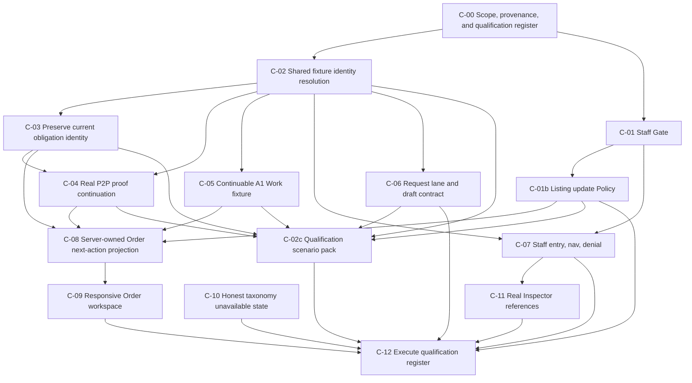

# Post-Spec #9: Qualification, Authorization, and Order Workspace Cut

**Status:** Technical findings/backlog; release scope superseded by [document 37](37-commerce-finish-map-and-quick-deal-scope.md). No implementation or qualification is claimed by this document.
**Purpose:** Bound the next work cut to truthful existing journeys, a reusable authorization seam, usable Order workspaces, and evidence-based completion.  
**Authority:** Subordinate to `docs/planning-hardening/05-artifact-authority-and-supersession-map.md`, the approved architecture/domain contracts, `CONTEXT.md`, and the applicable `.ai/rules/*` constraints.

**Scope notice:** follow document 37 for the current finish sequence and terminology. Human-Agent management is deferred; offline/online Quick Deal, assisted shared-device/kiosk access, and the bounded location Work Tool are now included. Preserve the technical findings and security/data safeguards below, but do not execute this checklist as the latest release scope or treat deferred Agent UI as a release blocker.

## 1. Outcome and limits

Deliver a bounded, honestly qualified slice where:

1. Existing buyer/provider, product, Work, payment, staff, and delegated actions preserve authoritative identity, terms, state, and history.
2. Authorization has a concrete Laravel-native resource-policy example that composes with the existing role, ownership, consent, capability, approval, and domain-state checks. No permissions package or wholesale rewrite.
3. Order pages explain who acts next, why, and which authorized action is available. Mobile keeps the existing mock-aligned shell, Glovo sheets, and one contextual bottom action dock; desktop uses its width for the current task and supporting truth.
4. A finite acceptance register records exercised evidence. A test row, rendered status, or source inspection alone is never evidence that a user journey passed.

This cut is **not** blanket pilot, production, live-money, or whole-project clearance. The original exclusion of Quick Deal and all GIS work is superseded by document 37; only continuous live tracking remains deferred. No new escrow/custody, taxonomy-publication backend, persona switcher, or new Deal Chain architecture is authorized by this older technical backlog.

## 2. Authority and evidence

Use, do not duplicate or supersede:

- `CONTEXT.md` for Work Shape, Work Node, clearance authority, tools, and A4 terms.
- `docs/architecture/MACRO-TO-MICRO-EXECUTION-PLAN.md` and canonical domain/state contracts for current implementation scope.
- `docs/planning-hardening/35-agent-intermediary-and-capability-delegation-contract.md` for capability attenuation and Policy Enforcement Point direction; subordinate to current schema/domain contracts.
- `.ai/rules/agent-delegation.md`, `payments.md`, `admin.md`, `ui-kit.md`, `testing.md`, and `architecture.md` for standing invariants.
- `docs/design-kit/sessions/final-orders-stock.html` and `docs/design-kit/order-detail-mobile.html` as Order visual/interaction references. Their static specimen actions are not proof of runtime behavior; newer payment and authority rules prevail over any stale mock copy.
- Laravel 12 authorization documentation: Gates suit non-resource checks; Policies suit resource-specific checks. No external permission engine is needed for the first slice.

**Evidence labels:** `PASS` means a specified behavior was exercised and its oracle met. `FAIL` means exercised and contradicted its oracle. `BLOCKED` names a missing prerequisite and owner. `NOT RUN` means no qualifying evidence yet. Source inspection, fixture rows, skipped tests, and agent confidence are never `PASS`.

**Current status:** all work and journey checks in this plan are `NOT RUN`. Reviewer source inspection identified likely failures; no fixes or browser qualification are claimed here.

## 3. Known source findings to carry forward

These are source/reviewer findings, not manual browser results:

- `RequestController.php` rejects `p2p_transfer` although `Requests/CreateRequest.tsx` submits it; persisted drafts can restore retired `bilateral_escrow`.
- Earlier source inspection found scenario windows expired relative to the seeded clock. Current `RequestQuoteSeeder` uses `CarbonImmutable::now()`, while other scenario seeders retain a fixed September 2026 anchor; C-02c will unify scenario clocks without refreshing existing accepted timestamps.
- Default seed order reaches `SeedTagudinBrowseCatalog` before the later chain seeder's local phone resolver. Other seeders still consume pinned identity constants directly.
- Scenario payment seeding matches by `order_id` while supplying fixed obligation IDs, and some overlays conflict with accepted amounts, supersession, and progress.
- The seeded P2P event uses `amount_minor`; `OrderPaymentObligationAdapter::latestSubmittedProofFacts()` consumes `sent_amount_minor`.
- ORD-2801's A1 scenario is hand-built with incomplete runtime state, a source/provider mismatch, and evidence marked clean without the consumer scan lifecycle.
- `Orders/Show.tsx` uses a narrow, long vertical stack. Its contextual dock is state-dependent and can be back-only while useful actions remain elsewhere in the page.
- Taxonomy version bump has a client-side fake success but no backend mutation route.
- `StaffAccessService` already admits active L4 users or active, currently effective `admin`/`operate` assignments. Do not simplify this to L4-only.
- `AuthorizationContext` and `AuthorizationDecision` are value objects, not evidence of a central authorization engine. Existing consent checks are transaction-time and exact-resource/action scoped.
- No owner-facing consent grant/revoke browser route was located. A seeded grant and service-level grant/revoke methods do not make that lifecycle end to end.
- Existing broad tests that directly alter Work state, listing approval, or scan facts are not browser evidence of those governed transitions.

## 4. Sequence and dependencies



C-01b and C-02 are independent after C-00. C-03/C-04/C-05/C-06 require safe fixture identity resolution. C-02c composes the repaired identity, request, payment, stock, and Work seed seams into named, continuable checkpoints. C-09 depends on C-08. C-12 runs only after each in-scope prerequisite is ready; blocked journeys remain blocked, not passed.

## 5. Work items

### C-00 — Freeze scope, provenance rules, and acceptance register

**Priority:** P1. Prevents unsafe cleanup and “green by fixture” claims.

**Deliverables:** create `docs/acceptance/POST-SPEC-9-QUALIFICATION-REGISTER.md` (new) with one row per journey/subcase: ID, environment/evidence class, actors, initial record references, steps, expected result, actual result, browser/test artifact, status, blocker owner, and retest evidence. Do not store passwords, private evidence contents, or unnecessary personal data.

**Rules:**

- Existing accepted terms/progress are not reset to make a preferred fixture number or amount appear.
- New canonical scenarios may use designated values only when they do not overwrite existing business history.
- Conflicting identity or public-reference ownership stops the affected seed plan before writes.
- Use scoped status values `PASS`, `FAIL`, `BLOCKED`, `NOT RUN`; no inherited “implemented” tag becomes qualification evidence.

**Acceptance:** the register contains every journey in §7 with explicit positive, negative, retry, refresh/relogin, and recovery or a reason a case is inapplicable. No case starts as `PASS`.

**Verification:** review authority citations and record structure; no application test is implied.

### C-01 — Put staff admission behind a named Laravel Gate

**Priority:** P1. Reuse the canonical staff access port and preserve service-level controls.

**Sources:** `StaffAccessService::canAccessStaff()`, `StaffAccessPort`, `EnsureAuthenticated`, `AppServiceProvider`, current nested admin route groups.

**Implementation boundary:** register one named staff Gate delegating to `StaffAccessPort`; use it at the staff HTTP admission seam. Preserve active-account check plus L4 OR active/effective admin/operator role. Consolidate staff route grouping where needed so nested identity-review routes use the same staff sign-in/denial contract.

This Gate is **staff admission only**. It is not an Order/resource policy, a broad `Gate::before` bypass, or permission to skip owner, consent, exact approval, hold, or state checks.

**Acceptance:** active L4 and eligible role users pass; suspended, inactive, future, expired, guest, and ordinary accounts behave correctly. Staff access never makes the actor an order participant or lets it skip payment/Work/hold rules. Direct application command paths retain their existing checks.

**Tests:** extend `tests/Feature/IdentityAccess/UnifiedStaffAndActingForTest.php`; new `tests/Feature/IdentityAccess/StaffAccessHttpBoundaryTest.php`. Exercise both page and command/service denials, not only route text.

**Narrow command:** `vendor/bin/sail artisan test --compact tests/Feature/IdentityAccess/UnifiedStaffAndActingForTest.php tests/Feature/IdentityAccess/StaffAccessHttpBoundaryTest.php`.

**Rollback:** revert Gate registration and middleware integration together; retain the existing `StaffAccessPort` and command checks.

### C-01b — Establish one resource Policy Enforcement Point on Listing draft update

**Priority:** P1. A staff Gate alone does not deliver the requested scalable resource-authorization foundation.

**Sources:** `ListingController::update()`, `ResourceActorResolver`, `UpdateListingDraft`, `ListingRepository::updateDraft()` and its existing `assertOwnerAndVersion()` / exact `listing.update` consent check. The repository already locks the Listing and rechecks consent in its transaction; preserve that authority.

**Implementation boundary:** add a Listings-owned `ListingPolicy::update` and explicit Gate registration. Extract/reuse one module-owned evaluator for the current actor, persisted listing owner, self-vs-acting-for context, active Agent capability, and exact `listing.update` consent. Apply the Policy through the actual actor and persisted/locked Listing inside the update transaction, so the HTTP controller and direct application callers traverse one PEP. Adapt denial into the existing Listing error envelope. Keep version, editable lifecycle, governed content, audit, and mutation checks in their current transaction/order.

Do not copy consent SQL into the Policy. Do not use an unlocked HTTP-only check as the sole guard. `ConsentGrantService` requires a transaction and lock; stale UI permissions remain advisory. No new user/role package, schema, generic policy engine, all-resource migration, admin bypass, or new Listing action scope in this item.
Preserve the existing lock order: prepare/lock and validate the consent grant **before** locking the Listing. Never acquire the Listing lock and then acquire the grant lock for the first time. The Policy on the locked Listing may reuse the canonical authorizer only while that grant lock is already held; direct and HTTP callers must use the same ordering and recheck, not a detached authorization token.

**Acceptance:** owner update and valid exact-grant Agent update work; non-owner, forged actor/principal, wrong grantee/action/resource, expired/revoked/suspended grant fail with zero Listing/version/audit/outbox mutation. Revocation after page load denies the subsequent save. Wrong version/editable lifecycle preserve their current conflict semantics. A direct application invocation with no web session enforces the same result. Staff status does not grant Listing ownership.

**Tests:** new `tests/Feature/Listings/ListingUpdatePolicyTest.php`; extend `tests/Feature/IdentityAccess/T1AIdentityDelegationTest.php`, `UnifiedStaffAndActingForTest.php`, and existing Listing lifecycle coverage.

**Narrow command:** `vendor/bin/sail artisan test --compact tests/Feature/Listings/ListingUpdatePolicyTest.php tests/Feature/IdentityAccess/T1AIdentityDelegationTest.php tests/Feature/IdentityAccess/UnifiedStaffAndActingForTest.php`.

**Qualification limit:** this is one proven Policy pattern, not a claim that all resource actions have migrated to Policies. Add further resource policies only with a separate source-backed inventory and no parallel authorization logic.

### C-02 — Resolve fixture identities once, safely, and for all consumers

**Priority:** P1. A single-seeder phone fix leaves orders, stock, staff, and scenario seeders pointing at absent principals.

**Sources:** `DatabaseSeeder.php`, `SeedTagudinBrowseCatalog`, `DealChainExecutionSeeder`, `DealChainExecutionFixtures`, `FixtureManager`/`FixtureRepository`, all default seeders consuming fixed user IDs.

**Implementation boundary:** introduce a small shared fixture identity resolver returning an immutable fixture-key→actual-user-ID map. Resolve expected UUID and phone independently for every declared fixture principal before any seed writes. Phone equality alone is not proof of fixture ownership. Adopt an alternate UUID only with established fixture provenance; ambiguous or split UUID/phone ownership fails with explicit `FIXTURE_IDENTITY_CONFLICT` and zero writes. Use resolved IDs across catalog/listing owners, authorship, roles, stock owners, scenario parties, evidence, cases, messages, recipients, staff, and development-only persona references if ever added.

Never rekey a real user, rewrite historical FKs, park/change a phone, delete a user, reset arbitrary credentials/status, or recommend a database reset. Do not modify accepted domain history just to match a static fixture constant. Preserve role assignment IDs and business progress on rerun.

**Acceptance:** empty database provisions intended fixture IDs; verified legacy fixture preserves UUID and account fields; unknown or conflicting ownership creates no partial fixture rows; direct and root seeder entrypoints resolve identically; downstream FKs point to resolved owners; rerun preserves role assignments, stock, accepted terms, Work, payment, and evidence progress.

**Tests:** new `tests/Feature/FixtureIdentityResolutionTest.php`; extend `tests/Feature/LiveSurfaceContractTest.php` and relevant seeder tests. Cover empty, adopted, split-ID/phone, unknown owner, genuine-classified, repeated-run, and late uniqueness-conflict cases.

**Narrow command:** `vendor/bin/sail artisan test --compact tests/Feature/FixtureIdentityResolutionTest.php tests/Feature/LiveSurfaceContractTest.php`.

**Risk:** this is a multi-consumer migration. Inventory every static identity consumer before implementation; no “fix” limited to the principal loop is complete.

### C-03 — Preserve the current primary obligation and scenario history

**Priority:** P1. Fixed-ID overlays risk non-cascading FK failures and contradictory accepted terms.

**Sources:** `PaymentObligationScenarioSeeder`, `DealChainExecutionSeeder`, payment obligation selectors/read models, obligations/events/cases/disputes/holds/evidence.

**Implementation boundary:** resolve the current, non-superseded `primary_consideration` obligation using runtime selection rules. Existing ID and history are authoritative. Create only when absent and when the desired public reference is unowned. Propagate resolved IDs through every dependent payment event, support case, dispute, hold, evidence projection, and fixture reference. New scenario facts must be authored coherently in one transaction. Existing reports, proof, settlement, holds, terms, supersession, and versions are never overwritten.

**Acceptance:** no obligation primary-key mutation; historical superseded obligation remains intact; no update of an arbitrary obligation by `order_id`; rerun preserves terminal/progressed state; public-reference conflict fails before writes; new scenario agreement amount, Work, payment evidence, and settlement facts agree; no Work completion settles payment.

**Tests:** new `tests/Feature/ScenarioObligationIdentityTest.php`; retain/extend `tests/Feature/PaymentCashSettlementTest.php`, `PaymentP2PWorkflowTest.php`, and `LiveSurfaceContractTest.php`. Include existing event/audit FK references, predecessor plus current obligation, settled replay, duplicate hold prevention, and public-reference ownership conflict.

**Narrow command:** `vendor/bin/sail artisan test --compact tests/Feature/ScenarioObligationIdentityTest.php tests/Feature/PaymentCashSettlementTest.php`.

**Rollback:** never “restore” an earlier primary ID or rewrite payment history. Roll back code only; resolve fixture provenance before replay.

### C-04 — Seed and qualify P2P proof through the real submission/scan/recipient path

**Priority:** P1. A proof event missing `sent_amount_minor` is visible but not verifiable by its consumer.

**Sources:** `PaymentObligationScenarioSeeder`; `OrderPaymentObligationAdapter::submitP2pProof()`, `latestSubmittedProofFacts()`, `verifyP2pPayment()`; scanner and notification handlers.

**Implementation boundary:** create proof through the source service and scanner lifecycle. Preserve `sent_amount_minor` and transfer reference. Never infer sent amount from the obligation, bypass quarantine, SQL-set scan clean, or settle from Work completion.

**Acceptance:** quarantined proof cannot be verified; clean scan projects actual sent amount/reference/private proof; only designated recipient can verify; matching confirmation settles once; mismatch/rejection stays unsettled and retains history; replacement and seeder reruns preserve evidence and current obligation.

**Tests:** extend `tests/Feature/PaymentP2PWorkflowTest.php`, `PaymentNotificationSourceTest.php`, and relevant evidence/private-access tests; assert projection, recipient settlement and wrong-user denial—not merely event existence.

**Narrow command:** `vendor/bin/sail artisan test --compact tests/Feature/PaymentP2PWorkflowTest.php tests/Feature/PaymentNotificationSourceTest.php`.

### C-05 — Make the A1 fixture a valid, continuable Work instance

**Priority:** P1. A display-oriented structure does not prove the governed Work transition.

**Sources:** `WorkExecutionScenariosSeeder`, `WorkExecutionService::initializeStructure()`, `advanceNode()`, `projectForOrder()`, source Listing and accepted Order terms.

**Implementation boundary:** form A1 from a source listing/version owned by the assigned provider; use normalized runtime structure with matching contract/schema versions and authored metric requirements. Seed starting progress through supported commands and required evidence/scanner consumers. Do not rebind an A3 source, SQL-mark evidence clean, or weaken `INVALID_STATE`/contract validation. Existing incompatible accepted ORD-2801 is a provenance blocker; do not rewrite it.

**Acceptance:** source owner/provider/shape/version/signature/active pointers agree; provider advances the exact active node with valid authored measurement and clean proof; customer performs required gate/sign-off; wrong actor, stale state, missing/bad metric, pending scan, and unsupported contract cause no partial transition; completed Work makes payment due only where policy allows and never settles it; rerun preserves progress.

**Tests:** new `tests/Feature/ScenarioContinuabilityTest.php`; extend `WorkExecutionServiceTest`, `T4WorkContractRegistryTest`, `OrderEvidenceTest`, and `LiveSurfaceContractTest`.

**Narrow command:** `vendor/bin/sail artisan test --compact tests/Feature/ScenarioContinuabilityTest.php tests/Feature/OrdersWork/WorkExecutionServiceTest.php tests/Feature/OrdersWork/T4WorkContractRegistryTest.php tests/Feature/OrdersWork/OrderEvidenceTest.php`.

### C-06 — Align request lane validation and persisted drafts

**Priority:** P1. P2P request creation currently contradicts server validation; old drafts can restore a retired choice.

**Sources:** `RequestController`, `Requests/CreateRequest.tsx`, `pendingRequestDraft.ts`, quote/award/payment-lane eligibility.

**Implementation boundary:** request preference accepts canonical `external_cash` or `p2p_transfer`. Reject retired `bilateral_escrow`; safely preserve other old draft content while requiring explicit payment-method reselection. Do not silently map escrow to P2P. A request preference is not a provider acceptance, payment obligation, or guarantee of the eventual eligible lane; leave quote/award rules authoritative.

**Acceptance:** both canonical request preferences validate and persist; retired/unknown values get field errors/no request write; an old draft shows a clear reselection notice and cannot silently submit; guest return/refresh keeps safe draft content; quote acceptance uses independently authorized terms/payment eligibility; request creation alone makes no obligation.

**Tests:** update `tests/Feature/BuyerRequestAndQuoteFlowTest.php` (including old `bilateral_escrow` posts); update `resources/js/Pages/Requests/CreateRequest.test.tsx` and `Requests/Show.test.tsx`; new `resources/js/lib/pendingRequestDraft.test.ts`.

**Narrow commands:** `vendor/bin/sail artisan test --compact tests/Feature/BuyerRequestAndQuoteFlowTest.php`; `vendor/bin/sail npm run test -- resources/js/Pages/Requests/CreateRequest.test.tsx resources/js/Pages/Requests/Show.test.tsx resources/js/lib/pendingRequestDraft.test.ts`.

### C-02c — Build a realistic, resumable qualification scenario pack

**Priority:** P1. Existing demo seeders populate many rows, but row presence and fixed final states do not prove that supported journeys can be started, continued, and recovered.

**Sources:** `DatabaseSeeder.php:17–31`; `CapstoneContractSeeder`; `TagudinBrowseCatalogSeeder`; `DealChainExecutionSeeder`; `RequestQuoteSeeder`; `OrdersStockSeeder`; `PaymentObligationScenarioSeeder`; `WorkExecutionScenariosSeeder`; `AdminWorkspaceSeeder`; `ListingReviewsSeeder`; `LiveSurfaceContractTest.php`; Issue #33 and its current acceptance criteria. Issue #33’s closed status and historical success comment are not fresh qualification evidence.

**Dependencies:** C-02 shared identity resolution, C-03 obligation preservation, C-04 real P2P proof, C-05 valid Work, and C-06 request contract. C-01/C-01b are required to qualify the staff/protected branches. Complete before C-12.

**Implementation boundary:**

- Evolve the existing `DatabaseSeeder` graph; do not create a second general-purpose fixture framework. Add a finite manifest in new `app/Shared/Infrastructure/Demo/QualificationScenarioManifest.php`, coordinated by new `database/seeders/QualificationScenarioSeeder.php`. Proposed explicit runner: new `app/Console/Commands/PrepareQualificationScenarios.php`, command `serbizyu:scenarios:prepare {--run=} {--anchor=} {--dry-run}`. This command/interface does not exist yet.
- The manifest names each scenario key, run/version and clock anchor, synthetic actors, public references, evidence class, source Listing/terms versions, initial checkpoint, next responsible actor/action, negative/recovery branch, and invariant oracle. Internal IDs resolve through the shared fixture identity map; never take a conflicting UUID or public reference from existing data.
- Use realistic **synthetic** Tagudin actors and data: distinct fictional buyer, merchant, provider, courier, Agent, maker, and checker; plausible fictional barangay locations, listings/variants, authored terms, PHP minor-unit prices, stock, schedule windows, evidence, cases and messages. Never import real local users, personal phone numbers, evidence bytes, or production data into the pack.
- Map every J01–J10 journey in §7 to at least one named starting checkpoint. Include request awaiting provider response, quote awaiting buyer choice, active A1 node with authored metric/proof requirements, external-cash due/unreported, P2P due before proof, product/A4 prepared before custody with separate counter-pickup and courier paths, A3 future booking/reschedule, A9 current submitted version/revision, open staff case with distinct maker/checker, exact-scope Agent grant fixtures, and a Deal Chain with independent children and a visible predecessor gate. Keep mismatch, shortage, stale version, infected evidence, expired/revoked grant, and unauthorized actor as separate negative/recovery branches.
- Separate `continuable` checkpoints from `reference_history` examples. A completed or settled historical example is visibly read-only; it is never described as a transition performed by the tester. For Holcim, the `20 on hand / 4 held / 5 committed / 11 available` checkpoint must correspond to real, distinctly identified pending/accepted orders and a coherent ledger. It is not a balance to restore after a user fulfills or damages stock.
- Static fixture writes are limited to absent, provenance-checked synthetic principals/profiles/cohort data, immutable catalog/reference inputs, and harmless private test bytes. Use existing source creation/publish/review services for listing lifecycle; Request/Tender services for publication, quote/counter/award; `SubmitOrderProposal`/`FinalizeOrderAgreement` and capacity ports for holds/commitments; `StockLedgerService::provisionVariant()`/`adjust()` for inventory; A3/A4/A9 and Work application services for appointment, custody, receipt, revision, and node transitions; upload plus registered scanner for evidence; payment obligation services for due/report/proof/acknowledgement/mismatch; ConsentGrantService for trusted test-only grant setup/revoke; and TrustSupport, conversation, notification, and outbox-consumer paths for their facts. Raw SQL must not fake a user-performed transition by setting `clean`, `settled`, `approved`, `delivered`, `fulfilled`, `closed`, or terminal Work state.
- A trusted test-only consent grant can establish a precondition for exact-scope authorization tests; label it fixture setup, not proof that an owner-facing consent-management UI exists. Keep the missing owner grant/revoke browser lifecycle as `BLOCKED/NOT RUN` until its own supported surface is delivered.
- Use one explicit run clock anchor. Tests freeze/inject the clock; runnable scenarios derive future quote/request expiry, appointment, hold, and grant windows from the recorded anchor. `RequestQuoteSeeder` currently uses `CarbonImmutable::now()`, while other fixture seeders still contain a fixed September 2026 anchor; unify scenario windows without sliding existing accepted timestamps or reviving expired records. Keep intentionally expired examples separately named.
- Require explicit opt-in and a disposable database/private-storage namespace, plus positive environment/evidence allowlists: supported local/test/capstone fixture plane and `CAPSTONE`, `SANDBOX`, or `TEAM_TRAINING`. Reject `GENUINE_PILOT`, genuine-tagudin subjects, production, staging, pilot, and unapproved combinations before any scenario writes. `--dry-run` performs preflight only. Conflicting identity/reference/history returns a named conflict and zero writes.
- Seed reruns may complete missing idempotent fixture setup but must never reset progressed user state. Existing run reports `PROGRESSED`, `EXPIRED`, or `CONFLICT` as applicable; recovery uses an actual domain command. A clean start is a separately provisioned disposable test database/run, never a reset of the developer’s populated database.

**Acceptance:**

- Each manifest scenario resolves to verified actors, ownership, pinned source/terms versions, public references, foreign keys, capacity, current obligation, Work contract/node, evidence ownership/path/hash/scan, grant scope, Deal Chain child/confirmation, case/hold, conversation membership, and recipient privacy.
- Every J01–J10 has a usable initial checkpoint and named next action, or an explicit `BLOCKED` explanation; a seeded row alone is not a completed journey.
- Each positive checkpoint is continued via the real application/UI path, then observed by the next actor after refresh/relogin. Retry is idempotent; negative branches leave unrelated rows and aggregates unchanged.
- Preparing twice against an unchanged baseline produces no duplicate records/events/files. Preparing after stock fulfillment/damage, payment settlement, Work progress, quote expiry, or grant revocation preserves those facts and reports the checkpoint rather than restoring it.
- Process interruption can resume only missing idempotent setup; it cannot compensate or erase accepted business truth.
- Environment, evidence-class, identity, owner, reference, adapter, and progressed-history conflicts fail before any database or storage write.
- A seeded `clean`, `settled`, `approved`, `received`, or `completed` history example is labeled historical and never counted as proof that the corresponding journey passed.

**Tests:** new `tests/Feature/QualificationScenarioPackTest.php`; extend `LiveSurfaceContractTest.php`, `FixtureIdentityResolutionTest.php`, `ScenarioContinuabilityTest.php`, and C-12 browser coverage. Test manifest relationship invariants, each next action, frozen-clock before/at/after expiry, unchanged reruns, post-consumption reruns, interruption/resume, and zero-write rejection. Do not rely on fixed row counts or nonempty tables.

**Narrow command:** `vendor/bin/sail artisan test --compact tests/Feature/QualificationScenarioPackTest.php tests/Feature/LiveSurfaceContractTest.php tests/Feature/FixtureIdentityResolutionTest.php tests/Feature/ScenarioContinuabilityTest.php` against the isolated verification database only.

**Manual:** in a disposable environment, dry-run and prepare a named scenario; log in as its synthetic actor; perform the declared next action in the browser; refresh/sign in as the counterparty; verify persisted state; retry once and exercise its recovery branch; run preparation again and verify it did not rewind progress. Record screenshots and references in the C-00 register. This scenario pack is test setup, not browser-pass evidence.

**Risk:** a large “everything already completed” dataset makes pages look populated but defeats qualification and can overwrite accepted progress. Prefer a small set of consistent checkpoints over volume. Do not seed every combination of roles and states; use a finite manifest traceable to J01–J10.

### C-07 — Provide a safe staff entry, canonical staff navigation, and truthful denial page

**Priority:** P1. Reduce login friction without creating a parallel auth system.

**Sources:** existing phone/email password auth services, `AuthController`, `EnsureAuthenticated`, auth rate limiter, `CurrentSession`, shared Inertia session projection, `DesktopGlobalNav`, mobile Browse navigation, `AdminLayout`.

**Implementation boundary:** staff-branded `/admin/login` is a presentation entry reusing existing authentication services, session regeneration, and `auth-login` throttling. Send only the active identifier so limiter keys do not collapse to a blank value. Validate/normalize return targets once on the server; allow only safe internal staff destinations, rejecting absolute/protocol-relative paths, backslash/control-character tricks, and login loops. Do not change production signup or add a staff password system.

Project one server-derived `canAccessStaff` boolean from `StaffAccessPort`; frontend never infers staff authority from user-provided role/tier fields. Add Admin Workbench links only when that projection is true. Add Storefront and POST logout exits to Admin. Signed-in nonstaff gets branded Inertia/HTML 403; JSON keeps 403 and `AUTHORIZATION_DENIED`. Message accurately allows L4 OR effective active admin/operator role.

**Acceptance:** phone/email staff sign-in reaches nested target; wrong credentials stay generic; nonstaff may authenticate but gets no staff access; hostile return target cannot redirect externally; new user role changes take effect after refresh/relogin; logout invalidates session; browser Back cannot reveal private data; JSON callers retain JSON; no client entitlement authorizes a route.

**Tests:** new `tests/Feature/IdentityAccess/AuthReturnToSecurityTest.php`, `StaffAccessHttpBoundaryTest.php` as needed, `resources/js/layouts/AdminLayout.test.tsx`, and staff E2E. Extend existing auth/session/rate-limit, session projection, global/mobile nav, and unified staff tests.

**Narrow verification:** relevant `vendor/bin/sail artisan test --compact` files; `vendor/bin/sail npm run test -- resources/js/components/layout/DesktopGlobalNav.test.tsx resources/js/layouts/AdminLayout.test.tsx`.

### C-08 — Project next responsibility and authorized Order actions from server truth

**Priority:** P1. Order layout needs a reliable server decision before it can explain the correct next step.

**Sources:** `OrderController::show()` participant privacy and current `can_*` props; Work service transactional checks; native A4, A9, appointment, payment and Deal Work Gate projections; `DealWorkGatePort`.

**Implementation boundary:** create a narrow, server-owned interaction projection composed from owning-module read decisions: responsible party, current action code, target panel, enabled/blocked state, concise reason/prerequisite, version, and relevant tools. It is presentation guidance, **not an authorization token**. Every command rechecks current actor, ownership, consent, exact approval, hold, state, version and dependency inside its existing mutation boundary. Do not infer authorization by attempting a mutation or catching an error. Do not expose restricted sibling/commercial facts to courier/operational parties.

**Acceptance:** proposal response, provider Work step, customer gate, evidence scan, predecessor wait, A4 custody, A9 delivery/revision, and payment acknowledgement each project truthful responsibility/action. Unauthorized action is absent or safely explained. Stale/revoked page action is still denied by server. Every emitted action code is handled; unknown values fail closed.

**Tests:** new `tests/Feature/OrdersWork/OrderInteractionProjectionTest.php`; extend `resources/js/Pages/Orders/Show.test.tsx`, native panel tests, Deal Chain privacy tests, and authorization mutation tests.

**Narrow command:** `vendor/bin/sail artisan test --compact tests/Feature/OrdersWork/OrderInteractionProjectionTest.php tests/Feature/OrdersWork/DealChainProductPartyPrivacyTest.php`.

### C-09 — Preserve the mobile shell/dock and use desktop width progressively

**Priority:** P2. Address perceived emptiness without turning the Order page into a wall of tools.

**Sources:** `resources/js/Pages/Orders/Show.tsx`; `docs/design-kit/sessions/final-orders-stock.html`; `docs/design-kit/order-detail-mobile.html`; `.ai/rules/ui-kit.md`.

**Mobile contract:** preserve the current Order header, independent Agreement/Work/Payment rails, Glovo sheets, and **one contextual fixed bottom action dock**. Do not add a second fixed global bottom navigation under the dock. Show named next responsibility and why near the top. Dock action follows C-08: proposal review, current Work task, evidence/confirmation, custody/delivery, payment report/acknowledgement, or meaningful wait/history. When Work is complete but payment still needs action, payment outranks feedback. Keep safe-area, keyboard, focus, single-scroll, and reduced-motion behavior.

**Desktop contract:** use available width for a task-first action panel plus independent rails, terms, evidence, and actual persisted activity/support. Keep detailed controls progressively disclosed and reuse existing panels; do not render duplicate stateful forms or invented sample history.

**Acceptance:** all relevant tools are discoverable without every form shown; mobile dock is not back-only where a permitted next action exists; A4/A9 use their own protocols; Work completion does not imply settlement; errors preserve input; refresh/relogin shows persisted facts only; desktop no longer strands the task in a narrow centered column with unused space.

**Tests:** extend `resources/js/Pages/Orders/Show.test.tsx` and affected native panel tests; new `e2e/order-workspace.spec.ts`. Test behavior/disclosure/action routing, not only layout text.

**Manual browser:** at 360px and 375px plus desktop, inspect proposal, active Work, awaiting confirmation, blocked, Work-complete/payment-due, and settled. Verify dock overlap, virtual keyboard, sheet scroll, keyboard focus, reduced motion, console/network errors.

**Narrow verification:** `vendor/bin/sail npm run test -- resources/js/Pages/Orders/Show.test.tsx` plus affected panel tests.

### C-10 — Remove fake taxonomy version mutation

**Priority:** P2. There is no taxonomy write route.

Remove client-only version bump, stale success state, and persistence claims from `TaxonomyStudio.tsx`. Show a disabled control with honest “Taxonomy version governance pipeline pending backend endpoint” explanation. Keep sample data visibly read-only. No taxonomy publication API/backend is part of this cut.

**Tests:** new `resources/js/Pages/Admin/Catalogs/TaxonomyStudio.test.tsx`; assert no success claim, no mutation call, unchanged version display and disabled state.

**Narrow command:** `vendor/bin/sail npm run test -- resources/js/Pages/Admin/Catalogs/TaxonomyStudio.test.tsx`.

### C-11 — Use canonical, resolvable Inspector references

**Priority:** P2. A link is useful only if it resolves to the intended record.

Use server-projected public references; remove fabricated `#ORD-` from UUID prefixes. Link only known references through `/admin/inspect?ref=...`; absent/unsupported references remain plain text. Retain the single universal Inspector and staff-only access.

**Acceptance:** each linked reference loads the exact child resource; unknown references stay 404; current replacement child is shown without presenting superseded history as current; ordinary users gain no access through URL guessing.

**Tests:** extend `tests/Feature/Admin/StaffWorkspaceReadModelsTest.php`, `StaffIdentityDealRegistryTest.php`, `StaffOrderProposalWorkspaceTest.php`, `resources/js/Pages/Admin/Inspector/Show.test.tsx`, and `Orders/Show.test.tsx`.

**Narrow command:** `vendor/bin/sail artisan test --compact tests/Feature/Admin/StaffWorkspaceReadModelsTest.php tests/Feature/Admin/StaffIdentityDealRegistryTest.php tests/Feature/Admin/StaffOrderProposalWorkspaceTest.php`.

### C-12 — Execute and record qualification

**Priority:** P1. Required to close the cut honestly.

Use separate browser contexts for buyer, provider, recipient, agent, maker, checker and courier roles. Starting fixtures may be prepared by tests; the transition being claimed must be performed through real supported commands/UI, not SQL mutation. Run registered scanner/notification consumers and observe their actual effects. Every E2E result is recorded in the register from C-00 with environment/evidence class and artifact.

No command here should run `migrate:fresh` or seed the user’s populated local database. Use isolated Sail verification database and explicitly configured safe browser environment. Avoid overlapping mutating E2E cases; serial isolation or unique scenario namespaces are required.

**Narrow/final gates:**

- Focused PHP: use each C-item’s narrow Pest file through `vendor/bin/sail artisan test --compact`.
- PHP quality: `vendor/bin/sail composer run quality:backend` (isolated Pest, PHPStan, Pint check); when PHP files change, first run `vendor/bin/sail bin pint --dirty --format agent`, then rerun the focused PHP tests.
- Frontend quality: `vendor/bin/sail npm run quality`.
- Build: `vendor/bin/sail npm run build`.
- Browser: `PLAYWRIGHT_BASE_URL=<explicit safe environment> vendor/bin/sail npm run e2e:smoke -- <named specs> --workers=1`.

The current Playwright config contains desktop Chromium and 360/375px Chromium viewport projects; confirm the selected specs actually execute in those projects. A missing URL/account, unavailable scanner, skipped test, or unavailable consent UI is `BLOCKED`/`NOT RUN`, never PASS.

## 6. Agent foundation: what this cut proves and does not prove

The current implementation already has meaningful enforcement pieces: actor/principal context, role reader, exact consent-resource/action checks, expiry/revocation/suspension checks under a transaction lock, and caller-specific command checks. The canonical model is not plain RBAC alone:

```text
Effective action
  = principal's resource/state policy
  ∩ authenticated actor and active role/capability
  ∩ exact, attenuating consent when acting-for
  ∩ capability activation
  ∩ exact approval when required
  ∩ current domain-state preconditions
```

Laravel Policies/Gates organize and expose decisions; they do not replace the intersection or transaction locks. This cut proves a small staff Gate and one real Listing update Policy pattern. It does not prove every module is Policy-backed, nor does it create an owner-facing consent UI. Existing seeded-grant authorization can be qualified separately from the grant/revoke journey. The owner-facing grant/revoke browser lifecycle is currently `BLOCKED/NOT RUN`; close that journey only through a separately scoped consent-management story using the canonical in-app/QR verification contract, never by assuming service methods are reachable from a page.

## 7. Finite journey register

All rows begin `NOT RUN`; add one subcase each for unauthorized actor, retry/idempotency, refresh, relogin, and recovery unless explicitly inapplicable.

| ID | Journey | Positive end-to-end oracle | Required negative/recovery checks |
|---|---|---|---|
| J01 | Sign-in/staff access | Existing account signs in; intended return route; staff view allowed for eligible user | ordinary/suspended/expired role denied; hostile return rejected; logout/back/relogin correct |
| J02 | Buyer Request → provider Quote → agreement | Canonical lane request reaches real provider; accepted current quote forms one pinned Order/Work/obligation | wrong actor, retired lane, stale/expired quote rejected; no duplicate agreement; draft recovery |
| J03 | Service Work → external cash | Provider executes authored Work; buyer clears gates; payer reports; recipient acknowledges | wrong actor, pending evidence, cash mismatch; Work alone never settles; retry/recovery |
| J04 | Service Work → P2P transfer | Source path proof, scan, actual amount/reference projection, authorized recipient confirmation | wrong recipient, quarantined/infected/mismatched proof, replay; replacement and history |
| J05 | Product stock → A4 custody → receipt | exact variant stock reservation; preparation; courier/counter custody; recipient receipt; payment separate | oversell race, wrong custodian, stale state, duplicate receipt, shortage recovery |
| J06 | Agent acting-for | authorized operation records both actor and principal against exact resource | wrong resource/action, expired/revoked consent, refresh/replay; consent management UI remains blocked unless separately delivered |
| J07 | Staff investigation → maker/checker → Lupon | staff resolves exact case; distinct checker; surgical hold; private packet/transmission/return/archive prerequisites | self-approval, wrong checker, stale target, unauthorized artifact, failed preparation/retry |
| J08 | Deal Chain | independent bilateral children, correct dependency gate, child-scoped progress/payment | no pooled payment, private sibling facts remain hidden, duplicate/replacement/cascade recovery |
| J09 | A3 appointment and A9 delivery | A3 exact reservation/reschedule; A9 versioned proof/revision/acceptance | overlap, stale hold, superseded version, wrong participant, retries; payment remains separate |
| J10 | Order workspace and Inspector | mobile/desktop named responsibility and correct tool; real public-reference resolution | unsupported action hidden/disabled; unknown reference honest; no role or stale-page authorization |

**Scenario completion is not the whole project completion claim.** Release notes must name which journeys passed, on which environment/evidence class, and which remain deferred, blocked, failed, or unrun.

## 8. Explicit deferrals and risks

- **Deferred:** GIS/live maps, Quick Deal expansion, dev persona switcher, permissions package, broad Policy rewrite, taxonomy publication backend, new money/custody providers.
- **Readiness blocker:** no owner-facing consent grant/revoke route was found. Service-level exact-grant checks do not equal a usable owner-to-agent lifecycle.
- **Data blocker:** ambiguous fixture UUID/phone or canonical public-reference ownership requires preserved rows and a provenance decision; no reset/rekey workaround.
- **Scenario blocker:** existing accepted/progressed records may be incompatible with desired canonical demo references/values. Preserve them; create separate fixtures only through an approved identity/reference design.
- **Scope risk:** other admin workbench sample operations may also be client-only. This cut removes only the taxonomy fake bump and does not claim a universal fake-operation audit unless a separate inventory is added.
- **Authority risk:** older mockups and the long Agent contract contain stale payment/commission examples. Current `.ai/rules`, payment contract, schema/domain contract, and execution authorities win.

## 9. Final cut Definition of Done

The cut may be reported complete only when:

- C-01 and C-01b prove staff admission and one resource-policy path without replacing transaction-time guards.
- C-02 through C-06 repair identity, obligations, evidence, Work progress, and request semantics; C-02c composes them into a safe, resumable scenario pack.
- C-07 through C-11 present only server-grounded actions and real references; mobile design-kit dock/sheets remain intact and desktop provides meaningful task context.
- Required automated suites, architecture checks, and browser journeys ran with recorded outputs; skipped/blocked cases are called out.
- The qualification register is complete for the agreed cut and contains no unexplained `FAIL`, `BLOCKED`, or `NOT RUN` row represented as passed.
- Production, pilot, genuine Tagudin, payment-provider, SMS, GIS, Quick Deal, and full Agent grant-management readiness are not inferred from CAPSTONE/SANDBOX evidence.
