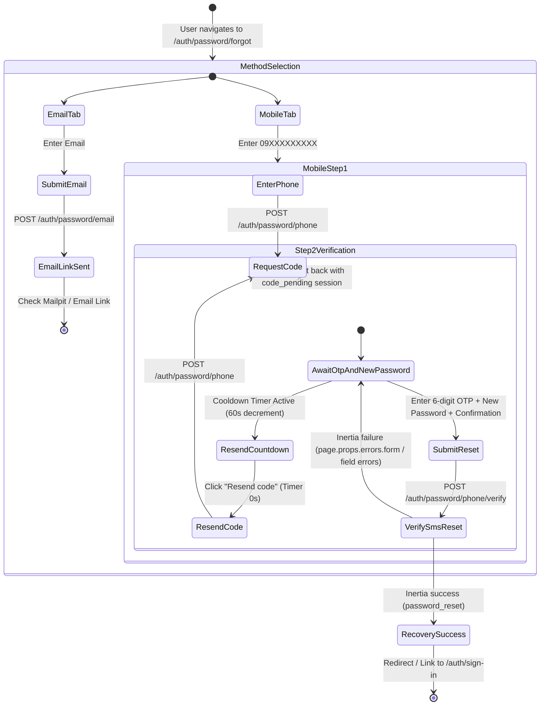

# Design: Complete Password Recovery Journey & Interface Retirement

**Change ID:** `complete-auth-recovery-and-retire-legacy-interfaces`  
**Status:** PROPOSED  

---

## 1. System Architecture & Recovery State Machine

### 1.1 Phone Password Recovery Journey Flow
The password recovery interface at `/auth/password/forgot` supports email and mobile methods. The mobile method transitions from a 1-step request into a 2-step verification and reset journey:



### 1.2 Interactive State Invariants in `ForgotPassword.tsx`
1. **Mode State**: `'email' | 'phone'`. Switching modes clears step state and transient form errors.
2. **Phone Sub-steps**:
   - `phoneStep`: `'request' | 'verify' | 'success'`. Initialized to `'verify'` if `session.status === 'challenge_pending'`, else `'request'`.
   - `phone`: Raw string entered by the user (e.g. `09171234567`). Restored from `session.phone` if present.
   - `code`: 6-digit string managed by `OtpPinInput`.
   - `password`: String managed by `PasswordInput`.
   - `passwordConfirmation`: String managed by `PasswordInput`.
   - `cooldownSeconds`: Countdown integer initialized from `session.cooldown_remaining_seconds` (defaulting to 60 upon successful code request), decrementing every 1000ms until 0. Persisting this in session prevents refreshing the browser from wiping the cooldown window.
   - `resendDisabled`: `cooldownSeconds > 0 || isSubmitting`.
3. **Inertia Error Contract Handling**:
   - `AuthController::failure()` redirects back using `back()->withErrors(['form' => [$message]])` for non-JSON requests.
   - The UI reads `page.props.errors?.form` as well as any field-specific errors (`code`, `password`, `phone`) from Inertia props, rendering them prominently within `Notice` components while remaining on Step 2.
4. **Dev Mode Integration**:
   - When `devMode === true` and `temporaryOtpPreview` is provided by `AuthController`, render the `DevOtpReceiver` component above the challenge form.
   - `DevOtpReceiver.onFillCode` auto-populates `code`.
   - `DevOtpReceiver` action "Request fresh code" is strictly disabled when `cooldownSeconds > 0` to prevent accidental 429 rate limit trips during local testing.

---

## 2. Controller & Session Data Contract

### 2.1 `AuthController::showForgot` Enhancements
Currently, `showForgot` only supplies `returnTo`. We enhance it to match `showSignIn` and `showRegister`, including cooldown hydration:

```php
public function showForgot(Request $request): InertiaResponse|RedirectResponse
{
    if (Auth::check()) {
        return redirect()->route('home');
    }

    $pendingPhone = $request->session()->get('auth_reset_phone_pending');
    $pendingPhone = is_string($pendingPhone) ? $pendingPhone : null;
    $temporaryOtpPreview = $this->temporaryOtp($pendingPhone, RequestResetSmsOtp::PURPOSE);

    // Calculate remaining cooldown based on last request timestamp
    $requestedAt = $request->session()->get('auth_reset_phone_requested_at');
    $cooldownRemaining = 0;
    if (is_int($requestedAt)) {
        $elapsed = now()->timestamp - $requestedAt;
        $cooldownRemaining = max(0, 60 - $elapsed);
    }

    $props = [
        'returnTo' => (string) $request->session()->get('auth_return_to', route('home')),
        'session' => [
            'status' => $pendingPhone !== null ? 'challenge_pending' : 'phone_required',
            'phone' => $pendingPhone,
            'cooldown_remaining_seconds' => $cooldownRemaining,
        ],
        'devMode' => in_array((string) config('serbizyu.environment', config('app.env')), ['local', 'testing', 'test', 'capstone'], true)
            && (bool) config('serbizyu.identity.browser_otp_preview', false),
    ];

    if ($temporaryOtpPreview !== null) {
        $props['temporaryOtpPreview'] = $temporaryOtpPreview;
    }

    return Inertia::render('Auth/ForgotPassword', $props);
}
```

In `AuthController::requestSmsReset`:
```php
$request->session()->put('auth_reset_phone_pending', $data['phone_e164']);
$request->session()->put('auth_reset_phone_requested_at', now()->timestamp);
```

### 2.2 Rate Limiting Alignment
- **Request Limiter (`auth-password-reset`)**: Configured in `AppServiceProvider` as:
  ```php
  RateLimiter::for('auth-password-reset', function (Request $request): Limit {
      $identifier = strtolower(trim((string) ($request->input('email') ?? $request->input('phone') ?? '')));
      return Limit::perMinute(3)->by($identifier.'|'.$request->ip());
  });
  ```
  Allows strictly **3 requests per minute** per identifier and IP.
  - The frontend 60-second cooldown strictly guarantees users and dev helpers cannot issue more than 1 request per 60 seconds from the UI, preventing HTTP 429 errors under normal operation.
- **Confirm Limiter (`auth-password-reset-confirm`)**: Allows strictly **3 verify attempts per minute** by IP. Form disabling during submit prevents accidental rapid double-submissions.

---

## 3. Interface Modernization: Onboarding & Architecture Hygiene

### 3.1 Replacing `AlmostThereOnboarding.tsx` & Migrating `MyListings.tsx`
`MyListings.tsx` is currently the active authenticated entry point where onboarding forms are presented to non-providers. It currently embeds a flat, ad-hoc 4-field form that omits required password fields and fails backend validation.

**Target Modernization**:
1. **Canonical Schema Alignment**:
   - `OnboardingRequest` requires:
     - `provider_intent` (boolean)
     - `display_name` (string, max 120)
     - `area_code` (strictly `'Tagudin'` or `'Tagudin Centro'` as validated by `OnboardingService`)
     - `language_code` (`'fil'` or `'en'`)
     - `password` (required, confirmed, min 8 chars)
     - `password_confirmation` (required string)
2. **Modern Component (`resources/js/components/onboarding/ModernOnboarding.tsx`)**:
   - Styled with standard Tailwind tokens (`#0F2F58`, `#FFC72C`) and `AuthShell` / card wrappers.
   - Replaces the legacy inline form in `MyListings.tsx` and provides clear error feedback from `OnboardingService`.
   - Eliminates `AlmostThereOnboarding.tsx` and deletes `almost-there-onboarding.css` completely.

### 3.2 Retiring `ProductExperience.tsx` and Orphaned `Home.tsx` Routing
- `HomeController::__invoke` is no longer registered in `routes/web.php` (superseded by `BrowseController` for `/`).
- `ProductExperience.tsx` is an obsolete 630-line foundation spike monolith.
- `Home.tsx` conditionally rendered `ProductExperience.tsx` under `foundation_v1`.
- Actions:
  1. Remove `ProductExperience.tsx` and its imports.
  2. Retire or clean up orphaned `Home.tsx` foundation branching.
  3. Keep `HomeController::onboarding` active for handling `POST /onboarding`.

---

## 4. Security, Anti-Enumeration & Race Conditions

### 4.1 Anti-Enumeration Invariant (`ADR-R-030 decision 12`)
- If a phone is unknown, suspended, or unverified (`phone_verified_at == null`):
  - `POST /auth/password/phone` returns HTTP 200 `status: "code_pending"`.
  - No OTP row is created in `auth_otps`.
  - No SMS notification is dispatched.
  - The UI proceeds to Step 2 normally so attackers cannot deduce whether the phone is registered.
  - Entering any OTP on Step 2 yields generic failure (`RESET_INVALID`), preventing confirmation-phase oracle leaks.

### 4.2 Account Status Race Condition
If an account is active and verified when the OTP is minted, but is subsequently suspended or closed before verification:
- `ResetPasswordWithSmsOtp` must fail generically with `RESET_INVALID` rather than leaking distinct internal status messages like "This account is not available".

### 4.3 Local Testing Seam
- In local development and testing environments:
  - For a valid, verified account (`phone_verified_at != null`):
    - Request reset code via UI or API.
    - Inspect code via:
      ```bash
      docker compose exec -e HOME=/tmp app php artisan serbizyu:otp:peek {phone} --purpose=reset
      ```
    - Output displays: `Code: XXXXXX` with exit code `0`.
  - For an unverified or nonexistent phone:
    - Command reports: `No fake OTP delivery found for that phone/purpose.` with exit code `1`.
