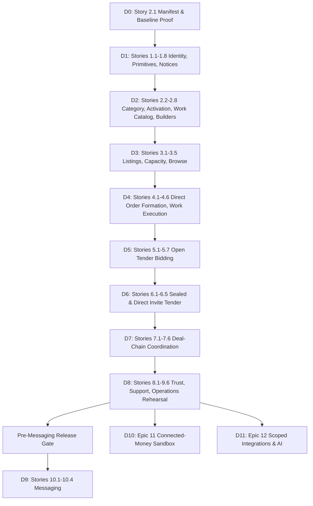

# Design — D0-Story-2.1: Canonical Migration Manifest and Catalog Baseline

Change ID: `d0-story-2-1-canonical-manifest-and-catalog-baseline`  
Story: `Story 2.1`  
Delivery Unit: `D0`  
Packet Contract: Master Delivery Plan §7 (15-section LLD/OpenSpec contract) + §7.1 (21-area engineering review matrix)

---

## 1. Actor, Principal, and Authorization Matrix

| Actor / Context | Authority Boundary | Allowed Commands / Access | Strictly Prohibited / Denied |
| --- | --- | --- | --- |
| **System Operator / CI Runner** | CLI environment in container context (`app` service) | Execute migration rehearsal (`migrate`, `migrate:status`, Pest catalog assertions, `pg_dump`, `pg_restore`) | Modifying production data; dropping tables without restore proof; committing secrets. |
| **Database Engine (`postgres`)** | Relational integrity and catalog dictionary (`pg_catalog`, `information_schema`) | Enforcing primary keys, foreign keys, uniqueness, and check constraints; recording checkpoints | Creating ad-hoc non-canonical tables; accepting unindexed foreign keys. |
| **End-User / Citizen / Provider** | HTTP web interface / Inertia SPA | None (zero HTTP routes exposed for Story 2.1) | Accessing schema inspection endpoints or executing DDL. |
| **Integration Client / Agent** | Machine API tokens | None | Direct database introspection or schema modification. |

Field visibility: Operator output exposes table names, migration batch numbers, checkpoint timestamps, index names, and schema verification status. No database passwords or sensitive environment variables are echoed to console output.

---

## 2. Canonical 61-Table Inventory and Candidate Keys

The canonical database inventory contains exactly **61 tables** grouped by domain context.

### 2.1 Full Inventory Table Map

| No. | Table Name | Domain Owner | Lifecycle / Primary Role | Key Constraints & Candidate Keys |
| --- | --- | --- | --- | --- |
| 1 | `users` | IdentityAccess | Core principal account | `id UUID PK`, `phone_e164 TEXT UNIQUE`, `status` |
| 2 | `user_profiles` | IdentityAccess | Account metadata | `id UUID PK`, `user_id UUID NOT NULL REFERENCES users(id)` |
| 3 | `role_assignments` | IdentityAccess | Additive roles | `id UUID PK`, `(user_id, role_code) UNIQUE` |
| 4 | `identity_verifications` | IdentityAccess | Verification state | `id UUID PK`, `user_id UUID NOT NULL` |
| 5 | `evidence_files` | TrustSupport | Uploaded evidence | `id UUID PK`, `quarantine_status`, `storage_path` |
| 6 | `consent_grants` | IdentityAccess | Delegation authority | `id UUID PK`, `(granter_id, grantee_id, scope) UNIQUE` |
| 7 | `categories` | Listings | Taxonomy root | `id UUID PK`, `slug TEXT UNIQUE` |
| 8 | `capability_profiles` | Listings | Service capabilities | `id UUID PK`, `(profile_family_code, business_version) UNIQUE` |
| 9 | `listings` | Listings | Root supply entity | `id UUID PK`, `owner_user_id UUID NOT NULL` |
| 10 | `listing_versions` | Listings | Immutable supply pins | `id UUID PK`, `(listing_id, version_no) UNIQUE` |
| 11 | `listing_capacity` | Listings | Inventory/slot capacity | `id UUID PK`, `(listing_id, listing_version_id, capacity_type, resource_key) UNIQUE` |
| 12 | `requests` | OrdersWork | Demand/Tender entity | `id UUID PK`, `requester_user_id UUID NOT NULL`, `tender_mode` |
| 13 | `quotes` | OrdersWork | Bid response lineages | `id UUID PK`, `(request_id, quote_version) UNIQUE`, `(bid_lineage_id, revision_no) UNIQUE` |
| 14 | `orders` | OrdersWork | Agreement spine | `id UUID PK`, `order_no TEXT UNIQUE`, `buyer_user_id UUID`, `provider_user_id UUID` |
| 15 | `order_parties` | OrdersWork | Order participants | `id UUID PK`, `(order_id, user_id, party_role) UNIQUE` |
| 16 | `order_terms_snapshots` | OrdersWork | Immutable agreement terms | `id UUID PK`, `order_id UUID NOT NULL UNIQUE` |
| 17 | `work_instances` | OrdersWork | Shape execution unit | `id UUID PK`, `(order_id, work_shape) UNIQUE` |
| 18 | `work_events` | OrdersWork | Append-only execution log | `id UUID PK`, `work_instance_id UUID NOT NULL`, `sequence_no` |
| 19 | `payment_obligations` | PaymentObligations | One-lane debt obligation | `id UUID PK`, `order_id UUID NOT NULL`, `lane` |
| 20 | `payment_events` | PaymentObligations | Append-only payment log | `id UUID PK`, `payment_obligation_id UUID NOT NULL` |
| 21 | `policy_versions` | PaymentObligations | Governed financial policy | `id UUID PK`, `(policy_type, version) UNIQUE` |
| 22 | `financial_accounts` | PaymentObligations | Ledger accounts | `id UUID PK`, `(owner_type, owner_id, currency) UNIQUE` |
| 23 | `financial_transactions` | PaymentObligations | Balanced journal entries | `id UUID PK`, `transaction_reference TEXT UNIQUE` |
| 24 | `financial_entries` | PaymentObligations | Double-entry debits/credits | `id UUID PK`, `transaction_id UUID NOT NULL`, debits = credits |
| 25 | `provider_events` | PaymentObligations | Inbound webhook audit | `id UUID PK`, `(provider, event_id) UNIQUE` |
| 26 | `financial_adjustments` | PaymentObligations | Reconciled corrections | `id UUID PK`, `original_transaction_id UUID NOT NULL` |
| 27 | `disputes` | TrustSupport | Formal order contestation | `id UUID PK`, `order_id UUID NOT NULL` |
| 28 | `dispute_events` | TrustSupport | Dispute lifecycle events | `id UUID PK`, `dispute_id UUID NOT NULL` |
| 29 | `administrative_holds` | TrustSupport | Operations containment | `id UUID PK`, `target_type`, `target_id` |
| 30 | `support_cases` | TrustSupport | Customer support tickets | `id UUID PK`, `case_number TEXT UNIQUE` |
| 31 | `safety_incidents` | TrustSupport | Safety violation reports | `id UUID PK`, `reporter_user_id UUID NOT NULL` |
| 32 | `reviews` | TrustSupport | Post-completion feedback | `id UUID PK`, `order_id UUID NOT NULL UNIQUE` |
| 33 | `conversations` | Communication | Contextual messaging | `id UUID PK`, `(context_type, context_id) UNIQUE` |
| 34 | `messages` | Communication | Conversation messages | `id UUID PK`, `conversation_id UUID NOT NULL` |
| 35 | `notifications` | Operations | Delivery intents | `id UUID PK`, `(recipient_id, purpose, source_event_id, source_contract_version) UNIQUE` |
| 36 | `notification_deliveries` | Operations | Channel attempts | `id UUID PK`, `(notification_id, delivery_generation, channel, attempt_no) UNIQUE` |
| 37 | `cohort_classifications` | PlatformIntegrity | Audit classification | `id UUID PK`, `target_type`, `target_id` |
| 38 | `audit_events` | PlatformIntegrity | Append-only audit stream | `id UUID PK`, `occurred_at`, `actor_id`, `action` |
| 39 | `outbox_messages` | PlatformIntegrity | Transactional outbox | `id UUID PK`, `(aggregate_type, aggregate_id, aggregate_sequence) UNIQUE` |
| 40 | `idempotency_keys` | PlatformIntegrity | Request deduplication | `id UUID PK`, `(scope, idempotency_key) UNIQUE` |
| 41 | `retention_holds` | PlatformIntegrity | Legal/dispute data hold | `id UUID PK`, `target_table`, `target_id` |
| 42 | `migration_checkpoints` | Operations | Schema checkpoint log | `id UUID PK`, `(migration_version, batch) UNIQUE` |
| 43 | `deal_chains` | DealCoordination | Multi-need coordination | `id UUID PK`, `coordinator_user_id UUID NOT NULL` |
| 44 | `deal_needs` | DealCoordination | Individual chain nodes | `id UUID PK`, `(deal_chain_id, need_key) UNIQUE` |
| 45 | `deal_dependencies` | DealCoordination | Acyclic dependency DAG | `id UUID PK`, `(deal_chain_id, predecessor_need_id, successor_need_id, dependency_type) UNIQUE` |
| 46 | `deal_invitations` | DealCoordination | Partner need invitation | `id UUID PK`, `(deal_need_id, invited_provider_user_id) UNIQUE` |
| 47 | `auth_otps` | IdentityAccess | Phone challenge auth | `id UUID PK`, `(phone_e164, purpose) WHERE status = 'pending' UNIQUE` |
| 48 | `category_versions` | Listings | Governed category rules | `id UUID PK`, `(category_id, business_version) UNIQUE` |
| 49 | `listing_capacity_reservations` | Listings | Held/committed locks | `id UUID PK`, `(command_scope, idempotency_key) UNIQUE` |
| 50 | `integration_clients` | Integrations | Scoped API clients | `id UUID PK`, `(owner_user_id, name) UNIQUE` |
| 51 | `integration_credentials` | Integrations | Hashed API credentials | `id UUID PK`, `public_selector TEXT UNIQUE` |
| 52 | `integration_object_mappings` | Integrations | External resource map | `id UUID PK`, `(integration_client_id, resource_type, external_id) UNIQUE` |
| 53 | `integration_webhook_subscriptions` | Integrations | Outbound webhooks | `id UUID PK`, `(integration_client_id, normalized_endpoint) UNIQUE` |
| 54 | `integration_webhook_deliveries` | Integrations | Outbound delivery log | `id UUID PK`, `(subscription_id, outbox_message_id, attempt_number) UNIQUE` |
| 55 | `integration_sync_cursors` | Integrations | Change data cursors | `id UUID PK`, `(integration_client_id, resource_stream) UNIQUE` |
| 56 | `inbox_messages` | Operations | Ordered consumer inbox | `id UUID PK`, `(consumer, source_event_id) UNIQUE`, `(consumer, aggregate_type, aggregate_id, aggregate_sequence) UNIQUE` |
| 57 | `capability_activations` | Operations | Dimensioned activations | `id UUID PK`, GiST non-overlapping `effective_range` per fingerprint |
| 58 | `command_approvals` | Operations | Maker/checker quorums | `id UUID PK`, `(approval_set_id, approver_user_id, approver_role) UNIQUE` |
| 59 | `request_invitations` | OrdersWork | Direct invite tender | `id UUID PK`, `(id, request_id, invited_provider_user_id) UNIQUE` (Deferred to D6) |
| 60 | `work_catalog_versions` | Catalogs | A1/A3/A4/A9 accelerators | `id UUID PK`, `(catalog_code, catalog_version) UNIQUE` |
| 61 | `deal_chain_catalog_versions` | Catalogs | Deal recipe templates | `id UUID PK`, `(recipe_code, catalog_version) UNIQUE` |

### 2.2 Auxiliary and Operational Non-Domain Tables

PostgreSQL currently contains **65 tables**:
- **60 canonical domain tables** (all canonical tables except `#59 request_invitations`).
- **2 database engine tables:**
  - `migrations`: Laravel internal migration ledger.
  - `spatial_ref_sys`: PostGIS coordinate reference systems extension table.
- **3 auxiliary/transitional tables:**
  - `oauth_identities`: Hybrid authentication OAuth provider metadata.
  - `password_reset_tokens`: Framework token store.
  - `t4_work_migration_audits`: Historical data audit log verifying T4 legacy work migration.

---

## 3. First-Consumer Dependency DAG (D0–D11)

To eliminate premature schema creation, tables are allocated to and owned by specific delivery units:



### Table-to-Delivery-Unit Allocation Map

| Delivery Unit | Primary Stories | Tables First Consumed / Owned | Invariant & Boundary Rule |
| --- | --- | --- | --- |
| **D0** | `Story 2.1` | `migration_checkpoints`, `work_catalog_versions`, `deal_chain_catalog_versions` | Manifest reconciliation only; no new domain table creation. |
| **D1** | `Stories 1.1–1.8` | `users`, `user_profiles`, `role_assignments`, `identity_verifications`, `evidence_files`, `consent_grants`, `auth_otps`, `audit_events`, `outbox_messages`, `idempotency_keys`, `retention_holds`, `notifications`, `notification_deliveries`, `inbox_messages`, `command_approvals` | Foundation primitives and essential notification transport; no category foreign keys. |
| **D2** | `Stories 2.2–2.8` | `categories`, `category_versions`, `capability_profiles`, `capability_activations` | Governed category rules created before dimensioned activations; authoring builder handoffs only. |
| **D3** | `Stories 3.1–3.5` | `listings`, `listing_versions`, `listing_capacity`, `listing_capacity_reservations` | Capacity bucket reservations and PostgreSQL Browse projections; cache is optional. |
| **D4** | `Stories 4.1–4.6` | `orders`, `order_parties`, `order_terms_snapshots`, `work_instances`, `work_events`, `payment_obligations` | Sole `FinalizeOrderAgreement` transaction seam; A1/A3/A4/A9 work instances. |
| **D5** | `Stories 5.1–5.7` | `requests` (Open Tender), `quotes` (Open Bids) | Exhaustive 9-state Quote revision machine; selection only in `selection_open`. |
| **D6** | `Stories 6.1–6.5` | `request_invitations` (Table #59 created here) | Direct Invite invitation authority and Sealed pre-close secrecy. |
| **D7** | `Stories 7.1–7.6` | `deal_chains`, `deal_needs`, `deal_dependencies`, `deal_invitations` | Coordination only; isolated ordinary child orders; cycle prevention trigger. |
| **D8** | `Stories 8.1–9.6` | `disputes`, `dispute_events`, `administrative_holds`, `support_cases`, `safety_incidents`, `reviews`, `cohort_classifications` | Operational proof, async recovery, emergency disablement rehearsal. |
| **D9** | `Stories 10.1–10.4` | `conversations`, `messages` | Purpose-bound chat consuming established participant/notice contracts. |
| **D10** | `Epic 11` | `policy_versions`, `financial_accounts`, `financial_transactions`, `financial_entries`, `provider_events`, `financial_adjustments` | Sandbox connected-money only; balanced accounting per currency. |
| **D11** | `Epic 12` | `integration_clients`, `integration_credentials`, `integration_object_mappings`, `integration_webhook_subscriptions`, `integration_webhook_deliveries`, `integration_sync_cursors` | Scoped external adapters; exact approval AI boundaries. |

---

## 4. Database Constraints and Candidate Key Verification

The catalog baseline for Story 2.1 verifies the following existing constraints and candidate keys:

### 4.1 `work_catalog_versions`
- Primary Key: `id UUID`
- Candidate Key 1: `(catalog_code, catalog_version) UNIQUE` (`uq_work_catalog_code_version`)
- Candidate Key 2: `(work_shape, shape_contract_version, payload_schema_version, catalog_version) UNIQUE` (`uq_work_catalog_shape_version`)
- Index: `(status, work_shape)` (`idx_work_catalog_status_shape`)
- Invariant: Definitions are immutable authoring aids; cannot create runtime work execution state directly.

### 4.2 `deal_chain_catalog_versions`
- Primary Key: `id UUID`
- Candidate Key 1: `(recipe_code, catalog_version) UNIQUE` (`uq_deal_chain_catalog_recipe_version`)
- Index: `(status, recipe_code)` (`idx_deal_chain_catalog_status_code`)
- Invariant: Recipe definitions are immutable templates; cannot own child orders or financial liability.

### 4.3 Checkpoint State Machine (`migration_checkpoints`)
- Columns: `id UUID PK`, `migration_version TEXT NOT NULL`, `batch TEXT NOT NULL`, `status TEXT NOT NULL`, `checksum TEXT NULL`, `created_at`, `updated_at`.
- Unique constraint: `(migration_version, batch) UNIQUE`.
- Legal Statuses: `started`, `completed`, `failed`.
- Canonical series: `migration_version = 'canonical-58-v1'` holds batches `000` through `009`.

---

## 5. Fixed Transaction, Checkpoint, and Lock Order

1. **Lock Order:**
   - Always lock `migration_checkpoints` first when asserting batch status.
   - For catalog assertion queries, use `READ ONLY` snapshot transactions to avoid lock contention with running background workers.
2. **Idempotency Fingerprint:**
   - Deterministic verification hashing: SHA-256 of sorted table names concatenated with column names, primary key definitions, and constraint names.
   - Replay behavior: Re-running the verification command on an identical schema returns `PASS` with the matching schema checksum.

---

## 6. Audit, Outbox, and Inbox Behavior

- Story 2.1 produces no domain outbox messages or application business events.
- Verification failures in automated pipelines record structured JSON error reports containing the exact mismatch type (`TABLE_COUNT_MISMATCH`, `CANDIDATE_KEY_MISSING`, `PREMATURE_TABLE_ACCESSED`).

---

## 7. Purpose-Specific Projections & Omissions

- **CLI Operator Output:** Summarizes canonical table count (61 total, 60 active in baseline, 1 deferred to D6), active table list, and constraint health.
- **Public / User Omissions:** Zero HTTP routes, zero Inertia props, zero public API schemas.

---

## 8. Failure Modes and Operator Runbook

| Failure Mode | Diagnosis / Error Code | Root Cause | Operator Recovery Action |
| --- | --- | --- | --- |
| Table count mismatch | `CATALOG_TABLE_COUNT_DRIFT` | An unapproved migration added a table, or a required table was dropped. | Query `information_schema.tables`, cross-reference with canonical inventory in §2.1, rollback unapproved migration. |
| Candidate key missing | `CATALOG_CANDIDATE_KEY_MISSING` | An index or unique constraint on catalog tables was altered or dropped. | Inspect `pg_constraint` / `pg_indexes` on `work_catalog_versions` or `deal_chain_catalog_versions`; re-run table migration. |
| Premature table detected | `PREMATURE_TABLE_ACCESSED` | Migration for `request_invitations` was run prior to D6. | Verify if table contains data; if empty, drop in disposable environment and defer to D6 packet. |
| Checkpoint mismatch | `CHECKPOINT_STATE_INVALID` | Checkpoint status is `started` or `failed` for canonical batches. | Inspect migration log for failure cause; re-run migration in transaction or restore from clean baseline. |

---

## 9. Security and Threat Model

- **Risk:** Malicious or accidental DDL execution creating backdoor tables or modifying security tables (`users`, `auth_otps`, `role_assignments`).
- **Mitigation:** CI/CD executes the automated `CanonicalMigrationManifestTest` on every branch pull request. Any unexpected table addition immediately breaks the build with a diff.
- **Risk:** Database credential leakage during rehearsal.
- **Mitigation:** Operator scripts and tests utilize Laravel's `env()` bindings and never write connection strings to repository files or log output.

---

## 10. Scheduler and Worker Semantics

- Story 2.1 requires no background workers, scheduled cron jobs, or queue workers.
- Migration operations must be executed in maintenance mode or on disposable/staging databases before deployment.

---

## 11. Test Strategy & Verification Contract

A dedicated feature test `tests/Feature/CanonicalMigrationManifestTest.php` must implement:
1. `test_canonical_inventory_defines_exactly_61_tables()`: Asserts that the canonical specification defines exactly 61 tables.
2. `test_active_database_contains_expected_60_canonical_tables_and_preserves_deferred_contract()`: Verifies that the current PostgreSQL database contains the 60 expected canonical domain tables, that `#59 request_invitations` is deferred, and that auxiliary tables (`oauth_identities`, `password_reset_tokens`, `t4_work_migration_audits`) are strictly tracked.
3. `test_authoring_catalog_tables_enforce_candidate_keys_and_constraints()`: Directly tests unique key constraints on `work_catalog_versions` and `deal_chain_catalog_versions`.
4. `test_migration_first_consumer_dag_is_acyclic_and_comprehensive()`: Validates that every canonical table is mapped to exactly one delivery unit D0–D11 and that the delivery graph has zero cycles.

---

## 12. Browser and CLI Smoke Path

Verification command:
```bash
docker compose exec app vendor/bin/pest tests/Feature/CanonicalMigrationManifestTest.php
```
Expected output:
```text
PASS  Tests\Feature\CanonicalMigrationManifestTest
✓ canonical inventory defines exactly 61 tables
✓ active database contains expected 60 canonical tables and preserves deferred contract
✓ authoring catalog tables enforce candidate keys and constraints
✓ migration first consumer dag is acyclic and comprehensive
```

---

## 13. Low-Data & Accessibility Impact

- **N/A:** Story 2.1 is an internal database architecture and migration baseline story. No user interfaces, HTML, CSS, or mobile views are created or modified.

---

## 14. Activation, Default, and Rollback Behavior

- **Default Activation:** Enabled across all environments.
- **Rollback Behavior:**
  - If schema verification fails, deployment halts.
  - In a disposable rehearsal environment: `php artisan migrate:fresh` followed by sequential batch execution proves clean-build convergence.
  - Backup/restore rehearsal: `pg_dump -Fc` on the verified baseline restores to an empty database with zero catalog drift.
- **Accountable Owner:** Database & Backend Lead / System Operator.

---

## 15. Canonical References and Acceptance Criteria Mapping

- **Epic:** `Epic 2: Author Valid Marketplace Offers and Work Specifications`
- **Story:** `Story 2.1: Reconcile the Canonical Migration Manifest and Existing Catalog Baseline`
- **Acceptance Criteria Verification:**
  - *Given the observed 47-table baseline, the two already-migrated catalog-version tables, and fourteen approved extensions:* Verified via SQL schema introspection.
  - *When the implementation packet reconciles inventory, ownership, dependency order, and clean/in-place migration/rollback paths:* Formally established in this LLD.
  - *Then the canonical manifest contains exactly 61 tables and maps every not-yet-needed table to its first consuming story:* Verified by §2.1 and §3.
  - *And this story verifies current catalog constraints plus production-shaped migration fixtures without pre-creating unrelated future tables:* Verified by `CanonicalMigrationManifestTest.php`.

---

## 16. Engineering Implementation Review Matrix (21-Area Assessment)

| Area | Review Findings and Concrete Evidence |
| --- | --- |
| **1. Requirement & Ownership** | Story 2.1 fulfills `PRD-060`, `PRD-061`, `PRD-072`, `PRD-075`, `PRD-080`, and `PRD-084`. The Operations & Database context owns migration authority; no user endpoints exist. |
| **2. Domain Correctness** | Enforces the distinction between application tables (61), auxiliary/transitional tables (3), and engine tables (2). Protects D6's ownership of `request_invitations`. |
| **3. Input & Contracts** | DDL inputs are strict Laravel migrations utilizing PostgreSQL native types (`UUID`, `TIMESTAMPTZ`, `JSONB`, `BIGINT`). |
| **4. Authentication & Authorization** | Operator execution only via Docker/CLI; no web request authentication required. |
| **5. Threat & Privacy Model** | Schema assertions detect unauthorized tables; test databases use synthetic data only; no customer PII exists in catalog tables. |
| **6. Data Model & Integrity** | All candidate keys (`uq_work_catalog_code_version`, `uq_deal_chain_catalog_recipe_version`, etc.) are backed by unique btree indexes. |
| **7. Historical Truth** | Catalog versions are immutable (`business_version`, `catalog_version`). Modifications require inserting a new version row. |
| **8. Transaction Boundary** | Migration operations run inside transactional DDL blocks (`DB::transaction`) where supported by PostgreSQL. |
| **9. Concurrency & TOCTOU** | Migration runner employs Laravel's migration lock advisory lock (`pg_advisory_lock`) to prevent concurrent runner collisions. |
| **10. Idempotency & Duplicates** | Checkpoints enforce single completion per `(migration_version, batch)`. Schema migrations use idempotent definitions. |
| **11. Side Effects & Consistency** | No asynchronous side effects, outbox messages, or external API calls during schema verification. |
| **12. External Dependency Resilience** | Pure PostgreSQL and PHP; no external network or cloud provider dependencies. |
| **13. Queue & Scheduler** | N/A (no queue jobs created or consumed). |
| **14. Query & Index Design** | Catalog assertions query `pg_catalog.pg_tables`, `pg_constraint`, and `pg_indexes` using indexed system catalog lookups. |
| **15. Performance & Capacity** | Catalog verification executes in < 200ms; zero impact on application runtime throughput. |
| **16. Cache & Delivery** | N/A (no application caching of schema metadata in production paths). |
| **17. Observability** | Verification script outputs structured logs with table counts, constraint lists, and exact assertion statuses. |
| **18. UX & Accessibility** | N/A (Internal database architecture only). |
| **19. Test Strategy** | Pest feature test asserts all 61 canonical table names, current database state, candidate keys, and acyclic first-consumer DAG. |
| **20. Migration & Deployment** | Expand-and-contract verified; existing database maintains backward compatibility; clean install and in-place paths converge. |
| **21. Runtime & Recovery** | Verified backup and restore via standard PostgreSQL tools (`pg_dump`, `pg_restore`). |
