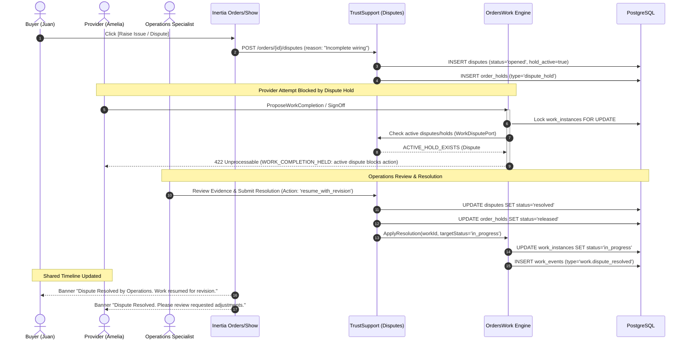
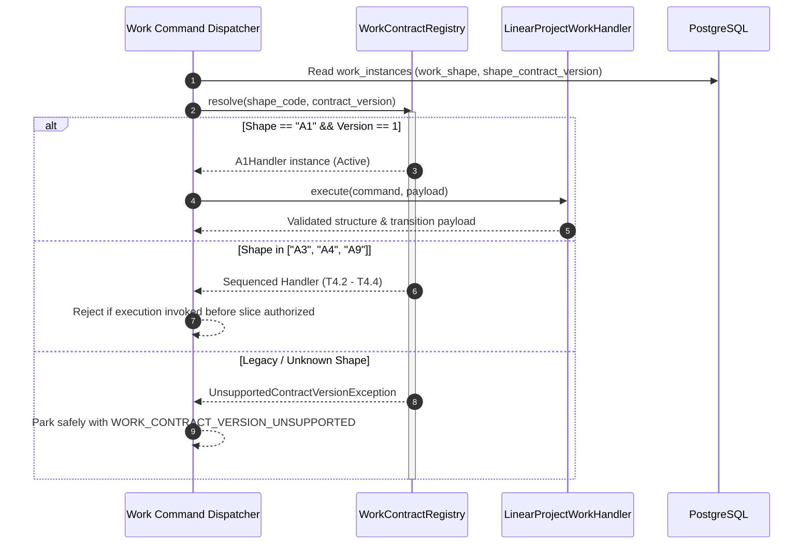

# Design — T4 Work Fulfillment & Extension Engine (Common Kernel + A1 First Slice)

Change ID: `t4-work-fulfillment`  
Plane: `C`, `T`, `S`  
Stories: `E3-S2` (A1 Linear Project), `E3-S3` (A3 Appointment — sequenced), `E3-S4` (A4 Handoff — sequenced), `E3-S5` (A4 Purchase-on-behalf — sequenced), `E3-S6` (A9 Digital Delivery — sequenced), `E3-S7` (Cancellation & Closure — sequenced), `E3-S9` (Retained Contract-Version Registry)  
Status: PROPOSED / BLOCKED ON T3 ALIGNMENT PREREQUISITES  

---

## 1. Intent and Authority

This design establishes the technical specification for Train T4 (Work Fulfillment & Extension Engine) in accordance with the mandatory 15-section LLD contract defined in `PROGRAM-IMPLEMENTATION-PLAN.md` §6. 

```text
┌─────────────────────────────────────────────────────────────────────────────────────────┐
│                                   OrdersWork Module                                     │
│                                                                                         │
│  ┌────────────────────────┐         ┌────────────────────────────────────────────────┐  │
│  │   Order Management     │         │              Work Engine Kernel                │  │
│  │                        │ 1:1 ref │                                                │  │
│  │  - orders              │────────>│  - work_instances (row_version, status, shape) │  │
│  │  - order_parties       │         │  - work_events (append-only, monotonic seq)    │  │
│  │  - order_terms_snaps   │         │  - WorkContractRegistry (A1, A3, A4, A9)       │  │
│  └────────────────────────┘         │  - A1 Linear Project Strategy Handler          │  │
│                                     └────────────────────────────────────────────────┘  │
└──────────────┬──────────────────────────────────────────┬───────────────────────────────┘
               │                                          │
               ▼ (Port)                                   ▼ (Port)
┌───────────────────────────────┐          ┌──────────────────────────────────────────────┐
│     TrustSupport Module       │          │          PaymentObligations Module           │
│                               │          │                                              │
│  - WorkEvidencePort           │          │  - WorkPaymentPort (read-only query)         │
│    (validates evidence refs)  │          │    (inspects obligation state; payment       │
│  - WorkDisputePort            │          │     events NEVER drive or complete Work)     │
│    (checks active holds)      │          └──────────────────────────────────────────────┘
│  - WorkNotificationPort       │                         │
│    (async delivery & retry)   │                         ▼ (Port)
└───────────────────────────────┘          ┌──────────────────────────────────────────────┐
                                           │              Operations Module               │
                                           │                                              │
                                           │  - IdempotencyGuard & AuditRecorder          │
                                           │  - OutboxWriter & InboxMessageManager        │
                                           │  - CapabilityActivationPort                  │
                                           └──────────────────────────────────────────────┘
```

### Governing Artifact Traceability

| Domain Layer | Canonical Source | Governed Contract |
|---|---|---|
| Product | `prd-rebuilt.md`: PRD-025..029, PRD-031, PRD-043, PRD-064 | Typed fulfillment shapes; independent sign-off; cancellation guards; contract version registry |
| UX | `ux-spec-rebuilt.md`: UX-008..011, UX-016..021, UX-027, UX-031 | 2-step completion progression; point-of-risk safety; payment decoupling; offline/low-data resilience |
| Domain / State | `domain-state-contracts-rebuilt.md`: §2.4, §5, §11, §16.2, §16.4 | Common Work lifecycle; monotonic sequence generation; 2-step completion; dispute/hold locking |
| Schema / ERD | `canonical-schema-rebuilt.md`: §6.4 `work_instances`, §6.5 `work_events`, `inbox_messages`, Batch 4 | Pinned capability profile; append-only events; `row_version` vs contract version vs sequence number |
| Architecture | `ARCHITECTURE-SPINE.md`: AD-4, AD-7, AD-12, AD-18, AD-25, AD-26, AD-27 | OrdersWork boundary; fixed lock hierarchy; acting-for consent; ordered outbox/inbox |
| Decisions | `adr-catalog-rebuilt.md`: ADR-R-004, ADR-R-007, ADR-R-032, ADR-R-033 | Immutable versions; unknown version parking (`WORK_CONTRACT_VERSION_UNSUPPORTED`); sole atomic agreement |
| Delivery Plan | `PROGRAM-IMPLEMENTATION-PLAN.md`: §6, §7, §9 | 15-section LLD contract; A1 first slice; sequenced A3/A4/A9; responsive low-data UX mapping |
| Mockup Bridge | `mockup-experience-expansion-bridge.md`: ORD-001..005, A1-001..003, SCN-01, SCN-07 | Extended Inertia `Orders/Show`; separate Payment Obligation truth; dispute/hold recovery timeline |

---

## 2. Scope and Non-Goals

### Active Implementation Scope (T4.1 — Common Kernel + A1 First Slice)
- **Retained Work Contract-Version Registry:** Maps capability profiles to immutable shape codes (`A1`, `A3`, `A4`, `A9`), shape-contract versions, and payload-schema versions. Unsupported, unmapped, or legacy shape strings park read-only with `WORK_CONTRACT_VERSION_UNSUPPORTED`.
- **Common Work State Machine:** Enforces full lifecycle transitions (`not_started`, `in_progress`, `completion_proposed`, `awaiting_signoff`, `completed`, `cancel_requested`, `cancelled`, `disputed`, `failed`), optimistic locking (`row_version`), and monotonic event sequencing.
- **Two-Step Completion Progression:** Enforces `in_progress` → `ProposeWorkCompletion` → `completion_proposed` → `RequestSignoff` (System/Engine trigger) → `awaiting_signoff` → `SignOffWorkCompletion` → `completed`.
- **A1 Linear Project Application Seam:** Implements milestone progress logging, verified deliverable evidence attachment, completion proposal, buyer review/revision, and independent buyer sign-off.
- **Actor & Acting-For Authorization Matrix:** Enforces owner-scoped permissions and validates active, unrevoked `consent_grant_id` for Agent delegations.
- **Web UI Integration:** Extends existing Inertia `Orders/Show` surface (ORD-002, ORD-003, ORD-005, A1-001..003) across 4 responsive screen groups with low-data/no-image mode, mobile-first timeline, and point-of-risk safety notices.
- **Shared Module Ports:** Integrates `WorkEvidencePort`, `WorkDisputePort`, `WorkPaymentPort` (read-only), and `WorkNotificationPort` (decoupled intent vs delivery).

### Sequenced Follow-On Units (Explicitly Sequenced, Not In Slice 1)
- **T4.2 (E3-S3):** A3 Appointment Work (slot booking, reschedule, attendance/no-show, safety guidance).
- **T4.3 (E3-S4 & E3-S5):** A4 Handoff Work (preparation, pickup/receipt, variance, purchase-on-behalf).
- **T4.4 (E3-S6):** A9 Digital Delivery Work (secure artifact versioning, download access grants, delivery confirmation).
- **T4.5 (E3-S7):** Cancellation & Order Closure cascade across nonterminal children. (In Slice 1, cancellation commands return `CAPABILITY_INACTIVE` or route to Admin/Operations support).

### Explicit Non-Goals & Deferrals
- **No Premature Implementation Before T3 Alignment Prerequisites:** Code implementation is blocked until T3 lock order, reservation contract, and legacy shape migration are reconciled.
- **No Backward-Compatibility Alias Shims:** No unapproved mapping of legacy strings (e.g. `local_service` -> A1); legacy records park safely until audited migration.
- **No Live Payments or Connected Money:** Escrow, digital disbursement, and settlement remain gated under T6/T7. Payment confirmation never triggers Work completion.
- **No Formation Expansion:** Quotes, Reverse Bidding, and Quick Deal formation remain gated under T5.
- **No Reviews or Ratings:** Public ratings, reputation, and reviews remain gated under T6.
- **No Live External Providers:** Live SMS, Google OAuth, and live government ID verification remain deferred behind ports.
- **No Pilot or Field Activation:** No live pilot or field deployment in Tagudin without founder review and explicit G3 readiness.

---

## 3. Actors and Authorization Matrix

In accordance with `ARCHITECTURE-SPINE.md` (AD-12, AD-29) and Domain Authorization contracts:

### Actor Classification
1. **Human Buyer (Owner):** The authenticated end-user who placed the Order.
2. **Human Provider (Owner):** The authenticated end-user offering the fulfillment capability.
3. **Authorized Agent (Acting-For):** An authenticated user executing actions on behalf of the Buyer or Provider under an active, unrevoked `consent_grant_id`.
4. **Service Principal (Integration Client):** An account-owned API client operating under scoped OAuth/token grants.
5. **Admin / Operations Specialist:** Internal operator performing dispute resolution, manual override, or dead-letter recovery.
6. **System Job / Worker:** Asynchronous background process (e.g. review expiry timer, notification dispatcher).

### Command Authorization Matrix

| Command | Allowed Actors | Required Consent / Grant Scope | Step-Up Required | Field Visibility / Mutation Scope | Error on Denial |
|---|---|---|---|---|---|
| `StartWorkInstance` | Provider (Owner), Authorized Agent, Service Principal | `work:start:execute` | No | Pinned profile, started_at | `AUTHORIZATION_DENIED` (403) |
| `RecordWorkProgress` | Provider (Owner), Authorized Agent, Service Principal | `work:progress:write` | No | Notes, evidence_ids, metrics | `AUTHORIZATION_DENIED` (403) |
| `ProposeWorkCompletion`| Provider (Owner), Authorized Agent, Service Principal | `work:propose:execute` | No | Completion notes, deliverable snapshots | `AUTHORIZATION_DENIED` (403) |
| `RequestSignoff` | System / Work Engine Worker | Internal System Principal | No | Status to `awaiting_signoff`, review timer | `SYSTEM_UNAUTHORIZED` (500) |
| `SignOffWorkCompletion`| Buyer (Owner), Authorized Agent (with explicit approval) | `work:signoff:execute` | Step-up OTP if high-value | Status to `completed`, feedback notes | `AUTHORIZATION_DENIED` (403) |
| `RequestWorkRevision` | Buyer (Owner), Authorized Agent | `work:revision:write` | No | Revision notes, requested changes | `AUTHORIZATION_DENIED` (403) |
| `OpenWorkDispute` | Buyer, Provider, Admin | `dispute:open` | No | Dispute reason, evidence attachments | `AUTHORIZATION_DENIED` (403) |
| `ResolveWorkDispute` | Admin / Operations Specialist | Role: `operations_specialist` | Maker/Checker Quorum | Resolution record, terminal target status | `ADMIN_UNAUTHORIZED` (403) |

### Acting-For Consent Enforcement Rules
1. Commands carrying `acting_for_user_id` MUST provide a valid `consent_grant_id`.
2. The engine verifies with `IdentityConsentPort` that the grant:
   - Matches the owner (`grant.owner_user_id == acting_for_user_id`) and agent (`grant.agent_user_id == actor_user_id`).
   - Is in `active` status (not expired, suspended, or revoked).
   - Contains the exact required permission scope for the requested command.
3. If consent is revoked or expired, the command fails immediately with `CONSENT_GRANT_INVALID` (403) without mutating database state.
4. Non-enumerating denial: Error messages return standard generic copy (`"Action not authorized for this account or delegated grant."`).

---

## 4. Commands, Queries, and Web Routing

### Command DTOs (Carrying Typed Context)

```php
// Common Actor Context
class ActorContext {
    public string $userId;
    public ?string $actingForUserId;
    public ?string $consentGrantId;
    public ?string $integrationClientId;
    public string $role; // 'buyer' | 'provider' | 'agent' | 'admin' | 'system'
}

// 1. Start Work
class StartWorkInstance {
    public string $workId;
    public ActorContext $actor;
    public int $expectedVersion;
    public string $idempotencyKey;
    public string $correlationId;
}

// 2. Record Progress
class RecordWorkProgress {
    public string $workId;
    public ActorContext $actor;
    public int $expectedVersion;
    public string $progressNotes;
    public ?string $evidenceRecordId;
    public ?array $metrics;
    public string $idempotencyKey;
    public string $correlationId;
}

// 3. Propose Work Completion
class ProposeWorkCompletion {
    public string $workId;
    public ActorContext $actor;
    public int $expectedVersion;
    public string $completionNotes;
    public string $deliverableEvidenceId;
    public array $deliverableSnapshots;
    public string $idempotencyKey;
    public string $correlationId;
}

// 4. Request Signoff (System Trigger)
class RequestSignoff {
    public string $workId;
    public string $correlationId;
    public string $causationEventId;
}

// 5. Sign-Off Work Completion
class SignOffWorkCompletion {
    public string $workId;
    public ActorContext $actor;
    public int $expectedVersion;
    public ?string $feedbackNotes;
    public ?int $ratingHint; // Non-authoritative hint for future T6
    public string $idempotencyKey;
    public string $correlationId;
}

// 6. Request Revision
class RequestWorkRevision {
    public string $workId;
    public ActorContext $actor;
    public int $expectedVersion;
    public string $revisionReason;
    public array $requestedChanges;
    public string $idempotencyKey;
    public string $correlationId;
}
```

### Queries
- `GetWorkInstanceDetail(string $workId, ActorContext $actor)`: Returns work instance aggregate, current status, pinned profile, structure payload, separate payment obligation state summary, and authorized actions.
- `GetWorkEventsTimeline(string $workId, ActorContext $actor)`: Returns chronological append-only events list with uploader attributions and evidence metadata.
- `GetWorkRegistryDefinition(string $shapeCode, int $version)`: Returns shape contract schema and state machine specification.

### Web Routing & Inertia Surface Integration
All user-facing actions extend the existing Inertia `Orders/Show` route (`/orders/{order}`) using standard form POST submissions:

| HTTP Method | URI Pattern | Inertia Action / Controller | Success Redirect | Flash Message Key |
|---|---|---|---|---|
| `GET` | `/orders/{order}` | `OrdersController@show` | Renders `Orders/Show` | N/A |
| `POST` | `/orders/{order}/work/start` | `WorkController@start` | `redirect()->route('orders.show', $order)` | `flash.banner: "Work started successfully."` |
| `POST` | `/orders/{order}/work/progress` | `WorkController@recordProgress` | `redirect()->route('orders.show', $order)` | `flash.banner: "Progress update logged."` |
| `POST` | `/orders/{order}/work/propose-completion` | `WorkController@proposeCompletion` | `redirect()->route('orders.show', $order)` | `flash.banner: "Completion proposed; awaiting buyer sign-off."` |
| `POST` | `/orders/{order}/work/sign-off` | `WorkController@signOff` | `redirect()->route('orders.show', $order)` | `flash.banner: "Work signed off and marked completed."` |
| `POST` | `/orders/{order}/work/revision` | `WorkController@requestRevision` | `redirect()->route('orders.show', $order)` | `flash.banner: "Revision requested."` |

---

## 5. State and Version Model

```text
                  ┌────────────────┐
                  │  not_started   │
                  └───────┬────────┘
                          │ (StartWorkInstance)
                          ▼
                  ┌────────────────┐  (RecordWorkProgress)
                  │  in_progress   │◄─────────────────────┐
                  └───────┬────────┘                      │
                          │                               │ (RequestWorkRevision)
                          │ (ProposeWorkCompletion)       │
                          ▼                               │
              ┌───────────────────────┐                   │
              │  completion_proposed  │                   │
              └───────────┬───────────┘                   │
                          │ (RequestSignoff - System)     │
                          ▼                               │
              ┌───────────────────────┐                   │
              │   awaiting_signoff    ├───────────────────┘
              └───────────┬───────────┘
                          │ (SignOffWorkCompletion - Buyer only)
                          ▼
                  ┌────────────────┐
                  │   completed    │ (Terminal)
                  └────────────────┘

  Cross-cutting transitions from any non-terminal state:
  - OpenWorkDispute ───► [disputed] (Locks sign-off / completion; SCN-07)
  - RequestCancel   ───► [cancel_requested] ───► [cancelled] (Sequenced to T4.5)
  - MarkFailed      ───► [failed] (Terminal - Operations override only)
```

### State Transition Matrix

| Current State | Command / Trigger | Next State | Authorized Actor | Preconditions & Invariants | Events Emitted |
|---|---|---|---|---|---|
| `not_started` | `StartWorkInstance` | `in_progress` | Provider (Owner/Agent) | Order is `accepted`; no active hold; sets `started_at`. | `work.started` |
| `in_progress` | `RecordWorkProgress` | `in_progress` | Provider (Owner/Agent) | Appends `work_events` progress note; evidence verified. | `work.progress_recorded` |
| `in_progress` | `ProposeWorkCompletion` | `completion_proposed` | Provider (Owner/Agent) | Deliverable summary present; required evidence attached; sets `completion_proposed_at`. | `work.completion_proposed` |
| `completion_proposed` | `RequestSignoff` | `awaiting_signoff` | System / Work Engine | Buyer notification intent emitted; review timer initiated; sets `awaiting_signoff_at`. | `work.signoff_requested` |
| `awaiting_signoff` | `SignOffWorkCompletion` | `completed` | Buyer (Owner/Agent) | **Guards:** No active dispute or hold on Order/Work; sets `completed_at`; terminal. | `work.completed` |
| `awaiting_signoff` | `RequestWorkRevision` | `in_progress` | Buyer (Owner/Agent) | Revisions remaining > 0; revision reason provided; increments `revisions_used`. | `work.revision_requested` |
| Any non-terminal | `OpenWorkDispute` | `disputed` | Buyer / Provider / Admin | Valid dispute reason; locks completion sign-off (SCN-07). | `work.disputed` |
| `disputed` | `ResolveWorkDispute` | `in_progress` \| `completed` \| `cancelled` | Admin / Operations | Operations resolution attached; maker/checker quorum satisfied. | `work.dispute_resolved` |
| Any non-terminal | `RequestWorkCancellation` | `cancel_requested` \| `cancelled` | Buyer / Provider / Admin | Sequenced to T4.5. In T4.1, returns `CAPABILITY_INACTIVE` or routes to Support. | `work.cancellation_requested` |

### Version Invariant Separations
1. `row_version`: Monotonic integer incremented on every DB update for optimistic concurrency locking.
2. `shape_contract_version`: Pinned business rule contract version (governs allowed states and transitions).
3. `payload_schema_version`: Pinned JSON structure schema version (governs payload validation).
4. `event_sequence_number`: Monotonic aggregate event sequence for `work_events` per `work_instance_id`.

---

## 6. Persistence and ERD Delta

### Database Schema Definition (PostgreSQL)

```sql
-- 1. Work Instances Table
CREATE TABLE work_instances (
    id UUID PRIMARY KEY DEFAULT gen_random_uuid(),
    order_id UUID NOT NULL REFERENCES orders(id) ON DELETE RESTRICT,
    work_shape VARCHAR(32) NOT NULL, -- 'A1', 'A3', 'A4', 'A9'
    shape_contract_version INT NOT NULL DEFAULT 1,
    payload_schema_version INT NOT NULL DEFAULT 1,
    status VARCHAR(32) NOT NULL DEFAULT 'not_started',
    structure_payload JSONB NOT NULL DEFAULT '{}'::jsonb,
    revisions_allowed INT NOT NULL DEFAULT 1,
    revisions_used INT NOT NULL DEFAULT 0,
    started_at TIMESTAMPTZ NULL,
    completion_proposed_at TIMESTAMPTZ NULL,
    awaiting_signoff_at TIMESTAMPTZ NULL,
    completed_at TIMESTAMPTZ NULL,
    cancelled_at TIMESTAMPTZ NULL,
    row_version INT NOT NULL DEFAULT 1,
    created_at TIMESTAMPTZ NOT NULL DEFAULT CURRENT_TIMESTAMP,
    updated_at TIMESTAMPTZ NOT NULL DEFAULT CURRENT_TIMESTAMP,
    CONSTRAINT chk_work_status CHECK (status IN (
        'not_started', 'in_progress', 'completion_proposed', 
        'awaiting_signoff', 'completed', 'cancel_requested', 
        'cancelled', 'disputed', 'failed'
    )),
    CONSTRAINT chk_work_shape CHECK (work_shape IN ('A1', 'A3', 'A4', 'A9')),
    CONSTRAINT chk_revisions CHECK (revisions_used <= revisions_allowed + 10)
);

CREATE INDEX idx_work_instances_order ON work_instances(order_id);
CREATE INDEX idx_work_instances_status ON work_instances(status);

-- 2. Append-Only Work Events Table
CREATE TABLE work_events (
    id UUID PRIMARY KEY DEFAULT gen_random_uuid(),
    work_instance_id UUID NOT NULL REFERENCES work_instances(id) ON DELETE CASCADE,
    order_id UUID NOT NULL REFERENCES orders(id) ON DELETE RESTRICT,
    event_type VARCHAR(64) NOT NULL,
    event_contract_version INT NOT NULL DEFAULT 1,
    payload_schema_version INT NOT NULL DEFAULT 1,
    sequence_number BIGINT NOT NULL,
    correlation_id UUID NOT NULL,
    causation_id UUID NOT NULL,
    actor_user_id UUID NOT NULL REFERENCES users(id) ON DELETE RESTRICT,
    acting_for_user_id UUID NULL REFERENCES users(id) ON DELETE RESTRICT,
    consent_grant_id UUID NULL,
    integration_client_id UUID NULL,
    actor_role VARCHAR(32) NOT NULL,
    payload_checksum CHAR(64) NOT NULL,
    payload JSONB NOT NULL DEFAULT '{}'::jsonb,
    created_at TIMESTAMPTZ NOT NULL DEFAULT CURRENT_TIMESTAMP,
    CONSTRAINT uq_work_events_sequence UNIQUE (work_instance_id, sequence_number)
);

CREATE INDEX idx_work_events_lookup ON work_events(work_instance_id, sequence_number ASC);
CREATE INDEX idx_work_events_correlation ON work_events(correlation_id);

-- 3. Consumer Inbox Messages Table (Ordered Consumption & Deduplication)
CREATE TABLE inbox_messages (
    id UUID PRIMARY KEY DEFAULT gen_random_uuid(),
    consumer_name VARCHAR(64) NOT NULL,
    event_id UUID NOT NULL,
    aggregate_type VARCHAR(64) NOT NULL,
    aggregate_id UUID NOT NULL,
    sequence_number BIGINT NOT NULL,
    status VARCHAR(32) NOT NULL DEFAULT 'pending', -- 'processed', 'gapped', 'dead_letter'
    error_message TEXT NULL,
    processed_at TIMESTAMPTZ NULL,
    created_at TIMESTAMPTZ NOT NULL DEFAULT CURRENT_TIMESTAMP,
    updated_at TIMESTAMPTZ NOT NULL DEFAULT CURRENT_TIMESTAMP,
    CONSTRAINT uq_inbox_consumer_event UNIQUE (consumer_name, event_id),
    CONSTRAINT uq_inbox_consumer_seq UNIQUE (consumer_name, aggregate_type, aggregate_id, sequence_number)
);

CREATE INDEX idx_inbox_status ON inbox_messages(consumer_name, status);
```

### Migration, Backfill, and Rollback Strategy
- **Migration:** Created under Batch 4 migration sequence (`2026_08_27_000001_create_t4_work_fulfillment_tables.php`).
- **Legacy Shape Handling:** Existing stub rows in `work_instances` with legacy strings (`local_service`, `product_handoff`) are NOT mutated by silent aliases. They are parked read-only with `WORK_CONTRACT_VERSION_UNSUPPORTED` until an audited, versioned migration script updates them to canonical `A1`/`A4` with valid `payload_schema_version`.
- **Zero-Data-Loss Rollback:** Rollback scripts drop only newly added columns/tables if unreferenced, preserving immutable order terms and accepted order records.

---

## 7. Transaction and Lock Boundaries

### Canonical Fixed Lock Order (AD-25 / ADR-R-033)
In strict compliance with `ARCHITECTURE-SPINE.md` AD-25, any transaction acquiring locks across multiple aggregate boundaries MUST adhere to the fixed hierarchy:

$$\text{source/listing/capacity} \longrightarrow \text{Order} \longrightarrow \text{Work} \longrightarrow \text{Obligation} \longrightarrow \text{integrity records}$$

1. **Intra-Work Mutations:** Commands modifying only Work state (`StartWorkInstance`, `RecordWorkProgress`, `ProposeWorkCompletion`, `RequestSignoff`, `SignOffWorkCompletion`, `RequestWorkRevision`) lock ONLY the `work_instances` row `FOR UPDATE`.
2. **Cross-Aggregate Synchronization:** Any transaction that touches Order, Work, and Obligation state MUST lock the parent `orders` record before locking `work_instances`.
3. **Work-First Local Replacement Prohibited:** T4 transactions NEVER reverse the lock order (e.g. locking Work before Order in multi-aggregate transactions).

### Atomic Transaction Execution Flow

```text
DB::transaction(function () {
    1. Lock work_instances row FOR UPDATE (or orders -> work_instances if cross-aggregate)
    2. Assert actor authorization & acting-for consent validity (IdentityConsentPort)
    3. Assert expected_version == work_instances.row_version (optimistic concurrency)
    4. Assert no active dispute or administrative hold (WorkDisputePort)
    5. Reserve / Verify Idempotency Key (IdempotencyGuard::begin)
    6. Resolve shape strategy from WorkContractRegistry (A1)
    7. Execute shape transition rules & validate payload structure schema
    8. Mutate work_instances (status, timestamps, payload, row_version = row_version + 1)
    9. Insert work_events row (with next sequence_number and payload SHA-256)
   10. Record Audit log (AuditRecorder::record)
   11. Write Outbox domain event (OutboxWriter::write)
   12. Complete Idempotency record (IdempotencyGuard::complete)
});
```

---

## 8. Event and Consumer Contract

### Canonical Event Envelope Schema (AD-18 / Domain §16.4)

Every domain event written to `work_events` and the Outbox conforms to the standard envelope:

```json
{
  "event_id": "01917f8a-3e2b-7000-8000-123456789abc",
  "event_type": "work.completion_proposed",
  "event_contract_version": 1,
  "payload_schema_version": 1,
  "aggregate_type": "work_instance",
  "aggregate_id": "01917f8a-3e20-7000-8000-abcdef012345",
  "aggregate_version": 3,
  "sequence_number": 3,
  "correlation_id": "01917f8a-3df0-7000-8000-fedcba543210",
  "causation_id": "01917f8a-3df1-7000-8000-fedcba543211",
  "actor_context": {
    "user_id": "01917f8a-3c00-7000-8000-111111111111",
    "acting_for_user_id": null,
    "consent_grant_id": null,
    "integration_client_id": null,
    "role": "provider"
  },
  "payload_checksum": "e3b0c44298fc1c149afbf4c8996fb92427ae41e4649b934ca495991b7852b855",
  "payload": {
    "work_id": "01917f8a-3e20-7000-8000-abcdef012345",
    "order_id": "01917f8a-3df0-7000-8000-fedcba543210",
    "proposed_at": "2026-08-27T10:00:00Z",
    "deliverable_notes": "Wiring complete and tested.",
    "evidence_id": "01917f8a-3e25-7000-8000-999999999999"
  },
  "recorded_at": "2026-08-27T10:00:00.123456Z"
}
```

### Consumer Inbox Lifecycle & Replay Rules
1. **Duplicate Detection:** Consumer queries `inbox_messages` by `(consumer_name, event_id)`. If present and processed, the event is acknowledged immediately with no-op.
2. **Monotonic Sequence Verification:** Consumer verifies `sequence_number == last_processed_sequence + 1`.
   - If sequence matches, process message and update cursor.
   - If `sequence_number > last_processed_sequence + 1` (gap detected), insert into `inbox_messages` with status `gapped` and trigger a sequence backfill fetch.
3. **Unsupported Version Dead-Lettering:** If event contract version is unsupported, mark status `dead_letter` and alert Operations.
4. **Operator Replay Tooling:** Support command `php artisan work:inbox:replay {consumer} {work_instance_id}` allows safe re-processing from a specific sequence number.

---

## 9. Async and Operations Contract

### Background Workers and Job Typologies
1. **`DispatchWorkNotificationJob` (Queue: `notifications`):**
   - Consumes outbox events (e.g. `work.signoff_requested`).
   - Dispatches SMS/Push notifications via `TrustSupport` notification ports.
   - Decoupled retry policy: Exponential backoff (1m, 5m, 15m). Dead-letters after 3 failed attempts to Operations dashboard.
2. **`CheckAwaitingSignoffExpirationsJob` (Schedule: Hourly):**
   - Scans `work_instances` in `awaiting_signoff` approaching or exceeding the 7-day review window.
   - Dispatches reminder notices to the Buyer. Does NOT auto-complete without explicit policy configuration.
3. **`ReconcileWorkEventsInboxJob` (Schedule: Every 5 minutes):**
   - Detects and re-queues gapped or stuck inbox messages.

### Effect-Specific Kill Switches
Via `capability_activations`, operators can disable specific transitions (e.g., `work.shape.A1.propose_completion`) dynamically during incidents, causing requests to return `CAPABILITY_TEMPORARILY_UNAVAILABLE` while preserving read-only timeline inspection.

---

## 10. External Adapter Contract

### 1. `TrustSupport` Module Ports
- `WorkEvidencePort::validateEvidence(string $evidenceId, string $uploaderUserId): EvidenceValidationResult`
  - Validates evidence record existence, non-quarantined status, and uploader attribution.
- `WorkDisputePort::hasActiveDisputeOrHold(string $orderId, string $workId): DisputeStatusResult`
  - Returns `true` with `dispute_id` and hold reason if an active dispute or administrative hold exists.
- `WorkNotificationPort::dispatchNotificationIntent(NotificationIntent $intent): void`
  - Queues async delivery. Failure in delivery does not roll back the domain transaction.

### 2. `PaymentObligations` Module Port
- `WorkPaymentPort::getObligationSummary(string $orderId): PaymentObligationSummary`
  - Provides read-only inspection of obligation lane (`external_cash`, `direct_deposit`, etc.) and status (`created`, `buyer_reported`, `provider_reported`, `reconciled`, `mismatch`).
  - **Inviolable Invariant:** Payment confirmation NEVER alters Work status.

### 3. `Operations` Module Ports
- `IdempotencyGuard`: Fingerprint assertion and cached response replay.
- `AuditRecorder`: Immutable structured audit log capture.
- `OutboxWriter`: Transactional domain event capture.

---

## 11. Privacy and Security Contract

1. **Owner-Scoped Authorization:** All queries and commands verify that the actor is the Order Buyer, Provider, or an authorized Agent. Cross-account access is strictly rejected with non-enumerating 403 Forbidden.
2. **Delegation Consent Verification:** Acting-for commands strictly enforce active `consent_grant_id`. Revoked or expired grants fail immediately.
3. **Evidence Quarantine & Privacy:** Evidence files uploaded to `TrustSupport` remain private to the Order parties and Operations reviewers. Minimal-image/no-image mode provides fallback text descriptors.
4. **Log Scrubbing:** Sensitive PII (phone numbers, full names, precise GPS coordinates) is masked in application logs.
5. **Rate Limiting:** Mutation endpoints are throttled to 30 requests/minute per authenticated user.

---

## 12. Detailed UX and Low-Fi Contract

All Work fulfillment interfaces are implemented as responsive components extending the existing Inertia `Orders/Show` page.

### Sequence 1: 2-Step Completion Proposal & Buyer Sign-Off Flow

```mermaid
sequenceDiagram
    autonumber
    actor Provider as Provider (Amelia)
    actor Buyer as Buyer (Juan)
    participant Web as Inertia Orders/Show
    participant Controller as WorkController
    participant Engine as OrdersWork Engine
    participant Registry as WorkContractRegistry
    participant Trust as TrustSupport
    participant DB as PostgreSQL
    participant Outbox as Outbox Writer
    participant Worker as Notification Worker

    Note over Provider, Web: Step 1: Propose Completion
    Provider->>Web: Submit Deliverables & Evidence
    Web->>Controller: POST /orders/{id}/work/propose-completion
    Controller->>Engine: ProposeWorkCompletion(workId, deliverables, evidenceId)
    activate Engine
    Engine->>DB: Lock work_instances FOR UPDATE
    Engine->>Trust: Check active disputes/holds (WorkDisputePort)
    Trust-->>Engine: No active holds (PASS)
    Engine->>Trust: Validate evidence (WorkEvidencePort)
    Trust-->>Engine: Evidence valid (PASS)
    Engine->>Registry: resolve("A1", v1)
    Registry-->>Engine: A1 Linear Project Handler
    Engine->>DB: UPDATE work_instances SET status='completion_proposed', version=v+1
    Engine->>DB: INSERT work_events (type='work.completion_proposed')
    Engine->>Outbox: Write WorkCompletionProposed
    
    Note over Engine, DB: System Transition: Request Signoff
    Engine->>DB: UPDATE work_instances SET status='awaiting_signoff', awaiting_signoff_at=NOW(), version=v+2
    Engine->>DB: INSERT work_events (type='work.signoff_requested')
    Engine->>Outbox: Write WorkSignoffRequested
    Engine-->>Controller: 200 OK (status: awaiting_signoff)
    deactivate Engine
    Controller-->>Web: Redirect Orders/Show with flash banner
    Web-->>Provider: Display "Completion proposed; Buyer notified"

    Outbox->>Worker: Async Event: WorkSignoffRequested
    Worker->>Trust: Dispatch Buyer SMS/Push Notice (with retry)

    Note over Buyer, Web: Step 2: Independent Buyer Sign-Off
    Buyer->>Web: Review Deliverables & Click Sign Off
    Web->>Controller: POST /orders/{id}/work/sign-off
    Controller->>Engine: SignOffWorkCompletion(workId, actor=Buyer)
    activate Engine
    Engine->>DB: Lock work_instances FOR UPDATE
    Engine->>Trust: Check active disputes/holds (WorkDisputePort)
    Trust-->>Engine: No active holds (PASS)
    Engine->>DB: UPDATE work_instances SET status='completed', completed_at=NOW(), version=v+1
    Engine->>DB: INSERT work_events (type='work.completed')
    Engine->>Outbox: Write WorkCompleted
    Engine-->>Controller: 200 OK (status: completed)
    deactivate Engine
    Controller-->>Web: Redirect Orders/Show with flash banner
    Web-->>Buyer: Display "Work Completed. (Payment tracked separately)"
```

### Sequence 2: Duplicate Command Replay & Unsupported Contract-Version Parking Flow

```mermaid
sequenceDiagram
    autonumber
    actor Client as Client / Mobile App
    participant Guard as IdempotencyGuard
    participant Engine as OrdersWork Engine
    participant Registry as WorkContractRegistry
    participant DB as PostgreSQL

    Note over Client, DB: Case A: Duplicate Idempotency Key Replay
    Client->>Engine: StartWorkInstance(workId, key="idem-999", fp={...})
    activate Engine
    Engine->>Guard: begin("work.start:W-1", "idem-999", fp)
    Guard-->>Engine: REPLAY (cached_response, 200 OK)
    Engine-->>Client: 200 OK (Cached response; NO DB mutation, NO duplicate event)
    deactivate Engine

    Note over Client, DB: Case B: Unsupported / Legacy Shape Parking
    Client->>Engine: MutateWork(workId, shape="legacy_shape_stub", ver=99)
    activate Engine
    Engine->>DB: Lock work_instances FOR UPDATE
    Engine->>Registry: resolve("legacy_shape_stub", ver=99)
    Registry-->>Engine: NOT_FOUND / UNSUPPORTED
    Engine->>Engine: Assert ZERO database mutation
    Engine-->>Client: 422 Unprocessable (WORK_CONTRACT_VERSION_UNSUPPORTED: parked safely)
    deactivate Engine
```

### Sequence 3: SCN-07 Dispute, Administrative Hold & Operations Resolution Recovery Flow



### Sequence 4: Retained Work Contract-Version Registry Resolution



---

### Embedded ASCII Low-Fi Screen Groups (Inertia `Orders/Show` Extension)

#### Group 1: Responsive Provider Workspace (Desktop & Mobile)

```text
┌────────────────────────────────────────────────────────────────────────────┐
│ SERBIZYU — ORDER #ORD-2026-0810-001                       [Role: Provider] │
├────────────────────────────────────────────────────────────────────────────┤
│ Service: Residential Electrical Installation (A1 Linear Project)           │
│ Buyer: Juan Dela Cruz (Tagudin, Ilocos Sur)    •    Status: IN PROGRESS    │
├────────────────────────────────────────────────────────────────────────────┤
│ [!] POINT-OF-RISK SAFETY NOTICE:                                           │
│  • Verify circuit main breaker is OFF before opening panels.               │
│  • Work only in approved designated work areas; no unescorted entry.       │
│  • [Report Safety Concern / Emergency Support]                             │
├────────────────────────────────────────────────────────────────────────────┤
│ DELIVERABLES SCOPE                                                         │
│ [x] 1. Site safety inspection & load calculation                           │
│ [ ] 2. Main distribution panel rough-in wiring                             │
│ [ ] 3. Outlet grounding & safety test report                               │
├────────────────────────────────────────────────────────────────────────────┤
│ WORK PROGRESS TIMELINE                                                     │
│ • 08/11 09:30 — Work Started [Ref: #EVT-101]                               │
│ • 08/11 14:15 — Rough-in completed. [📷 Photo: #EVD-402]                   │
├────────────────────────────────────────────────────────────────────────────┤
│ ACTIONS                                                                    │
│ [ + Add Progress Note / Upload Photo ]                                     │
│ [ Propose Work Completion & Submit Deliverables ] ──► (Triggers Sign-Off)  │
└────────────────────────────────────────────────────────────────────────────┘

MOBILE VARIANT (360px Viewport):
┌──────────────────────────────────────┐
│ ◄ Order #ORD-001     [Safety Notice ⚠]│
├──────────────────────────────────────┤
│ Status: IN PROGRESS                  │
│ Payment: ₱1,500.00 (External Cash)   │
│ (Payment tracked separately)         │
├──────────────────────────────────────┤
│ DELIVERABLES (1/3 Completed)         │
│ [x] Safety Inspection                │
│ [ ] Panel Rough-In                   │
│ [ ] Safety Test Report               │
├──────────────────────────────────────┤
│ TIMELINE                             │
│ ● 09:30 Started                      │
│ ○ 14:15 Rough-in done [📷 Photo]     │
├──────────────────────────────────────┤
│ [ + Add Progress Note ]              │
│ [ Propose Completion ]               │
└──────────────────────────────────────┘
```

#### Group 2: Responsive Buyer Review & Sign-Off (Desktop & Mobile)

```text
┌────────────────────────────────────────────────────────────────────────────┐
│ SERBIZYU — ORDER #ORD-2026-0810-001                          [Role: Buyer] │
├────────────────────────────────────────────────────────────────────────────┤
│ Status: AWAITING YOUR SIGN-OFF                                             │
│ Provider: Amelia Santos (Verified Electrician)                             │
├────────────────────────────────────────────────────────────────────────────┤
│ SUBMITTED DELIVERABLES & COMPLETION NOTES                                  │
│ Notes: "Wiring fully installed and load tested under load. Safe to use."   │
│ Attached Evidence: [📷 Switchboard Photo #EVD-409] [📄 Test Report #EVD-410]│
├────────────────────────────────────────────────────────────────────────────┤
│ IMPORTANT NOTICES & CONSEQUENCES:                                          │
│  • INACTIVITY NOTICE: You have 7 days to review. If no action is taken,   │
│    reminders will be sent. Work does not automatically complete.           │
│  • WORK COMPLETION EFFECT: Signing off marks Work completed and releases   │
│    the provider's deliverable obligation.                                  │
│  • PAYMENT SEPARATION (SCN-01): Payment is External Cash. Pay provider    │
│    directly in person. Signing off does NOT move digital funds.            │
├────────────────────────────────────────────────────────────────────────────┤
│ ACTIONS                                                                    │
│ [ ✓ Accept & Sign Off Work ]    [ ↺ Request Revision ]   [ ⚠ Raise Issue ] │
└────────────────────────────────────────────────────────────────────────────┘

MOBILE VARIANT (360px Viewport):
┌──────────────────────────────────────┐
│ ◄ Order #ORD-001      [Review Status]│
├──────────────────────────────────────┤
│ Status: AWAITING YOUR SIGN-OFF       │
│ Provider: Amelia Santos              │
├──────────────────────────────────────┤
│ DELIVERABLES SUBMITTED               │
│ "Wiring installed and load tested."  │
│ Evidence: [📷 1 Photo] [📄 1 Report] │
├──────────────────────────────────────┤
│ ℹ Inactivity: 7-day review window.   │
│ ℹ Signing off marks Work completed.  │
│ ℹ Payment is External Cash (direct). │
├──────────────────────────────────────┤
│ [ ✓ Accept & Sign Off Work ]         │
│ [ ↺ Request Revision ]               │
│ [ ⚠ Raise Issue / Dispute ]          │
└──────────────────────────────────────┘
```

#### Group 3: SCN-07 Dispute, Administrative Hold & Operations Timeline

```text
┌────────────────────────────────────────────────────────────────────────────┐
│ [!] DISPUTE HOLD ACTIVE — DISPUTE #DSP-104                   [All Actors]  │
├────────────────────────────────────────────────────────────────────────────┤
│ Reason: Incomplete main distribution panel grounding.                      │
│ Opened by: Juan Dela Cruz (Buyer) on 2026-08-12 10:00 UTC                  │
│ Status: UNDER OPERATIONS REVIEW  •  Work Completion Paused                 │
├────────────────────────────────────────────────────────────────────────────┤
│ UNIFIED DISPUTE & RESOLUTION TIMELINE                                      │
│ • 08/12 10:00 — Dispute opened by Buyer. Evidence submitted: [#EVD-501]    │
│ • 08/12 11:30 — Provider submitted counter-evidence: [#EVD-505]            │
│ • 08/12 14:00 — Operations Specialist assigned (Admin: Paige)              │
│ • 08/12 15:30 — Resolution Issued: "Provider to complete grounding wire;   │
│                 Work status returned to in_progress."                      │
├────────────────────────────────────────────────────────────────────────────┤
│ OPERATIONS ACTIONS (Admin Only)                                            │
│ [ Submit Formal Resolution ]  [ Release Hold ]  [ Close as Cancelled ]     │
└────────────────────────────────────────────────────────────────────────────┘
```

#### Group 4: Edge, Error, Degraded, Low-Data & Point-of-Risk Safety States

```text
1. LOADING / SKELETON STATE:
┌──────────────────────────────────────┐
│ [████████████████]       [████████]  │
│ Status: [████████████]               │
│ Deliverables:                        │
│ [ ] [████████████████████████████]   │
│ [ ] [████████████████████]           │
└──────────────────────────────────────┘

2. EMPTY STATE (Work Started, No Notes):
┌──────────────────────────────────────┐
│ ℹ No progress updates logged yet.     │
│ The provider has started the job.    │
│ [ + Post First Progress Update ]     │
└──────────────────────────────────────┘

3. PERMISSION / DELEGATION CONSENT DENIED:
┌────────────────────────────────────────────────────────────────────────────┐
│ [X] DELEGATION PERMISSION DENIED                                           │
│ Your acting-for consent grant has expired or does not allow sign-off.      │
│ Please contact the account owner to renew delegation permissions.          │
└────────────────────────────────────────────────────────────────────────────┘

4. CONCURRENCY CONFLICT (STALE RELOAD):
┌────────────────────────────────────────────────────────────────────────────┐
│ [!] CONCURRENCY CONFLICT DETECTED                                          │
│ Another party updated this order while you were editing.                   │
│ Your changes were safely preserved. Please review updates and resubmit.    │
│ [ Refresh & Compare Updates ]                                              │
└────────────────────────────────────────────────────────────────────────────┘

5. UNSUPPORTED / PARKED CONTRACT VERSION:
┌────────────────────────────────────────────────────────────────────────────┐
│ [i] UNSUPPORTED CONTRACT VERSION PARKED                                    │
│ This record uses contract shape 'A1.v99' which is currently parked.        │
│ Diagnostic: WORK_CONTRACT_VERSION_UNSUPPORTED. Zero database mutation.     │
│ [ Contact Support for Backfill ]                                           │
└────────────────────────────────────────────────────────────────────────────┘

6. OFFLINE / LOW-DATA / NO-IMAGE MODE:
┌────────────────────────────────────────────────────────────────────────────┐
│ [⚡ LOW-DATA MODE ACTIVE]  •  Image previews disabled to save bandwidth.   │
│ Evidence attached: "switchboard_wiring.jpg" (1.2 MB) [Download Text Report]│
│ [ Offline Draft Preserved ]  •  Auto-retrying connection... (Attempt 2/5)  │
└────────────────────────────────────────────────────────────────────────────┘
```

---

## 13. Verification Matrix

| Test Identifier | Category | Verification Obligation / Scenario Covered | Method |
|---|---|---|---|
| `Pest:T4-01` | Registry | `WorkContractRegistry` resolves A1..A9 schemas; parks unmapped/legacy versions with `WORK_CONTRACT_VERSION_UNSUPPORTED` | Unit / Kernel |
| `Pest:T4-02` | Lifecycle | `StartWorkInstance` transitions `not_started` → `in_progress`, asserts provider role, emits `work.started` | Feature / DB |
| `Pest:T4-03` | Lifecycle | `RecordWorkProgress` appends note, verifies evidence via `WorkEvidencePort`, increments version | Feature / DB |
| `Pest:T4-04` | Lifecycle | `ProposeWorkCompletion` sets `completion_proposed`, attaches deliverables, triggers `RequestSignoff` → `awaiting_signoff` | Feature / DB |
| `Pest:T4-05` | Lifecycle | `SignOffWorkCompletion` transitions `awaiting_signoff` → `completed`, asserts buyer role, sets `completed_at` | Feature / DB |
| `Pest:T4-06` | Decoupling | SCN-01: Payment obligation creation/confirmation/report events NEVER complete Work | Feature / Integration |
| `Pest:T4-07` | Disputes | SCN-07: Active dispute or administrative hold immediately blocks `SignOffWorkCompletion` with `WORK_COMPLETION_HELD` | Feature / Integration |
| `Pest:T4-08` | Revision | `RequestWorkRevision` validates revision limit, increments `revisions_used`, returns state to `in_progress` | Feature / DB |
| `Pest:T4-09` | Concurrency | Optimistic concurrency: Stale `expected_version` fails with `CONCURRENCY_CONFLICT` (409) and zero mutation | Feature / Concurrency |
| `Pest:T4-10` | Idempotency | Idempotent replay: Identical key + fingerprint returns cached response; different fingerprint fails with 409 | Feature / Idempotency |
| `Pest:T4-11` | Delegation | Acting-for consent: Valid grant passes; expired/revoked grant fails with `CONSENT_GRANT_INVALID` (403) | Feature / Auth |
| `Pest:T4-12` | Events | Ordered outbox/inbox: Monotonic sequence generated; consumer detects duplicate and parks sequence gaps safely | Feature / Events |
| `Pest:T4-13` | UI / Inertia | Inertia `Orders/Show` routes handle valid POSTs, redirect with flash banners, and return structured `$errors` | Feature / HTTP |

---

## 14. Activation, Deactivation, and Rollback Contract

### Dimensioned Activation Matrix
Capability enablement is controlled via `capability_activations`:

```sql
INSERT INTO capability_activations (
    capability_code, environment, cohort, geography, shape_code, is_enabled, created_by
) VALUES 
('work_engine.a1_linear_project', 'testing', 'all', 'tagudin', 'A1', true, 'admin-migration-001'),
('work_engine.a3_appointment', 'testing', 'all', 'tagudin', 'A3', false, 'admin-migration-001'),
('work_engine.a4_handoff', 'testing', 'all', 'tagudin', 'A4', false, 'admin-migration-001'),
('work_engine.a9_digital_delivery', 'testing', 'all', 'tagudin', 'A9', false, 'admin-migration-001');
```

### In-Flight Disable & Degradation Behavior
If `work_engine.a1_linear_project` is deactivated during an incident:
1. In-flight mutation commands fail gracefully with `CAPABILITY_TEMPORARILY_UNAVAILABLE` (503).
2. Existing work detail and append-only timelines remain fully accessible in read-only mode.
3. Outbox and notification queue dispatchers pause processing without dropping pending messages.

### Rollback Contract
- **Code Rollback:** Reverting code preserves existing `work_instances` and `work_events` rows intact.
- **Database Rollback:** The migration down-step drops only T4-specific tables if no foreign references exist, with zero data loss for parent Orders.

---

## 15. Implementation Evidence & Blocking Prerequisites

### Status Verdict: BLOCKED ON UPSTREAM PREREQUISITES
In accordance with `PROGRAM-IMPLEMENTATION-PLAN.md` §3 and §6, permanent implementation of T4 application code cannot commence until the following three upstream prerequisites are formally resolved:

1. **Prerequisite 1 — Canonical Lock Order Reconciliation:**
   - *Requirement:* Reconcile `FinalizeOrderAgreement` to obey AD-25 fixed lock order `source/listing/capacity → Order → Work → Obligation → integrity`.
   - *Owner:* Architecture / T3 Alignment.
2. **Prerequisite 2 — Singular Proposal/Finalization Reservation Contract:**
   - *Requirement:* Standardize on pure pending proposal without side effects, committing capacity strictly at finalization.
   - *Owner:* Domain / T2-T3 Alignment.
3. **Prerequisite 3 — Legacy Shape Migration & Strict Registry Parking:**
   - *Requirement:* Author audited data migration to convert legacy stubs to canonical A1/A4 or park them read-only with `WORK_CONTRACT_VERSION_UNSUPPORTED`.
   - *Owner:* Data / Migration Specialist.

Once these three prerequisites are satisfied, the implementer can proceed immediately with the deliverables defined in `tasks.md`.
